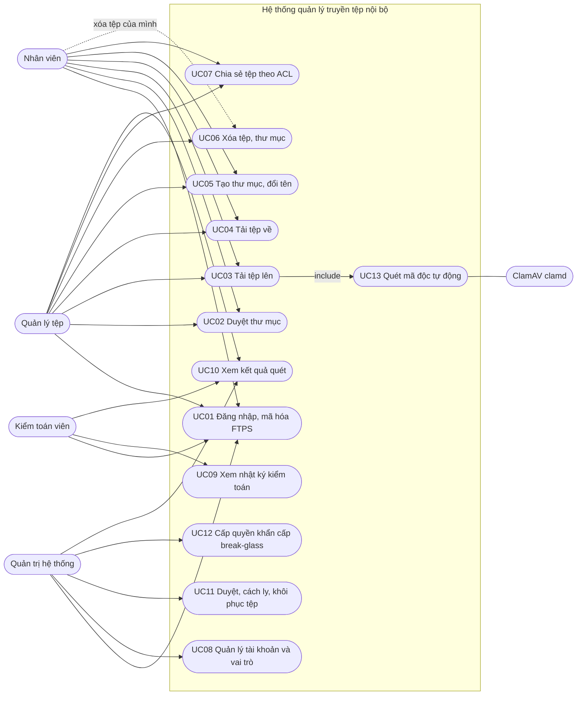
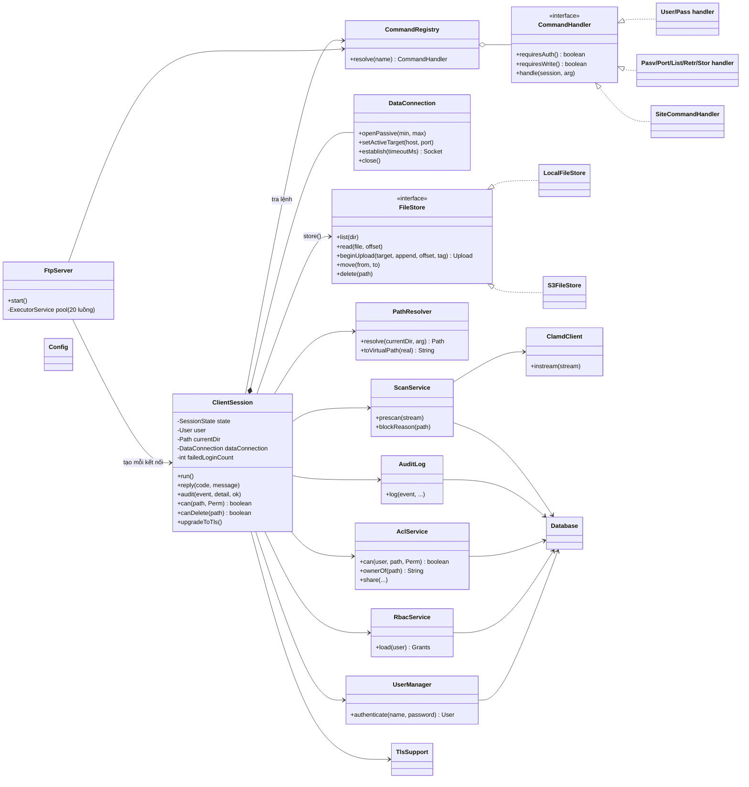
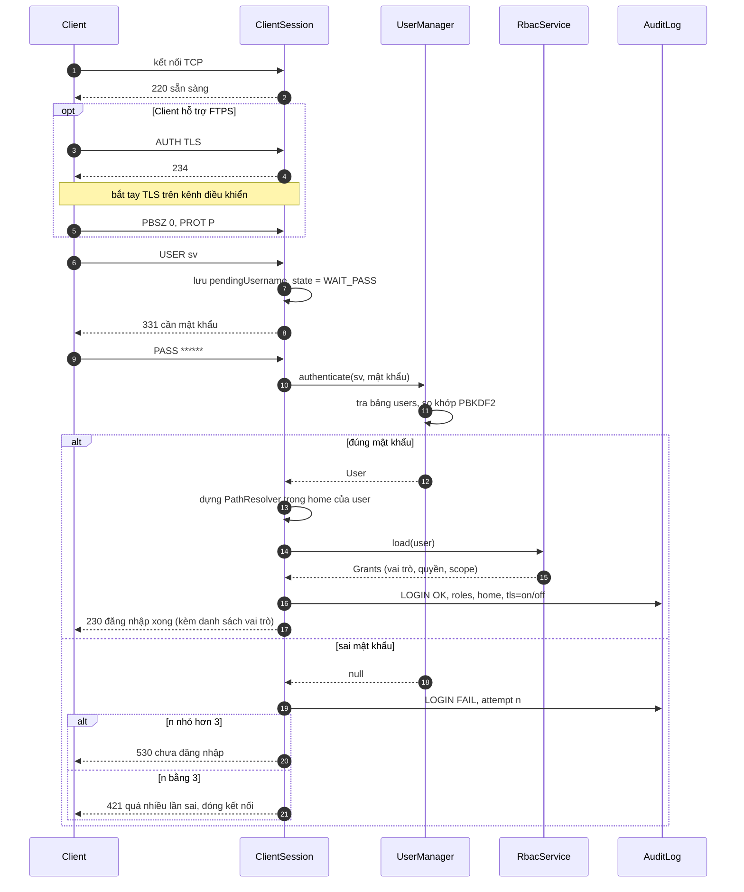
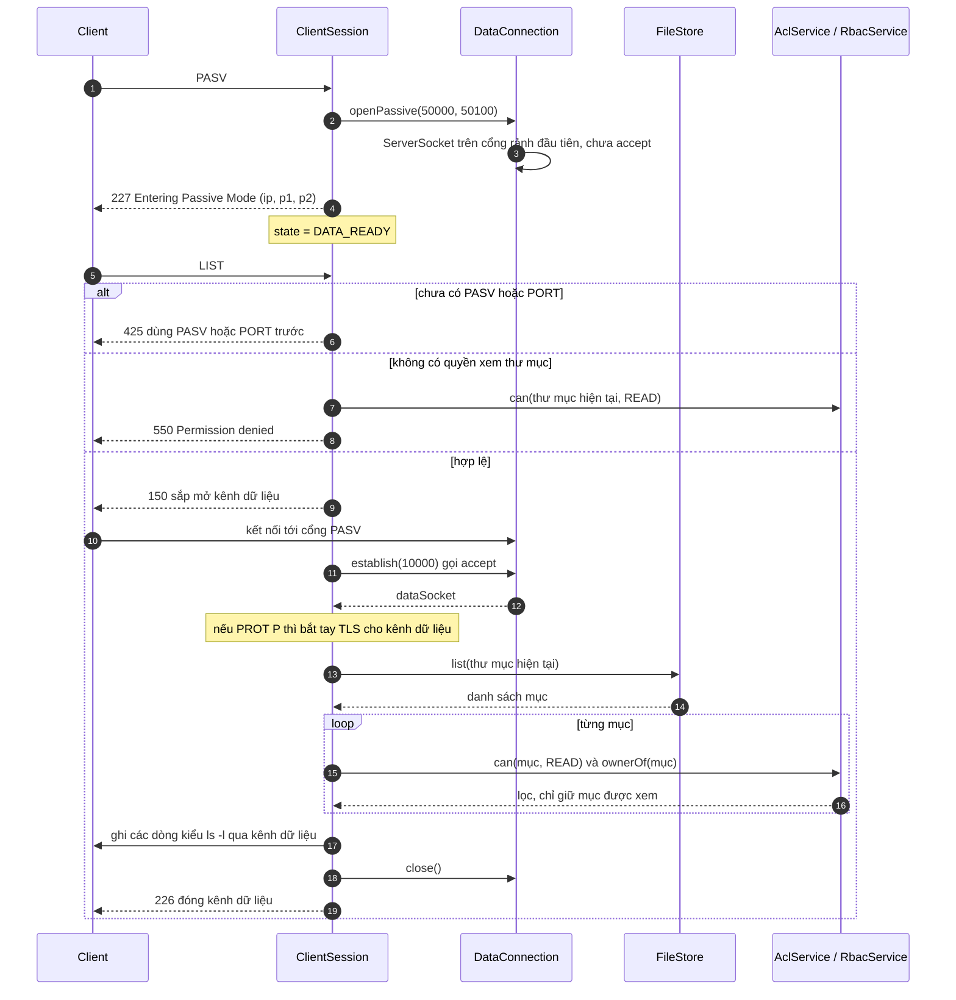
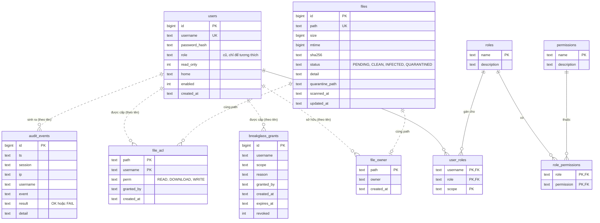

# BÁO CÁO BÀI TẬP LỚN MÔN LẬP TRÌNH MẠNG

## Hệ thống FTP Server tự cài đặt, FTP Client GUI và Trang quản trị web, triển khai trên Azure

> Báo cáo tổng hợp từ việc quét toàn bộ mã nguồn trong repo (`ftp/`, `ftp-client-gui/`, `ftp/admin-web/`, `terraform/`, `ansible/`, `scripts/`, `.github/`, `docs/`). Các con số (dòng code, số test, số lệnh) được đếm trực tiếp từ repo.

---

## Mục lục

1. [Giới thiệu và mục tiêu](#1-giới-thiệu-và-mục-tiêu)
2. [Bối cảnh bài toán: Công ty A cần hệ thống truyền tệp nội bộ](#2-bối-cảnh-bài-toán-công-ty-a-cần-hệ-thống-truyền-tệp-nội-bộ)
3. [Phân tích yêu cầu](#3-phân-tích-yêu-cầu)
4. [Khảo sát giải pháp có sẵn và lý do chọn FTP](#4-khảo-sát-giải-pháp-có-sẵn-và-lý-do-chọn-ftp)
5. [Tổng quan hệ thống](#5-tổng-quan-hệ-thống)
6. [Công nghệ sử dụng](#6-công-nghệ-sử-dụng)
7. [Cấu trúc thư mục dự án](#7-cấu-trúc-thư-mục-dự-án)
8. [FTP Server (Java)](#8-ftp-server-java)
9. [Mô hình bảo mật](#9-mô-hình-bảo-mật)
10. [Quét mã độc với ClamAV](#10-quét-mã-độc-với-clamav)
11. [Cơ sở dữ liệu](#11-cơ-sở-dữ-liệu)
12. [FTP Client GUI (JavaFX)](#12-ftp-client-gui-javafx)
13. [Trang quản trị web (FastAPI)](#13-trang-quản-trị-web-fastapi)
14. [Hạ tầng Azure (Terraform + Ansible)](#14-hạ-tầng-azure-terraform--ansible)
15. [CI/CD](#15-cicd)
16. [Kiểm thử và đo hiệu năng](#16-kiểm-thử-và-đo-hiệu-năng)
17. [Hướng dẫn cài đặt và chạy](#17-hướng-dẫn-cài-đặt-và-chạy)
18. [Tài khoản dùng thử và kịch bản demo](#18-tài-khoản-dùng-thử-và-kịch-bản-demo)
19. [Chi phí vận hành](#19-chi-phí-vận-hành)
20. [Phân công công việc](#20-phân-công-công-việc)
21. [Hạn chế đã biết và hướng phát triển](#21-hạn-chế-đã-biết-và-hướng-phát-triển)
22. [Kết luận](#22-kết-luận)
23. [Tài liệu tham khảo](#23-tài-liệu-tham-khảo)
24. [Phụ lục](#24-phụ-lục)

---

## 1. Giới thiệu và mục tiêu

Đề tài xây dựng một **hệ thống chia sẻ tệp theo giao thức FTP** hoàn chỉnh, trong đó giao thức được **tự cài đặt bằng `Socket` thuần của Java** (không dùng thư viện FTP có sẵn như Apache MINA/FtpServer), kèm theo:

- một **client giao diện đồ họa** hai bảng (máy cục bộ / máy chủ) giống FileZilla;
- một **trang quản trị web** để quản lý tài khoản, vai trò, nhật ký, quét mã độc;
- **hạ tầng đám mây** (Azure) triển khai tự động bằng Terraform và Ansible.

Mục tiêu học thuật: nắm vững lập trình mạng ở mức Socket (hai kênh điều khiển/dữ liệu, PASV/PORT, đa luồng, TLS), đồng thời áp dụng các nguyên tắc bảo mật thực tế (phân quyền theo vai trò, tách biệt nhiệm vụ, kiểm toán, quét mã độc trước khi lưu).

Mục tiêu kỹ thuật:

| Mục tiêu | Cách đạt được |
|---|---|
| Tự cài đặt giao thức FTP | `ServerSocket`/`Socket`, mỗi lệnh một `CommandHandler`, 31 lớp trong `command/` |
| Nhiều client đồng thời | Thread pool 20 luồng, mỗi phiên một `ClientSession` độc lập |
| Mã hóa đường truyền | FTPS explicit (RFC 4217): `AUTH TLS`, `PBSZ`, `PROT` |
| Phân quyền nhiều tầng | RBAC (vai trò + scope thư mục) kết hợp ACL từng tệp, kiểm tra ngay trên server |
| Kiểm toán | Audit song song ra file `audit.log` và bảng `audit_events` |
| An toàn dữ liệu | Quét clamd **trước** khi commit vào kho; tệp nhiễm không bao giờ được lưu |
| Mở rộng | Kho tệp trừu tượng (`FileStore`): đĩa cục bộ hoặc SeaweedFS (S3); CSDL SQLite hoặc PostgreSQL |
| Vận hành | Docker, Terraform, Ansible, GitHub Actions |

---

## 2. Bối cảnh bài toán: Công ty A cần hệ thống truyền tệp nội bộ

> Mục này đặt bài toán trong một **tình huống giả định** để làm căn cứ cho phần phân tích yêu cầu và thiết kế. Công ty A, các phòng ban và số liệu quy mô dưới đây là giả định phục vụ báo cáo, không phải dữ liệu của một doanh nghiệp có thật.

### 2.1 Giới thiệu tổ chức

**Công ty A** là một doanh nghiệp quy mô vừa (giả định khoảng 150–300 nhân viên) hoạt động trong lĩnh vực cung cấp dịch vụ, có trụ sở chính và một số nhân sự làm việc từ xa hoặc ở chi nhánh. Công ty có năm khối chức năng thường xuyên trao đổi tài liệu với nhau:

| Khối | Tài liệu thường trao đổi | Mức nhạy cảm |
|---|---|---|
| Kinh doanh | Báo giá, hợp đồng nháp, hồ sơ khách hàng | Trung bình – cao |
| Kế toán – Tài chính | Báo cáo tài chính, bảng lương, hóa đơn | **Cao** |
| Nhân sự | Hồ sơ nhân viên, đánh giá, thông tin cá nhân | **Cao** |
| Kỹ thuật / CNTT | Mã nguồn, bản vẽ, gói cài đặt, bản sao lưu | Trung bình – cao |
| Pháp chế – An toàn thông tin | Hợp đồng đã ký, báo cáo sự cố, hồ sơ kiểm toán | **Cao** |

### 2.2 Hiện trạng và vấn đề

Hiện nay nhân viên chia sẻ tệp bằng nhiều kênh rời rạc. Mỗi kênh có điểm yếu riêng:

| Kênh hiện tại | Vấn đề |
|---|---|
| Email đính kèm | Giới hạn dung lượng, không thu hồi được sau khi gửi, tệp nhân bản khắp hộp thư, khó biết ai đã mở |
| USB, ổ cứng di động | Dễ thất lạc, là đường lây mã độc phổ biến, không có nhật ký |
| Dịch vụ lưu trữ đám mây công cộng | Dữ liệu nhạy cảm nằm ngoài tầm kiểm soát của công ty, phụ thuộc chính sách nhà cung cấp, chi phí theo đầu người |
| Thư mục chia sẻ mạng (SMB) | Phân quyền thô theo thư mục, quản trị viên mạng thường xem được mọi thứ, khó kiểm toán chi tiết |

Các vấn đề cốt lõi mà ban lãnh đạo yêu cầu giải quyết:

1. **Không kiểm soát được ai xem/tải/xóa tệp nào, lúc nào, từ đâu** (thiếu nhật ký tập trung).
2. **Phân quyền quá thô**: người quản trị hệ thống đọc được cả bảng lương và hồ sơ nhân sự, trái nguyên tắc tối thiểu quyền.
3. **Tệp nhiễm mã độc** (đặc biệt từ khách hàng, đối tác) đi thẳng vào kho dùng chung rồi lây sang máy khác.
4. **Chia sẻ tạm thời, có chọn lọc** (một tệp cho đúng vài người) chưa có cách làm an toàn và có thể thu hồi.
5. **Dữ liệu truyền qua mạng chưa được mã hóa** khi nhân viên làm việc từ xa.
6. **Sự cố cần truy cập khẩn cấp** (ví dụ chủ tệp nghỉ việc đột xuất) chưa có quy trình có kiểm soát và để lại dấu vết.

### 2.3 Mục tiêu của hệ thống

Công ty A cần một **hệ thống quản lý truyền tệp nội bộ**, tự chủ dữ liệu, chi phí thấp, đáp ứng:

| # | Mục tiêu | Chỉ tiêu cụ thể |
|---|---|---|
| M1 | Tập trung và có kiểm soát | Một kho tệp duy nhất, mọi truy cập qua đăng nhập |
| M2 | Phân quyền đúng người, đúng việc | Nhiều vai trò, phạm vi theo thư mục, chia sẻ theo từng tệp |
| M3 | Tách bạch quản trị và dữ liệu | Quản trị hệ thống và kiểm toán viên không đọc nội dung tệp |
| M4 | Truy vết đầy đủ | Mọi thao tác, kể cả bị từ chối, được ghi kèm IP và thời gian |
| M5 | An toàn dữ liệu | Quét mã độc **trước khi lưu**; mã hóa đường truyền |
| M6 | Dễ dùng | Giao diện hai bảng quen thuộc, tiếng Việt, kéo-thả; dùng được với client FTP phổ thông |
| M7 | Tự chủ và tiết kiệm | Tự vận hành trên hạ tầng của công ty hoặc thuê bao Azure, không trả phí theo đầu người |

### 2.4 Phạm vi

| Trong phạm vi | Ngoài phạm vi (hướng mở rộng) |
|---|---|
| Máy chủ FTP/FTPS tự cài đặt, client giao diện đồ họa, trang quản trị web | Đăng nhập một lần (SSO), tích hợp LDAP/Active Directory |
| Phân quyền RBAC + ACL, audit, break-glass, quét mã độc | Soạn thảo trực tuyến, đồng bộ tự động thư mục (kiểu Dropbox) |
| Triển khai tự động trên Azure, CI/CD | Ứng dụng di động, giao thức SFTP/WebDAV |
| Quy mô hàng chục đến vài trăm người dùng đồng thời | Phân tán nhiều site, sao chép dữ liệu địa lý |

### 2.5 Ánh xạ vị trí trong công ty sang vai trò hệ thống

| Vị trí tại Công ty A | Vai trò hệ thống | Phạm vi (scope) | Lý do |
|---|---|---|---|
| Quản trị hệ thống CNTT | `system_admin` | `/` | Tạo tài khoản, gán vai trò, cấp break-glass, thao tác kết quả quét. **Không đọc được nội dung tệp** |
| Chuyên viên an toàn thông tin, kiểm toán nội bộ | `security_auditor` | `/` | Chỉ xem nhật ký và kết quả quét |
| Trưởng phòng, người phụ trách lưu trữ tài liệu | `file_manager` | Thư mục phòng ban (ví dụ `/ketoan`) hoặc `/` | Quản lý, xóa tệp, bỏ qua ACL từng tệp **trong phạm vi được giao** |
| Nhân viên | `employee` | Thư mục riêng (`home`) | Tải lên/xuống, đổi tên, chia sẻ tệp của mình; xóa tệp mình tải lên |

---

## 3. Phân tích yêu cầu

### 3.1 Tác nhân (actor)

| Tác nhân | Mô tả |
|---|---|
| Nhân viên | Người dùng thông thường, trao đổi tệp hằng ngày |
| Quản lý tệp | Phụ trách một vùng dữ liệu (phòng ban), có quyền xóa và quản lý tệp trong vùng đó |
| Quản trị hệ thống | Quản lý tài khoản, vai trò, kết quả quét; không đọc nội dung tệp |
| Kiểm toán viên | Chỉ đọc nhật ký và kết quả quét |
| ClamAV (`clamd`) | Hệ thống ngoài, nhận luồng dữ liệu và trả kết quả sạch/nhiễm |
| Kho tệp (SeaweedFS hoặc đĩa) | Hệ thống ngoài, lưu trữ nội dung tệp |

### 3.2 Sơ đồ use case



### 3.3 Yêu cầu chức năng

| Mã | Yêu cầu | Tác nhân | Thành phần hiện thực |
|---|---|---|---|
| FR-01 | Xác thực bằng tên đăng nhập và mật khẩu; ngắt phiên sau 3 lần sai | Tất cả | `UserCommandHandler`, `PassCommandHandler`, `UserManager`, `PasswordHasher` |
| FR-02 | Mã hóa đường truyền bằng FTPS explicit; có thể bắt buộc | Tất cả | `TlsSupport`, `AUTH/PBSZ/PROT`, `TlsClient` |
| FR-03 | Liệt kê và duyệt thư mục, chỉ thấy những gì mình có quyền xem | NV, QL | `LIST/NLST/CWD/CDUP/PWD`, `AclService` |
| FR-04 | Tải tệp lên (kể cả ghi đè, nối thêm, tiếp tục truyền) | NV, QL | `StorCommandHandler`, `REST`, `APPE`, `FileStore.beginUpload` |
| FR-05 | Tải tệp về (hỗ trợ tiếp tục truyền) | NV, QL | `RetrCommandHandler` |
| FR-06 | Tạo thư mục, đổi tên, di chuyển | NV, QL | `MKD`, `RNFR/RNTO` |
| FR-07 | Xóa tệp/thư mục: `file_manager` hoặc chủ sở hữu | QL, NV | `DELE`, `RMD`, `ClientSession.canDelete` |
| FR-08 | Chia sẻ tệp/thư mục cho người khác theo quyền `READ`/`DOWNLOAD`/`WRITE`, thu hồi được | NV, QL | `SITE SHARE`, `SITE ACL`, `file_acl` |
| FR-09 | Quản lý tài khoản: tạo, khóa/mở, đặt lại mật khẩu | QT | Trang web `/users` |
| FR-10 | Gán/gỡ vai trò theo phạm vi thư mục | QT | Trang web `/users/{u}/roles`, `user_roles` |
| FR-11 | Ghi nhật ký mọi thao tác (kể cả bị từ chối) kèm IP, xem và lọc | KT | `AuditLog`, `SITE AUDIT`, trang `/audit` |
| FR-12 | Quét mã độc mọi tệp tải lên **trước khi lưu**; chặn tải tệp nhiễm | Hệ thống | `ScanService`, `ClamdClient` |
| FR-13 | Quét lại, duyệt sạch, cách ly, khôi phục, xóa hẳn tệp | QT | Trang `/files` |
| FR-14 | Cảnh báo mã độc 24 giờ và CSDL virus cũ trên dashboard | QT | Trang `/` |
| FR-15 | Cấp quyền truy cập khẩn cấp có thời hạn, có lý do, thu hồi được; không tự cấp | QT | `SITE BREAKGLASS`, trang `/breakglass` |
| FR-16 | Client hai bảng, kéo-thả, tải đệ quy, tiến độ, hủy truyền, chia sẻ | NV, QL | `ftp-client-gui` |
| FR-17 | Đổi mật khẩu mặc định của tài khoản mẫu khi khởi động | QT | `SeedAccounts`, `FTP_SEED_PASSWORD` |

### 3.4 Yêu cầu phi chức năng

| Nhóm | Yêu cầu | Cách đáp ứng / bằng chứng |
|---|---|---|
| Bảo mật | Mật khẩu không lưu dạng rõ; phân quyền kiểm tra trên server; tách quyền quản trị khỏi dữ liệu | PBKDF2-HMAC-SHA256 120.000 vòng lặp, `RbacService`/`AclService` trên server, migration `V005`/`V007` |
| Bảo mật | Chống thoát thư mục (`../`) | `PathResolver` + `PathResolverTest` (8 test) |
| Bảo mật | Tiến trình không chạy bằng root, bí mật không nằm trong mã | Container user `ftp`, `.env` quyền 0600, Ansible Vault, gitleaks |
| Hiệu năng | Phục vụ nhiều client đồng thời | Thread pool 20 luồng; đo loopback 200 client không lỗi, ~600 MB/s |
| Độ tin cậy | Tệp không hỏng khi hai người cùng tải một tên hoặc khi đứt giữa chừng | Ghi tạm rồi commit (`beginUpload`/`commit`/`abort`) |
| Độ tin cậy | Không rò rỉ tài nguyên khi client ngắt đột ngột | `cleanup()` trong `finally`; `pasv_leak_test.py` |
| An toàn dữ liệu | Ưu tiên an toàn hơn sẵn sàng khi máy quét lỗi | Tệp `PENDING` bị chặn tải khi `scan.enforce=true` |
| Truy vết | Mọi thao tác nhạy cảm có dấu vết không thể bỏ qua | Audit kép: file `audit.log` + bảng `audit_events` |
| Khả chuyển, mở rộng | Đổi kho tệp và CSDL không sửa nghiệp vụ | Interface `FileStore`, hai bộ migration SQLite/PostgreSQL |
| Tương thích | Dùng được với client FTP phổ thông | Tuân RFC 959/4217, thử với `ftp`, `curl` |
| Dễ dùng | Giao diện tiếng Việt, xác nhận thao tác nguy hiểm, lỗi dễ hiểu | `ErrorText`, hộp xác nhận mặc định "Không" |
| Vận hành | Bật/tắt theo giờ, sao lưu, cập nhật không gián đoạn lâu | Auto-shutdown 23:00, snapshot đĩa, chạy lại Ansible |
| Chi phí | Thấp, dự đoán được | ≈ 53 USD/tháng (24/7), ≈ 27 USD (8 giờ/ngày) |
| Bảo trì | Có kiểm thử và CI | 60 test Java, 73 kiểm tra web, GitHub Actions |
| Đa nền tảng | Client chạy Windows, macOS, Linux | JavaFX + `jpackage` |

### 3.5 Quy tắc nghiệp vụ

| Mã | Quy tắc |
|---|---|
| BR-01 | Tệp đã có chủ sở hữu mặc định **riêng tư**: chỉ chủ, `file_manager` trong phạm vi và người được cấp quyền mới thấy |
| BR-02 | `system_admin` và `security_auditor` **không đọc được nội dung tệp** qua FTP |
| BR-03 | Nhân viên xóa được tệp/thư mục **mình tải lên hoặc tạo**; tệp của người khác chỉ `file_manager` xóa |
| BR-04 | Tệp nhiễm mã độc không bao giờ được lưu; tệp cũ cùng tên (nếu ghi đè) còn nguyên |
| BR-05 | Tệp `INFECTED`/`QUARANTINED` luôn bị chặn tải; `PENDING` bị chặn khi bật `enforce` |
| BR-06 | Break-glass: chỉ `system_admin`, cấp cho **người khác**, thời hạn 1–480 phút, bắt buộc có lý do, ghi audit cả lúc cấp, lúc dùng lần đầu, lúc thu hồi |
| BR-07 | Quyền ACL tối đa của tài khoản chỉ đọc là `DOWNLOAD` |
| BR-08 | Sai mật khẩu 3 lần trong một phiên thì đóng kết nối (`421`) |
| BR-09 | Mỗi người dùng bị nhốt trong thư mục `home` của mình |
| BR-10 | Thay đổi vai trò có hiệu lực từ lần đăng nhập sau |

### 3.6 Mô tả use case chính

**UC03 — Tải tệp lên**

| Mục | Nội dung |
|---|---|
| Tác nhân | Nhân viên, Quản lý tệp; hệ thống ngoài: ClamAV, kho tệp |
| Tiền điều kiện | Đã đăng nhập; có quyền `file:upload` và ACL `WRITE` (hoặc là chủ) tại thư mục đích; đã mở kênh dữ liệu (`PASV`/`PORT`) |
| Luồng chính | 1) Gửi `STOR`. 2) Server trả `150`. 3) Nhận dữ liệu vào **bản ghi tạm**. 4) Gửi bản tạm cho clamd. 5) Kết quả sạch: commit vào kho, ghi `files=CLEAN`, ghi chủ sở hữu, audit `UPLOAD`. 6) Trả `226` |
| Luồng thay thế | A1: Tệp nhiễm: hủy bản tạm, trả `550 WARNING: malware detected`, audit `MALWARE`. A2: Đứt giữa chừng: hủy bản tạm, trả `426`. A3: clamd lỗi: vẫn commit, trạng thái `PENDING`, bị chặn tải khi `enforce`. A4: Không đủ quyền: `550`, audit `DENIED` |
| Hậu điều kiện | Thành công: tệp có trong kho, có chủ sở hữu, có bản ghi `files`. Thất bại: kho không đổi |

**UC07 — Chia sẻ tệp**

| Mục | Nội dung |
|---|---|
| Tác nhân | Nhân viên (chủ tệp) hoặc Quản lý tệp |
| Tiền điều kiện | Đã đăng nhập; là chủ tệp hoặc có `file:manage`; người nhận tồn tại và thấy được thư mục chứa tệp |
| Luồng chính | 1) Chọn tệp, bấm **Chia sẻ**. 2) Gõ tên, chọn một hoặc nhiều người nhận và quyền. 3) Client gửi `SITE SHARE <tệp> <user> <quyền>`. 4) Server ghi `file_acl`, audit `SHARE`. 5) Hộp thoại hiển thị lại ACL (`SITE ACL`) |
| Luồng thay thế | A1: Chọn `NONE`: thu hồi quyền. A2: Không phải chủ: từ chối và audit |
| Hậu điều kiện | Người nhận thấy/tải được tệp theo quyền được cấp |

**UC12 — Cấp quyền khẩn cấp (break-glass)**

| Mục | Nội dung |
|---|---|
| Tác nhân | Quản trị hệ thống |
| Tiền điều kiện | Có `breakglass:grant`; người nhận **khác** người cấp |
| Luồng chính | 1) Mở mục Break-glass trên web hoặc gõ `SITE BREAKGLASS GRANT <user> <thư-mục> <phút> <lý do>`. 2) Hệ thống kiểm tra thời hạn 1–480 phút và có lý do. 3) Ghi `breakglass_grants`, audit `BREAKGLASS_GRANT`. 4) Người nhận truy cập thư mục trong thời hạn, lần dùng đầu ghi `BREAKGLASS_USE`. 5) Hết hạn hoặc bị thu hồi thì mất hiệu lực, audit `BREAKGLASS_REVOKE` |
| Hậu điều kiện | Có dấu vết đầy đủ ai cấp, cho ai, vì sao, trong bao lâu |

**UC11 — Xử lý tệp nghi nhiễm**

| Mục | Nội dung |
|---|---|
| Tác nhân | Quản trị hệ thống |
| Tiền điều kiện | Có `scan:manage` |
| Luồng chính | 1) Dashboard cảnh báo mã độc 24 giờ. 2) Vào mục Tệp, đồng bộ danh sách từ kho. 3) **Quét** lại qua clamd, hoặc **Cách ly** (chuyển sang bucket `<bucket>-quarantine`), hoặc **Duyệt sạch**, **Khôi phục**, **Xóa hẳn**. 4) Mọi thao tác có hộp xác nhận |
| Hậu điều kiện | Trạng thái `files.status` cập nhật; quản trị viên không đọc nội dung tệp |

### 3.7 Ma trận truy vết yêu cầu và mục tiêu

| Mục tiêu | Yêu cầu chức năng | Quy tắc nghiệp vụ |
|---|---|---|
| M1 Tập trung | FR-01, FR-03, FR-04, FR-05 | BR-09 |
| M2 Phân quyền | FR-07, FR-08, FR-10 | BR-01, BR-03, BR-07, BR-10 |
| M3 Tách bạch | FR-09, FR-10, FR-13 | BR-02 |
| M4 Truy vết | FR-11, FR-15 | BR-06 |
| M5 An toàn | FR-02, FR-12, FR-13, FR-14, FR-17 | BR-04, BR-05, BR-08 |
| M6 Dễ dùng | FR-16 | |
| M7 Tự chủ, tiết kiệm | Toàn bộ, triển khai ở mục 14 | |

---

## 4. Khảo sát giải pháp có sẵn và lý do chọn FTP

### 4.1 Các giải pháp được xem xét

| Giải pháp | Mô tả ngắn |
|---|---|
| **vsftpd** | FTP server mã nguồn mở phổ biến trên Linux; hỗ trợ FTPS, người dùng ảo, chroot |
| **FileZilla Server** | FTP/FTPS server có giao diện quản trị; phân quyền theo người dùng/nhóm và thư mục |
| **SFTP (OpenSSH)** | Truyền tệp qua SSH, một cổng, mã hóa mặc định |
| **Thư mục chia sẻ SMB/NAS** | Chia sẻ tệp mạng nội bộ (Samba, Windows File Server) |
| **Nextcloud / ownCloud** | Nền tảng đồng bộ và chia sẻ tệp tự lưu trữ, giao diện web |
| **Dịch vụ đám mây công cộng** | OneDrive, Google Drive, Dropbox |
| **Hệ thống đề tài** | FTP/FTPS tự cài đặt + RBAC/ACL + audit + quét mã độc |

### 4.2 So sánh theo tiêu chí của Công ty A

Ký hiệu: ✔ có sẵn, ◐ có nhưng hạn chế hoặc phải tự ghép thêm, ✘ không có. Đánh giá dựa trên tính năng cốt lõi của từng sản phẩm ở cấu hình phổ biến; phần "◐" thường làm được bằng script, plugin hoặc hệ thống ngoài với công sức bổ sung. Bạn nên đối chiếu lại với phiên bản cụ thể khi bảo vệ.

| Tiêu chí | vsftpd | FileZilla Server | SFTP (OpenSSH) | SMB / NAS | Nextcloud | Cloud công cộng | **Hệ thống đề tài** |
|---|---|---|---|---|---|---|---|
| Mã hóa đường truyền | ◐ (FTPS) | ◐ (FTPS) | ✔ | ◐ (SMB 3) | ✔ (HTTPS) | ✔ | ◐ → ✔ (FTPS, bắt buộc được) |
| Vai trò nhiều cấp (RBAC) có scope thư mục | ◐ | ◐ | ✘ (theo quyền OS) | ◐ (ACL/AD) | ◐ | ✔ | ✔ |
| Chia sẻ theo từng tệp, thu hồi được | ✘ | ✘ | ✘ | ◐ | ✔ | ✔ | ✔ |
| Tách quyền quản trị khỏi đọc dữ liệu | ✘ | ✘ | ✘ | ✘ | ◐ | ◐ | ✔ (`BR-02`) |
| Quét mã độc **trước khi lưu** | ✘ | ✘ | ✘ | ◐ (AV trên máy chủ) | ◐ (ứng dụng) | ✔ | ✔ (chặn tệp không vào kho) |
| Nhật ký kiểm toán tập trung, có thể truy vấn | ◐ (file log) | ◐ (file log) | ◐ (syslog) | ◐ | ◐ | ✔ | ✔ (DB + file) |
| Quyền khẩn cấp có thời hạn, có lý do | ✘ | ✘ | ✘ | ✘ | ✘ | ◐ | ✔ |
| Dữ liệu nằm trong tầm kiểm soát công ty | ✔ | ✔ | ✔ | ✔ | ✔ | ✘ | ✔ |
| Chi phí | Thấp | Thấp | Thấp | Trung bình | Trung bình | Theo đầu người | Thấp (~53 USD/tháng) |
| Dùng được client FTP phổ thông | ✔ | ✔ | ✘ (cần client SFTP) | ✘ | ✘ | ✘ | ✔ |
| Phù hợp mục tiêu học lập trình mạng (tự cài giao thức) | ✘ | ✘ | ✘ | ✘ | ✘ | ✘ | ✔ |
| Công sức triển khai ban đầu | Thấp | Thấp | Thấp | Thấp | Trung bình | Thấp | Cao (tự phát triển) |

### 4.3 Lý do chọn FTP/FTPS và tự cài đặt

1. **Mục tiêu môn học**: đề tài thuộc môn Lập trình mạng; tự cài đặt giao thức bằng `Socket` thể hiện được kiến thức cốt lõi (hai kênh điều khiển/dữ liệu, PASV/PORT, đa luồng, TLS) mà dùng sản phẩm có sẵn thì không thấy được.
2. **Nghiệp vụ không có sẵn ở sản phẩm phổ biến**: luồng "nhận vào bản tạm → quét clamd → mới commit", tách quyền quản trị khỏi dữ liệu, break-glass có thời hạn, ACL theo tệp có chủ sở hữu. Với vsftpd hay FileZilla Server phải vá hoặc ghép nhiều lớp ngoài; tự cài đặt cho phép kiểm soát chính xác từng điểm.
3. **Chuẩn mở, client sẵn có**: nhân viên dùng được FileZilla, `curl`, lệnh `ftp` mà không cần cài thêm, bên cạnh client riêng của hệ thống.
4. **Quen thuộc với đối tượng người dùng**: mô hình hai bảng "máy tôi / máy chủ" dễ tiếp cận.

### 4.4 Đánh đổi cần thừa nhận

| Điểm yếu của FTP | Cách hệ thống giảm thiểu | Còn lại |
|---|---|---|
| FTP gốc truyền mật khẩu và dữ liệu dạng rõ | FTPS explicit, `tls.required=true` trên Azure, client ghim chứng chỉ TOFU | Chứng chỉ tự ký chỉ phù hợp thử nghiệm; production cần chứng chỉ thật |
| Kênh dữ liệu dùng dải cổng riêng, khó qua tường lửa/NAT | Dải PASV hẹp (50000–50100), `pasv.address` cấu hình, NSG chỉ mở cho dải đó | Vẫn phức tạp hơn SFTP (một cổng) |
| FTP không có xác thực mạnh mặc định (khóa công khai, MFA) | Mật khẩu băm PBKDF2, giới hạn 3 lần sai mỗi phiên | Chưa có MFA, chưa khóa tài khoản sau nhiều lần sai (hướng phát triển) |

Nếu tiêu chí chỉ là "truyền tệp an toàn, vận hành đơn giản" thì **SFTP** thường là lựa chọn tốt hơn; đề tài chọn FTP/FTPS vì mục tiêu học tập và vì cần kiểm soát nghiệp vụ như ở mục 4.3. Hỗ trợ SFTP được xếp vào hướng phát triển.

---

## 5. Tổng quan hệ thống

Hệ thống gồm **ba ứng dụng** chia sẻ chung dữ liệu và một lớp **hạ tầng**:

| Thành phần | Công nghệ | Thư mục | Quy mô mã (xấp xỉ) |
|---|---|---|---|
| FTP Server | Java 21, Maven | `ftp/src/main` | ~5.100 dòng (Java + SQL) |
| Test server | JUnit 5, Testcontainers | `ftp/src/test` | ~1.150 dòng, 60 test |
| FTP Client GUI | JavaFX 21, Maven | `ftp-client-gui/` | ~2.500 dòng |
| Trang quản trị | Python, FastAPI, Jinja2 | `ftp/admin-web/` | ~1.630 dòng (gồm template + test) |
| Terraform | HCL | `terraform/` | ~590 dòng |
| Ansible | YAML + Jinja2 | `ansible/` | ~540 dòng |

### 5.1 Kiến trúc tổng thể

```
        Người dùng                              Quản trị viên
   (FTP Client GUI / FileZilla / curl)         (trình duyệt web)
            │  FTP/FTPS :2121                        │  HTTP :8080
            │  PASV 50000-50100                      │
            ▼                                        ▼
   ┌─────────────────────┐                  ┌──────────────────┐
   │   FTP Server (Java) │                  │ Admin Web        │
   │   ClientSession x20 │                  │ (FastAPI)        │
   └──┬────────┬─────────┘                  └───┬────────┬─────┘
      │        │                                │        │
      │        │ INSTREAM                       │        │
      │        ▼                                │        ▼
      │   ┌─────────┐   ◀── INSTREAM, VERSION ──┘   ┌──────────┐
      │   │  clamd  │                               │ Audit log│
      │   └─────────┘                               └──────────┘
      │ S3 API (hoặc đĩa cục bộ)         JDBC/psycopg
      ▼                                        ▼
 ┌────────────┐                       ┌─────────────────────┐
 │ SeaweedFS  │                       │ PostgreSQL / SQLite │
 │ (kho tệp)  │                       │ users, roles, ACL,  │
 └────────────┘                       │ audit, files        │
                                      └─────────────────────┘
```

Server và trang quản trị **dùng chung** CSDL, kho tệp và `audit.log`, nên quản trị viên thấy ngay thay đổi của server (và ngược lại).

---

## 6. Công nghệ sử dụng

| Lớp | Công nghệ / phiên bản | Ghi chú |
|---|---|---|
| Ngôn ngữ server, client | Java 21 | Dùng `switch` biểu thức, `record`, virtual-friendly I/O |
| Build | Maven 3.8+, `maven-shade-plugin` 3.5.3 | Đóng gói `ftpserver.jar` chạy độc lập |
| CSDL | SQLite (`sqlite-jdbc` 3.46.1.3), PostgreSQL 16 (`postgresql` 42.7.12) | Hai bộ migration riêng theo dialect |
| Kho đối tượng | SeaweedFS 4.50 qua AWS SDK v2 S3 (2.30.31, dùng `url-connection-client`) | Loại bỏ apache/netty client để jar gọn |
| Quét mã độc | ClamAV (`clamd`, giao thức `INSTREAM`) | Tự cài `ClamdClient`, không dùng thư viện ngoài |
| GUI | JavaFX 21 (`javafx-controls`), `javafx-maven-plugin` 0.0.8 | Đóng gói bằng `jpackage` (MSI/DMG/deb) |
| Web quản trị | FastAPI 0.115, Uvicorn 0.30, Jinja2 3.1, itsdangerous, `psycopg[binary]` 3.2, `boto3` 1.36 | Phiên đăng nhập ký bằng `FTPADMIN_SECRET` |
| Băm mật khẩu | PBKDF2WithHmacSHA256 (muối ngẫu nhiên, số vòng lặp lưu cùng chuỗi băm) | `auth/PasswordHasher` |
| Test | JUnit 5.10.2, Testcontainers (PostgreSQL 1.21.4), Python script | |
| IaC | Terraform (provider `azurerm`) | RG, VNet, NSG, 2 VM, đĩa, PostgreSQL |
| Cấu hình máy | Ansible (roles `base`, `docker`, `storage`, `ftpserver`) | Có Ansible Vault cho bí mật |
| Container | Docker, Docker Compose | Base `eclipse-temurin:21-jre`, chạy bằng user `ftp` (không root) |
| CI/CD | GitHub Actions | test, trivy, gitleaks, build image, jpackage, release |
| Bảo mật mã nguồn | gitleaks, Trivy, SonarCloud | `.gitleaks.toml`, `.trivyignore.yaml`, `.sonarcloud.properties` |

---

## 7. Cấu trúc thư mục dự án

```
BTL_LTM/
├── README.md                    Tổng quan, hướng dẫn chạy, thiết kế Azure
├── baocao.md                    (tệp này)
├── logo.png
├── ftp/                         ── FTP SERVER ──
│   ├── pom.xml, Dockerfile, docker-compose.yml, ftpserver.conf
│   ├── LUONG-DU-LIEU.md         Luồng dữ liệu từng lệnh, bám theo code
│   ├── src/main/java/ftpserver/
│   │   ├── Main.java            Điểm vào
│   │   ├── config/              Config (đọc ftpserver.conf + biến môi trường)
│   │   ├── core/                FtpServer, ClientSession, CommandRegistry,
│   │   │                        CommandRegistrations, CommandHandler, FtpReply,
│   │   │                        SessionState, Services
│   │   ├── command/             31 lớp: mỗi lệnh FTP một handler (+ ListingFormatter)
│   │   ├── data/                DataConnection (PASV/PORT), DataMode, TransferType
│   │   ├── fs/                  FileStore, LocalFileStore, S3FileStore, PathResolver
│   │   ├── auth/                User, UserManager, PasswordHasher, SeedAccounts
│   │   ├── rbac/                RbacService
│   │   ├── acl/                 AclService, Perm
│   │   ├── audit/               AuditLog
│   │   ├── tls/                 TlsSupport
│   │   ├── scan/                ScanService, ClamdClient
│   │   └── db/                  Database, Migrator
│   ├── src/main/resources/db/migration/{sqlite,postgres}/V001..V007 + index.txt
│   ├── src/test/java/ftpserver/ 12 lớp test
│   ├── scripts/                 smoke, concurrency, pasv_leak, ftps, bench_throughput, gen-keystore.sh
│   ├── ftproot/                 Thư mục gốc mẫu (docs/sample.txt)
│   └── admin-web/               ── TRANG QUẢN TRỊ ──
│       ├── main.py (858 dòng), storage.py (215 dòng), test_admin.py
│       ├── templates/           base, login, dashboard, users, files, audit, breakglass + partial
│       ├── static/              favicon, logo
│       ├── Dockerfile, requirements.txt
├── ftp-client-gui/              ── FTP CLIENT ──
│   ├── pom.xml, packaging/      Icon .ico/.icns/.png cho jpackage
│   └── src/main/
│       ├── java/ftpclient/      Launcher, Main
│       │   ├── net/             FtpSession, RemoteSession, TlsClient, RemoteFile, FtpException
│       │   └── ui/              MainWindow (1.423 dòng), FileIcons, Icons, Formats,
│       │                        ErrorText, FileOpener, AppIcon
│       └── resources/           app.css, icon logo-16..256.png
├── terraform/                   main.tf, storage.tf, db.tf, variables.tf, outputs.tf, versions.tf
├── ansible/                     site.yml, ansible.cfg, group_vars, inventory, roles/{base,docker,storage,ftpserver}
├── scripts/backup-seaweedfs.sh  Snapshot đĩa dữ liệu VM-B
├── docs/                        Thiết kế/triển khai Azure, bảo mật & hiệu năng, phân công, bàn giao
└── .github/workflows/ci.yml     Pipeline CI/CD
```

---

## 8. FTP Server (Java)

### 8.1 Kiến trúc lớp

| Gói | Vai trò |
|---|---|
| `Main` | Nạp cấu hình, khởi tạo `Database` + chạy migration, dựng các service, đăng ký lệnh, mở `FtpServer` |
| `config/Config` | Đọc `ftpserver.conf`, cho phép ghi đè bằng biến môi trường (`FTP_*`) |
| `core/FtpServer` | Vòng `accept()`, đẩy `ClientSession` vào `ExecutorService` cố định 20 luồng |
| `core/ClientSession` | Một phiên = một luồng: đọc dòng lệnh, tra `CommandRegistry`, kiểm tra xác thực/quyền ghi, gọi handler, ghi reply; dọn tài nguyên trong `finally` |
| `core/CommandRegistry` / `CommandRegistrations` | Ánh xạ tên lệnh → handler (mẫu Command) |
| `core/FtpReply` | Hằng số mã trả lời (RFC 959) |
| `core/SessionState` | Trạng thái phiên: chưa đăng nhập → chờ PASS → đã xác thực → kênh dữ liệu sẵn sàng → đóng |
| `data/DataConnection` | Tạo kênh dữ liệu: PASV (`ServerSocket` trên cổng trong dải) hoặc PORT (kết nối ngược); đóng ngay sau mỗi lần truyền |
| `fs/PathResolver` | Cửa duy nhất đổi đường dẫn người dùng gõ thành đường dẫn an toàn; chặn `../` thoát khỏi thư mục gốc của user |
| `fs/FileStore` | Interface kho tệp (list, size, read, delete, mkdir, rename, `beginUpload`/`commit`/`abort`) |
| `fs/LocalFileStore` | Cài đặt trên đĩa; upload ghi vào `.part-<sessionId>` rồi `Files.move` |
| `fs/S3FileStore` | Cài đặt trên SeaweedFS qua S3: mỗi tệp là một object, thư mục là tiền tố, upload đệm tạm rồi `PutObject` |
| `scan/` | `ClamdClient` (INSTREAM), `ScanService` (prescan, quét nền, chặn tải) |
| `tls/TlsSupport` | Nạp keystore PKCS12, bọc socket điều khiển/dữ liệu bằng `SSLSocket` |
| `db/` | `Database` (kết nối SQLite/PostgreSQL), `Migrator` (chạy `V00x` theo `index.txt`) |

### 8.2 Danh sách lệnh FTP hỗ trợ

| Nhóm | Lệnh |
|---|---|
| Phiên, xác thực | `USER`, `PASS`, `QUIT`, `REIN`, `NOOP`, `SYST`, `FEAT`, `OPTS` |
| Thư mục | `PWD`, `CWD`, `CDUP`, `MKD`, `RMD` |
| Tệp | `DELE`, `RNFR`, `RNTO`, `SIZE`, `MDTM` |
| Truyền dữ liệu | `PASV`, `PORT`, `TYPE`, `LIST`, `NLST`, `RETR`, `STOR`, `APPE`, `REST` |
| Bảo mật | `AUTH`, `PBSZ`, `PROT` |
| Mở rộng riêng | `SITE` (`SHARE`, `ACL`, `USERS`, `AUDIT`, `SCAN`, `BREAKGLASS`) |

Hỗ trợ cả **Passive** và **Active**, tiếp tục truyền (`REST`), nối thêm (`APPE`).

### 8.3 Hai kênh của FTP — nền tảng của toàn bộ thiết kế

| Kênh | Lớp quản lý | Vòng đời |
|---|---|---|
| Điều khiển | `ClientSession` (`controlSocket`, `reader`, `writer`) | Suốt phiên, từ `accept()` đến `QUIT`/ngắt/timeout |
| Dữ liệu | `DataConnection` | Mở lại cho **mỗi** `LIST`/`RETR`/`STOR`, đóng ngay khi xong |

Toàn bộ hệ thống chỉ có hai "điểm neo": `ClientSession.reply(code, message)` (ghi kênh điều khiển) và `DataConnection.establish(timeoutMs)` (mở kênh dữ liệu). Mọi lệnh cụ thể chỉ là cách gọi vào hai điểm này.

### 8.4 Vòng đời một phiên

```
accept() ─▶ new ClientSession ─▶ pool.submit()      (1 trong 20 luồng nhận)
   │
   ▼ vòng lặp while (state != CLOSED)
readLine() ─▶ tách "RETR file.pdf" ─▶ registry.resolve("RETR")
   ├─ chưa AUTHENTICATED mà lệnh cần auth?  → 530
   ├─ lệnh ghi mà tài khoản không có quyền? → 550
   └─ handler.handle(session, arg) ─▶ session.reply(code, msg)
   ▼
finally: đóng DataConnection, reader, writer, controlSocket, state = CLOSED
```

- Một phiên xử lý **tuần tự từng lệnh**, nên không cần khóa giữa các lệnh cùng phiên.
- Mọi trạng thái (`currentDir`, `user`, `type`...) là field của `ClientSession`, không có biến `static` giữ dữ liệu phiên → các phiên không chạm nhau.
- `idle.timeout.seconds` (mặc định 300 giây) ngắt client im lặng; `SO_TIMEOUT` đảm bảo luồng quay về pool.
- Đăng nhập sai 3 lần **trong một phiên**: `421` và ngắt kết nối (bộ đếm theo phiên, hệ thống chưa khóa tài khoản). Lệnh `PASS` được log dưới dạng `****`.

### 8.5 Luồng `RETR` (tải về)

1. Giải đường dẫn qua `PathResolver`; kiểm tra quyền ACL/RBAC (`file:download`).
2. `ScanService.blockReason`: chặn tệp `INFECTED`, `QUARANTINED` (và `PENDING` khi `scan.enforce=true`).
3. Trả `150`, mở kênh dữ liệu (`establish`), (nếu `PROT P`) bắt tay TLS cho kênh dữ liệu.
4. Đọc `FileStore.read` → ghi ra socket qua mảng đệm 8192 byte (không giữ cả tệp trong RAM, tệp 1 GB hay 1 KB đều như nhau).
5. `flush()`, đóng kênh dữ liệu, **sau đó mới** gửi `226` trên kênh điều khiển (client dùng việc đóng socket dữ liệu làm dấu hiệu "xong").

### 8.6 Luồng `STOR` (tải lên) — điểm đặc biệt của hệ thống

```
Client ──STOR──▶ resolve path, kiểm tra quyền ghi ──▶ 150
   │  byte tệp
   ▼
FileStore.beginUpload(...)   ← bản ghi TẠM theo sessionId (chưa vào kho)
   │  đóng kênh dữ liệu
   ├─ lỗi giữa chừng ──▶ up.abort() ──▶ 426 Transfer aborted
   └─ xong ──▶ ScanService.prescan(up.reopen())  (gửi cho clamd INSTREAM)
          ├─ INFECTED ──▶ up.abort()  (tệp KHÔNG bao giờ vào kho, tệp cũ còn nguyên)
          │               550 WARNING: malware detected (<tên mẫu>), audit MALWARE
          └─ CLEAN / không quét được ──▶ up.commit()  (ghi đè nguyên tử ở thời điểm này)
                                         ghi bảng files, ghi chủ sở hữu, audit ──▶ 226
```

Nhờ cơ chế tạm + commit: hai client cùng `STOR` một tên không làm hỏng tệp; tệp nhiễm không bao giờ nằm trong kho. Ngoại lệ: `APPE`/`REST` ghi trực tiếp và được quét **sau** khi ghi (tệp nhiễm bị xóa).

### 8.7 Chống thoát thư mục (path traversal)

`PathResolver` tính `rootDir.toRealPath()` **một lần** lúc khởi động, mỗi lệnh có đường dẫn đều qua `resolve(currentDir, arg)`: `normalize()` rồi kiểm tra `startsWith(rootDir)`, vi phạm → `SecurityException` → `550`. Mỗi user bị nhốt trong `home` riêng (ví dụ `sv` ở `/sv`); `PWD` trả đường dẫn ảo để không lộ đường dẫn thật của OS. Có test riêng `PathResolverTest`.

### 8.8 Cấu hình `ftpserver.conf`

| Khóa | Mặc định | Ý nghĩa |
|---|---|---|
| `control.port` | 2121 | Cổng kênh điều khiển |
| `data.port.min` / `max` | 50000 / 50100 | Dải cổng PASV |
| `pasv.address` | (tự phát hiện) | IP công khai báo trong `227` (Ansible tự đặt trên Azure) |
| `idle.timeout.seconds` | 300 | Ngắt phiên im lặng |
| `storage.type` | `local` | `local` (đĩa) hoặc `s3` (SeaweedFS) |
| `root.dir` | `./ftproot` | Thư mục gốc khi dùng kho local |
| `db.path` / `db.url`, `db.user`, `db.password` | `./data/ftpserver.db` | SQLite hoặc PostgreSQL |
| `tls.keystore`, `tls.keystore.password`, `tls.required` | tắt | FTPS; `tls.required=true` bắt buộc mã hóa |
| `scan.clamd` / `scan.command` | tắt | Quét qua clamd (TCP) hoặc lệnh ngoài |
| `scan.enforce` | false | Chặn tải tệp chưa quét xong (`PENDING`) |
| `audit.log` | `logs/audit.log` | Đường dẫn nhật ký |

Ngoài ra ghi đè bằng env: `FTP_STORAGE`, `FTP_S3_ENDPOINT/ACCESS_KEY/SECRET_KEY/BUCKET/REGION/PREFIX`, `FTP_DB_URL/USER/PASSWORD`, `FTP_TLS_KEYSTORE(_PASSWORD)`, `FTP_CLAMD`, `FTP_SCAN_COMMAND`, `FTP_SCAN_ENFORCE`, `FTP_SEED_PASSWORD`...

### 8.9 Sơ đồ lớp (các lớp chính của server)



Ba dịch vụ `AclService`, `RbacService`, `ScanService` cùng `FileStore` được gom trong record `Services` và truyền cho mỗi `ClientSession`; `UserManager`, `PathResolver`, `Config` được tạo một lần ở `Main`.

### 8.10 Sơ đồ tuần tự: đăng nhập



Dòng `230` trả kèm danh sách vai trò để client GUI bật/tắt nút; quyền thật vẫn do server kiểm tra ở từng lệnh. Mật khẩu không được ghi log (hiển thị `****`).

### 8.11 Sơ đồ tuần tự: mở phiên dữ liệu PASV rồi `LIST`



Điểm cần nhớ: danh sách trả về đã **lọc theo quyền** từng mục (tệp riêng tư của người khác không xuất hiện); `226` luôn gửi **sau** khi đóng kênh dữ liệu; với `PORT` thì bước 2–3 thay bằng việc ghi nhớ địa chỉ client và server chủ động `connect()` ở bước `establish`.

---

## 9. Mô hình bảo mật

### 9.1 Tổng quan các lớp phòng thủ

| Lớp | Cơ chế | Mã nguồn |
|---|---|---|
| Đường truyền | FTPS explicit (AUTH TLS, PBSZ 0, PROT P), có thể bắt buộc (`tls.required`) | `tls/TlsSupport`, `AuthCommandHandler`, `PbszCommandHandler`, `ProtCommandHandler` |
| Xác thực | Mật khẩu băm PBKDF2-HMAC-SHA256 + muối, so sánh an toàn | `auth/PasswordHasher`, `UserManager` |
| Mật khẩu mặc định | `FTP_SEED_PASSWORD` tự đổi mật khẩu các tài khoản mẫu; không đặt thì in `CANH BAO` | `auth/SeedAccounts` |
| Phân quyền vai trò | RBAC: vai trò + quyền + **scope thư mục** | `rbac/RbacService` |
| Phân quyền tệp | ACL từng tệp/thư mục: `READ` < `DOWNLOAD` < `WRITE` | `acl/AclService`, `Perm` |
| Cách ly đường dẫn | `PathResolver`, nhốt user trong `home` | `fs/PathResolver` |
| Kiểm toán | Audit file + bảng DB, ghi cả lần bị từ chối, kèm IP nguồn | `audit/AuditLog` |
| Truy cập khẩn cấp | Break-glass có thời hạn, có lý do, không tự cấp | `SiteCommandHandler`, bảng `breakglass_grants` |
| Mã độc | Quét clamd trước khi commit, chặn tải tệp nhiễm | `scan/` |
| Tách quyền | `system_admin` và `security_auditor` **không đọc nội dung tệp** | migration `V005`, `V007` |

### 9.2 RBAC — 4 vai trò, 13 quyền

Quyền được kiểm tra **ngay trên FTP server** (không chỉ ẩn nút ở GUI). Vai trò gán qua bảng `user_roles(username, role, scope)`; `scope` là thư mục áp dụng (`/` = toàn bộ). Vai trò nạp lúc đăng nhập (đổi vai trò có hiệu lực từ lần đăng nhập sau).

| Vai trò | Quyền | Đọc nội dung tệp? |
|---|---|---|
| `system_admin` | `user:manage`, `role:manage`, `config:manage`, `breakglass:grant` (+ `scan:manage` trên web) | **Không** |
| `security_auditor` | `audit:view`, `scan:view` | **Không** |
| `file_manager` | `file:list/upload/download/rename/delete` (+ `file:manage` bỏ qua ACL từng tệp) trong scope, `scan:view` | Có, trong scope |
| `employee` | `file:list/upload/download/rename/share`, theo ACL | Theo ACL |

Danh sách 13 quyền: `file:list`, `file:upload`, `file:download`, `file:rename`, `file:delete`, `file:share`, `file:manage`, `user:manage`, `role:manage`, `config:manage`, `audit:view`, `scan:view`, `breakglass:grant`.

Tính **tách biệt nhiệm vụ** (separation of duties, migration `V007`): người quản trị hệ thống không thể đọc dữ liệu người dùng; kiểm toán viên chỉ xem log; người quản lý tệp không quản lý tài khoản.

### 9.3 ACL theo từng tệp/thư mục

- Mỗi tệp/thư mục có **chủ sở hữu** (người tải lên hoặc tạo) — bảng `file_owner`. Tệp đã có chủ mặc định **riêng tư**: chỉ chủ, `file_manager` (có `file:manage`) và người được cấp quyền mới thấy (không hiện trong `LIST`/`NLST`, `RETR` trả "File not found").
- Cấp quyền: `SITE SHARE <tệp> <user> <READ|DOWNLOAD|WRITE|NONE>` (NONE = thu hồi); xem: `SITE ACL <tệp>`. Bảng `file_acl`.

| Quyền ACL | Cho phép |
|---|---|
| `READ` | Thấy trong danh sách, `SIZE`, `MDTM`, `CWD` vào thư mục |
| `DOWNLOAD` | Thêm: tải về (`RETR`) |
| `WRITE` | Thêm: ghi đè/nối (`STOR`/`APPE`), đổi tên, tạo tệp trong thư mục |

- Quyền cấp cho thư mục áp dụng cho mọi thứ bên trong. Chia sẻ chỉ có tác dụng giữa các user có thể "thấy nhau" (cùng thư mục `home` chung, ví dụ `/shared`).

### 9.4 Quyền xóa (mô hình hai điều kiện)

`DELE`/`RMD` cho phép khi thỏa **một trong hai**:
1. có `file:delete` (vai trò `file_manager`) và ACL cho phép; hoặc
2. có `file:upload` và là **chủ sở hữu** tệp/thư mục (hoặc chủ thư mục cha).

Nhờ vậy nhân viên tự gỡ được tệp mình tải nhầm, còn tệp người khác chỉ `file_manager` xóa được. Lần từ chối ghi audit `denied: not owner and no file:delete permission` (`ClientSession.canDelete`).

### 9.5 Break-glass (cấp quyền khẩn cấp)

`system_admin` cấp cho **người khác** (không tự cấp) quyền truy cập tệp trong một thư mục, **có thời hạn (1–480 phút) và bắt buộc có lý do**:

```
SITE BREAKGLASS GRANT <user> <thư-mục> <phút 1..480> <lý do>
SITE BREAKGLASS LIST | REVOKE <id>
```

Sự kiện cấp, lần dùng đầu tiên trong mỗi phiên (`BREAKGLASS_USE`) và thu hồi đều vào audit. Trang web có mục **Break-glass** tương ứng.

### 9.6 Audit

- Ghi song song `logs/audit.log` và bảng `audit_events` (cột `ts`, `session`, `ip`, `username`, `event`, `result` là `OK`/`FAIL`, `detail`; chỉ mục theo thời gian, user, loại sự kiện).
- Ghi cả thao tác **bị từ chối** và IP nguồn của phiên.
- `security_auditor` xem: `SITE AUDIT [n] [user=<u>] [event=<e>]` hoặc trang web **Nhật ký** (có phân trang, lọc).
- Các loại sự kiện (đối chiếu trong mã): `LOGIN`, `LOGOUT`, `AUTH_TLS`, `UPLOAD`, `DOWNLOAD`, `DELETE`, `RMDIR`, `MKDIR`, `RENAME`, `SHARE`, `DENIED`, `MALWARE`, `AUDIT_VIEW`, `BREAKGLASS_GRANT`, `BREAKGLASS_USE`, `BREAKGLASS_REVOKE`.

### 9.7 FTPS và client ghim chứng chỉ

Server: keystore PKCS12 sinh bằng `scripts/gen-keystore.sh <host>` (tự ký để thử; production dùng Let's Encrypt đóng gói PKCS12). `tls.required=true` từ chối đăng nhập khi chưa nâng cấp TLS. Client GUI luôn thử `AUTH TLS` sau lời chào, tự thương lượng, và ghim chứng chỉ kiểu **TOFU** (xem mục 12.3). Thứ tự bắt tay kênh dữ liệu: client chỉ bắt tay TLS **sau khi nhận `150`**, vì server chỉ bọc socket sau khi gửi `150`.

---

## 10. Quét mã độc với ClamAV

### 10.1 Ba chế độ

| Chế độ | Cấu hình | Ghi chú |
|---|---|---|
| clamd qua mạng (dùng trên Azure) | `scan.clamd=host:3310` | `ClamdClient` tự cài giao thức `INSTREAM`; quét **trước commit** |
| Lệnh ngoài | `scan.command=clamdscan --no-summary --fdpass` | Exit 0 = sạch, 1 = nhiễm, khác = lỗi (giữ `PENDING`) |
| Không quét | (trống) | Tệp ở trạng thái `PENDING` |

`clamscan` (không daemon) nạp lại CSDL mỗi lần (~7 giây/tệp); `clamdscan` với daemon nhanh (~0,3 giây/tệp). Test `realClamscanDetectsEicar` chạy thật với tệp EICAR khi máy có `clamscan`.

### 10.2 Trạng thái tệp (cột `files.status`)

| Giá trị | Hiển thị trên web | Hành vi tải về |
|---|---|---|
| `PENDING` | Chờ quét | Bị chặn nếu `scan.enforce=true` |
| `CLEAN` | Sạch | Cho phép |
| `INFECTED` | Nhiễm mã độc | **Luôn chặn** |
| `QUARANTINED` | Đã cách ly | **Luôn chặn** |

### 10.3 Khi clamd lỗi

Tệp vẫn được commit nhưng ở `PENDING` và bị chặn tải (khi `enforce`), chờ quét lại — ưu tiên **an toàn** hơn **sẵn sàng**. Trang web có nút **Quét** để quét lại và **Cách ly** để chuyển tệp sang bucket `<bucket>-quarantine`. Dashboard cảnh báo các upload mã độc trong 24 giờ và báo nếu CSDL virus của clamd cũ hơn 3 ngày.

---

## 11. Cơ sở dữ liệu

Schema tạo bằng **migration** khi server khởi động (`db/Migrator`, danh sách trong `index.txt`), có hai bộ riêng cho `sqlite/` và `postgres/`. Test `DialectRoundTripTest` kiểm tra trên PostgreSQL thật qua Testcontainers (tự bỏ qua nếu máy không có Docker).

| Migration | Nội dung |
|---|---|
| `V001__create_users` | Bảng `users` (`id`, `username`, `password_hash`, `role` cũ, `read_only`, `home`, `enabled`, `created_at`) |
| `V002__seed_accounts` | Tài khoản mẫu `admin`, `sv` (`fm`, `auditor` được thêm ở `V007`) |
| `V003__create_files` | Bảng `files` (`path`, `size`, `mtime`, `sha256`, `status`, `detail`, `quarantine_path`, `scanned_at`, `updated_at`) + chỉ mục `idx_files_status` |
| `V004__file_acl` | `file_owner`, `file_acl` + chỉ mục theo user |
| `V005__rbac` | `roles`, `permissions`, `role_permissions`, `user_roles` + nạp 4 vai trò, 13 quyền; chuyển tài khoản cũ |
| `V006__audit_breakglass` | `audit_events` (3 chỉ mục), `breakglass_grants` |
| `V007__separate_duties` | Tách nhiệm vụ: thêm quyền `scan:manage` cho `system_admin` (kiểm toán viên chỉ xem), thêm tài khoản mẫu `fm` (`file_manager`) và `auditor` (`security_auditor`) |

**Các bảng:** `users`, `files`, `file_owner`, `file_acl`, `roles`, `permissions`, `role_permissions`, `user_roles`, `audit_events`, `breakglass_grants`.

Tương thích ngược: tài khoản chưa có dòng `user_roles` được suy từ cột `role` cũ (`admin` → `system_admin@/`, còn lại → `employee@/`). Trang web cài lại đúng logic suy luận này (`ROLE_COMPAT`) để hành vi hai phía khớp nhau.

### 11.1 Sơ đồ quan hệ thực thể (ER)



Đường liền là khóa ngoại thật (`ON DELETE CASCADE`) trong cụm RBAC. Đường đứt là **quan hệ logic** không khai báo khóa ngoại: `file_owner`, `file_acl`, `files` nối với nhau bằng cột `path`, còn `audit_events` và `breakglass_grants` tham chiếu người dùng bằng tên. Cách làm này giữ được nhật ký và cấp phát ngay cả khi tài khoản hoặc tệp đã bị xóa.

Ghi chú về dữ liệu: thời gian lưu dạng chuỗi UTC `YYYY-MM-DD HH:MM:SS`; `users.role` chỉ còn ý nghĩa tương thích, quyền thật lấy từ `user_roles`; `files.path` là đường dẫn ảo, khớp với khóa object trong S3.

---

## 12. FTP Client GUI (JavaFX)

### 12.1 Cấu trúc

| Lớp | Vai trò |
|---|---|
| `Launcher`, `Main` | Điểm vào (Launcher tách riêng để jpackage chạy được JavaFX trên classpath) |
| `net/RemoteSession` | Interface phiên từ xa (list, upload, download, delete, mkdir, rename, `site`...) và `CancelledException` |
| `net/FtpSession` (407 dòng) | Cài đặt FTP: kết nối, đọc reply nhiều dòng (`213-`), đăng nhập, phân tích `227` của PASV, mở kênh dữ liệu, `list()` + `parseLine`, upload/download, `REST` tiếp tục, hủy truyền, `negotiateTls` |
| `net/TlsClient` | Nâng cấp `AUTH TLS`, ghim chứng chỉ TOFU |
| `net/RemoteFile`, `FtpException` | Mô hình tệp từ xa, ngoại lệ có mã reply |
| `ui/MainWindow` (1.423 dòng) | Toàn bộ giao diện và điều phối |
| `ui/ErrorText` | Đổi lỗi FTP thô thành câu tiếng Việt dễ hiểu (mã độc, không đủ quyền, sai mật khẩu, mất kết nối...) |
| `ui/FileIcons`, `Icons`, `AppIcon`, `Formats`, `FileOpener` | Icon SVG theo loại tệp, định dạng kích thước/ngày, mở tệp bằng ứng dụng hệ thống |
| `resources/ftpclient/ui/app.css` | Giao diện |

### 12.2 Tính năng giao diện

- **Hai bảng**: trái là máy cục bộ, phải là máy chủ; dòng `..` đi lên thư mục cha; thanh đường dẫn, nút "Lên", sắp xếp, chọn cột hiển thị, ẩn/hiện tệp ẩn.
- **Thanh kết nối**: máy chủ, cổng, tài khoản, mật khẩu, nút *Kết nối/Ngắt*. Nhớ máy chủ/cổng/tài khoản, **không lưu mật khẩu**. Thanh trạng thái chỉ còn trạng thái mã hóa ("🔒 Mã hóa TLS" / "⚠ Chưa mã hóa"); nhãn vai trò đã bỏ khỏi thanh kết nối.
- **Truyền tệp**: chọn nhiều tệp hoặc cả thư mục (tải lên/xuống **đệ quy**), **kéo-thả** giữa hai bảng và từ hệ điều hành, thanh tiến độ, phần trăm, nút **Hủy truyền**, **Mở** tệp tạm bằng ứng dụng mặc định.
- **Thao tác**: Tạo thư mục (cả hai bảng), Đổi tên, Xóa (hộp xác nhận, nút mặc định là "Không"), menu chuột phải, Làm mới. Đổi chỗ hai bảng bằng kéo tiêu đề.
- **Chia sẻ**: hộp thoại "Chia sẻ tệp/thư mục" có gợi ý tên khi gõ, chọn nhiều người nhận (chip bấm để bỏ), chọn quyền `READ/DOWNLOAD/WRITE`, hiển thị ACL hiện tại (`SITE ACL`). Nút Xóa/Chia sẻ bật/tắt theo vai trò.
- **Nhật ký giao thức**: khung log lệnh/reply FTP (mật khẩu che), nút Xóa nhật ký.

### 12.3 FTPS trong client

- Luôn thử `AUTH TLS` ngay sau lời chào; server không hỗ trợ thì giữ kết nối thường và **hỏi xác nhận** (mặc định "Không") trước khi gửi mật khẩu dạng rõ.
- **TOFU**: lần đầu gặp một `host:port`, lưu SHA-256 của chứng chỉ vào `~/.ftpclient/known_hosts`; lần sau chứng chỉ khác thì **từ chối** (chống nghe lén/giả mạo). Đổi chứng chỉ hợp lệ: xóa dòng `host:port` trong tệp đó.
- Dấu vân tay chứng chỉ ghi ở khung log.

### 12.4 Đóng gói

CI dùng `jpackage` tạo bản cài đặt theo hệ điều hành (Windows MSI, macOS DMG, Linux) từ `packaging/FtpClient.{ico,icns,png}`, có tùy chọn ký MSI và notarize DMG khi có chứng chỉ.

---

## 13. Trang quản trị web (FastAPI)

### 13.1 Đặc điểm

- Dùng **cùng CSDL, kho tệp, audit log** với server (`FTP_HOME`, `FTP_S3_*`, `FTP_CLAMD`...).
- Chỉ tài khoản có quyền web (`user:manage`, `role:manage`, `audit:view`, `scan:view`, `scan:manage`, `breakglass:grant`) đăng nhập được; `file_manager` **không** đăng nhập trang quản trị. Menu hiển thị theo quyền.
- Phiên đăng nhập ký bằng `FTPADMIN_SECRET`; mặc định bind `127.0.0.1`; `FTPADMIN_TRUST_PROXY=1` để ghi IP thật khi sau proxy.
- Có hộp xác nhận cho mọi thao tác nguy hiểm; thông báo tiếng Việt.

### 13.2 Các trang và route (đếm từ `main.py`)

| Trang | Route | Chức năng |
|---|---|---|
| Đăng nhập | `GET/POST /login`, `POST /logout` | Xác thực bằng chính tài khoản FTP |
| Dashboard | `GET /` | Thống kê, khung cảnh báo mã độc 24 giờ (tắt được, tự hiện lại khi có sự kiện mới), cảnh báo CSDL virus cũ |
| Người dùng | `GET/POST /users`, `/users/{u}/toggle`, `/roles`, `/roles/remove`, `/password` | Tạo tài khoản, khóa/mở khóa, gán/gỡ vai trò theo scope, đặt lại mật khẩu |
| Tệp & quét | `GET /files`, `POST /files/sync`, `/{id}/scan`, `/approve`, `/quarantine`, `/restore`, `/delete` | Đồng bộ kho S3 vào bảng `files`, quét lại, duyệt sạch, cách ly, khôi phục, xóa hẳn |
| Nhật ký | `GET /audit` | Xem/lọc/phân trang audit |
| Break-glass | `GET/POST /breakglass`, `POST /breakglass/{id}/revoke` | Cấp và thu hồi quyền khẩn cấp |

Tổng cộng 21 route. Template Jinja2: `base`, `login`, `dashboard`, `users`, `files`, `audit`, `breakglass`, và các phần dùng chung `_audit_table`, `_icon`, `_pager`.

### 13.3 `storage.py`

Lớp trừu tượng kho dùng cho web: `from_env(root, quarantine)` chọn backend đĩa hoặc S3 (boto3), băm SHA-256 theo luồng, bọc lỗi S3 thành thông báo rõ. Tệp cách ly chuyển sang bucket `<bucket>-quarantine`.

### 13.4 Kiểm thử

`test_admin.py` (258 dòng) chạy trên SQLite và trên PostgreSQL (CI), kiểm tra đăng nhập, quyền theo vai trò, quản lý user, thao tác tệp, audit.

---

## 14. Hạ tầng Azure (Terraform + Ansible)

### 14.1 Kiến trúc triển khai (gói Azure for Students, vùng `eastasia`)

| Thành phần | Cấu hình | Vai trò |
|---|---|---|
| **VM-A** `Standard_B2ats_v2` (1 GB) | `10.20.1.10` + public IP tĩnh, Ubuntu 24.04, OS disk P6 64 GB + data disk 64 GB, swap 2 GB | Chạy **ftpserver** (`-Xmx192m`) và **admin-web** |
| **VM-B** `Standard_B2als_v2` (4 GB) | `10.20.1.11`, chỉ trong VNet, OS 30 GB + data disk 64 GB StandardSSD, swap 4 GB | Chạy **SeaweedFS** (S3 :8333) và **clamd** (:3310) |
| **PostgreSQL Flexible Server** B1ms | 32 GB, PG 16, bắt buộc TLS | Tài khoản, ACL, audit, bảng `files` |
| **VNet** `10.20.0.0/16` | subnet `10.20.1.0/24` | Mạng riêng giữa hai VM |

Lý do tách VM: VM-A chỉ 1 GB RAM nên chỉ chạy việc nhẹ; clamd cần ~1 GB RAM (đo thực tế 954 MiB) và SeaweedFS ~0,3 GB nên chuyển sang VM-B. `Standard_B2s` (v1) không có ở `eastasia` cho gói Student nên VM-B dùng `B2als_v2`.

### 14.2 Mạng và NSG

| NSG | Luật |
|---|---|
| VM-A | `22` chỉ từ `ssh_allowed_cidr`; `2121` và `50000-50100` từ `ftp_allowed_cidr`; `8080` chỉ mở khi đặt `admin_web_allowed_cidr` (mặc định đóng, vào qua SSH tunnel) |
| VM-B | Chỉ nhận `22`/`8333`/`3310` **từ `10.20.1.10`**; luật ưu tiên 4000 chặn mọi nguồn khác trong VNet. Không có SSH công khai (Ansible đi qua VM-A bằng ProxyCommand) |
| PostgreSQL | Firewall chỉ cho IP VM-A (+ `db_allowed_cidr_extra`), bắt buộc TLS |

clamd **không có xác thực** nên tuyệt đối không mở ra ngoài. Cloudflare: bản ghi **A** → IP VM-A ở chế độ **DNS only** (proxy Cloudflare không chuyển được FTP).

### 14.3 Terraform (`terraform/`)

| Tệp | Tài nguyên |
|---|---|
| `main.tf` | Resource group, VNet, subnet, public IP, NSG + liên kết, NIC, VM-A, data disk + attachment, lịch auto-shutdown 23:00, `local_file.ansible_inventory` (sinh `ansible/inventory/hosts.ini`) |
| `storage.tf` | VM-B: public IP (tùy chọn, chỉ để ra internet kéo image/CSDL virus), NSG, NIC, VM, đĩa, auto-shutdown |
| `db.tf` | `random_string` hậu tố tên, `random_password`, PostgreSQL Flexible Server, database `ftpserver`, hai firewall rule |
| `variables.tf`, `outputs.tf`, `versions.tf` | Biến (prefix, location, kích thước VM/đĩa, CIDR cho phép, tags, giờ tắt...), đầu ra, khóa phiên bản provider |

### 14.4 Ansible (`ansible/`)

`site.yml` gồm 3 play:

1. **Cả hai VM**: role `base` (swap, định dạng và mount data disk) + role `docker` (Docker Engine, compose).
2. **VM-B** (`storage`): role `storage` dựng SeaweedFS + clamd bằng Docker Compose (`mem_limit`, `GOMEMLIMIT`), chờ cổng 8333/3310 (tối đa 15 phút vì lần đầu clamd tải CSDL virus).
3. **VM-A** (`app`): role `ftpserver` sinh `ftpserver.conf`, `.env` (quyền 0600), build image từ mã nguồn (`ftp_image_source: build`), `compose up`, chờ cổng 2121. Đổi `ftpserver.conf` tự khởi động lại service; mở quyền duyệt thư mục `certs` để container đọc keystore; bật FTPS bắt buộc trên Azure.

Bí mật nằm trong `group_vars/ftpserver/vault.yml` (mã hóa bằng Ansible Vault; mẫu: `vault.yml.example`) gồm `vault_ftp_s3_access_key/secret_key`, `vault_ftp_seed_password`, mật khẩu keystore.

### 14.5 Luồng triển khai

```bash
az login
cd terraform && cp terraform.tfvars.example terraform.tfvars   # sửa ssh_allowed_cidr = "<IP bạn>/32"
terraform init && terraform apply
cd ../ansible && export ANSIBLE_CONFIG=$PWD/ansible.cfg
ansible-galaxy collection install -r requirements.yml
cp group_vars/ftpserver/vault.yml.example group_vars/ftpserver/vault.yml
ansible-vault encrypt group_vars/ftpserver/vault.yml
ansible-playbook site.yml --ask-vault-pass
```

### 14.6 Vận hành

| Việc | Cách làm |
|---|---|
| Bật/tắt | Auto-shutdown 23:00 chỉ **tắt**, không tự bật. Bật **VM-B trước**, rồi VM-A (`az vm start`) |
| Sao lưu | `scripts/backup-seaweedfs.sh [prefix] [số bản]`: snapshot incremental data disk VM-B, giữ 7 bản; nên dừng SeaweedFS 1 phút để nhất quán. Snapshot cùng RG nên `terraform destroy` vẫn xóa chung → cần sao chép sang RG khác để giữ lâu dài |
| Đổi IP nhà | Sửa `ssh_allowed_cidr`/`admin_web_allowed_cidr` rồi `terraform apply` |
| Cập nhật ứng dụng | Chạy lại `ansible-playbook site.yml` |
| Xóa hạ tầng | `terraform destroy` xóa **cả dữ liệu** SeaweedFS lẫn PostgreSQL — sao lưu trước |

### 14.7 Docker Compose cục bộ (`ftp/docker-compose.yml`)

Dựng 4 dịch vụ để chạy đầy đủ trên máy cá nhân: `db` (postgres:16-alpine), `seaweedfs` (chrislusf/seaweedfs:4.50), `ftp` (server, cổng 2121 + dải PASV), và `admin` (trang quản trị). Image server chạy bằng user không root; build với `--build-arg WITH_CLAMAV=1` để cài ClamAV trong container.

---

## 15. CI/CD

Pipeline `.github/workflows/ci.yml` (GitHub Actions), các job:

| Job | Việc |
|---|---|
| `gitleaks` | Quét bí mật trong mã và lịch sử (`.gitleaks.toml` cho phép mật khẩu demo; baseline bỏ qua phát hiện cũ) |
| `server-test` | `mvn` build + test server, đẩy artifact `ftpserver-jar` |
| `trivy` | Quét CVE thư viện + cấu hình Terraform/Dockerfile; **lỗi khi có HIGH/CRITICAL đã có bản vá** (`.trivyignore.yaml`) |
| `infra-check` | `terraform fmt` + `validate`, `ansible --syntax-check` |
| `admin-web-test` | Test trang quản trị trên SQLite **và** PostgreSQL, build Docker image, Trivy quét image |
| `ui-package` | Ma trận hệ điều hành: build jar + gom dependency JavaFX theo OS, tính version, `jpackage`; ký MSI, notarize DMG (tùy chọn) |
| `server-docker`, `admin-docker` | Build và push image lên `ghcr.io` |
| `release` | Gom artifact thành bản phát hành |

Ngoài ra có `.sonarcloud.properties` cho phân tích chất lượng mã.

---

## 16. Kiểm thử và đo hiệu năng

### 16.1 Kiểm thử tự động

| Loại | Nội dung | Số lượng |
|---|---|---|
| Unit/Integration Java | `AclServiceTest`, `AuditLogDbTest`, `PasswordHasherTest`, `SeedAccountsTest`, `ConfigTest`, `DialectRoundTripTest` (Postgres Testcontainers), `MigrationAndAuthTest`, `FileStoreTest`, `PathResolverTest`, `RbacServiceTest`, `ClamdClientTest`, `ScanServiceTest` | 12 lớp, **60 test** (chạy thực tế, xem 16.3) |
| Web | `ftp/admin-web/test_admin.py` | 73 kiểm tra (SQLite; CI thêm PostgreSQL) |
| Kịch bản đầu cuối (server đang chạy) | `smoke_test.py` (chức năng cơ bản), `concurrency_test.py` (nhiều client), `pasv_leak_test.py` (rò rỉ cổng PASV), `ftps_test.py` (FTPS, cần keystore) | 4 script |
| Hiệu năng | `bench_throughput.py` | xem dưới |

`pasv_leak_test.py` xác nhận 100 lần "kết nối → PASV → ngắt đột ngột" không làm tăng số luồng hay cổng đang mở, nhờ `cleanup()` trong `finally`.

### 16.2 Đo thông lượng

Lệnh: `python3 scripts/bench_throughput.py --host <ip> --port 2121 --user fm --password <mk> --size-mb 20 --clients 1,5,10,25 [--tls]`. Mỗi client tải lên rồi tải về một tệp riêng, kiểm tra SHA-256, xóa tệp.

Kết quả ngày 2026-11-06 (loopback, một máy 16 nhân, tệp 20 MB, FTP thường, kho local, không quét virus; **0 lỗi, SHA-256 khớp**):

| Số client | Thời gian cả đợt | Thông lượng thực (lên + xuống) |
|---|---|---|
| 1 | 0,16 s | 252 MB/s |
| 10 | 0,75 s | 535 MB/s |
| 50 | 3,26 s | 613 MB/s |
| 100 | 6,71 s | 596 MB/s |
| 200 | 13,70 s | 584 MB/s |

Nhận xét:
- Server chịu 200 kết nối đồng thời không lỗi; thông lượng bão hòa ~600 MB/s từ khoảng 10 client; thời gian cả đợt tăng tuyến tính.
- Cột "MB/s up/down" của script bị thổi phồng khi client không chạy chồng nhau; báo cáo dùng cột wall-clock.
- Loopback chỉ phản ánh chi phí phần mềm. **Chưa đo** FTPS, S3/SeaweedFS, clamd, và đường truyền thật tới Azure.

### 16.3 Kết quả chạy kiểm thử thực tế (ngày 2026-11-10)

Các lệnh dưới đây được chạy trực tiếp trên máy phát triển khi viết báo cáo.

**Kiểm thử Java (`mvn -o test` trong `ftp/`)**: **60 test, 0 lỗi, 0 thất bại, 1 bỏ qua; `BUILD SUCCESS`.**

| Lớp test | Số test | Phạm vi kiểm tra |
|---|---|---|
| `AclServiceTest` | 9 | Quyền READ/DOWNLOAD/WRITE, kế thừa từ thư mục, chủ sở hữu |
| `AuditLogDbTest` | 1 | Ghi audit vào CSDL |
| `PasswordHasherTest` | 4 | Băm và xác minh PBKDF2 |
| `SeedAccountsTest` | 3 | Đổi mật khẩu tài khoản mẫu |
| `ConfigTest` | 3 | Đọc cấu hình, ghi đè bằng biến môi trường |
| `DialectRoundTripTest` | 5 | Cùng thao tác trên hai dialect SQL |
| `MigrationAndAuthTest` | 6 | Chạy migration và xác thực |
| `FileStoreTest` | 2 (1 bỏ qua) | Kho tệp |
| `PathResolverTest` | 8 | Chặn thoát thư mục gốc |
| `RbacServiceTest` | 8 | Vai trò, quyền, scope |
| `ClamdClientTest` | 5 | Giao thức INSTREAM |
| `ScanServiceTest` | 6 | Quét trước commit, chặn tải, trạng thái |
| **Tổng** | **60** | |

**Kiểm thử trang quản trị (`test_admin.py`)**: **73 kiểm tra `PASS`, kết thúc `ALL ADMIN TESTS PASSED`** (chạy với SQLite; CI chạy thêm bản PostgreSQL). Các nhóm gồm đăng nhập/đăng xuất, quyền theo vai trò, quản lý người dùng, thao tác tệp, break-glass (cấp, thu hồi, biến mất khỏi danh sách), dashboard cảnh báo mã độc 24 giờ.

**Chưa chạy trong lần này**: các script đầu cuối cần server đang chạy (`smoke_test.py`, `concurrency_test.py`, `pasv_leak_test.py`, `ftps_test.py`) và `bench_throughput.py`. Số liệu hiệu năng ở mục 16.2 là kết quả đo ngày 2026-11-06 trong tài liệu `docs/BAO-MAT-VA-HIEU-NANG.md`. Test GUI chưa có.

### 16.4 Ảnh minh họa cần chụp và chèn

Ảnh chụp màn hình phải lấy từ ứng dụng đang chạy nên báo cáo này để sẵn chỗ chèn. Gợi ý lưu ảnh vào `docs/images/` rồi thay dòng đánh dấu bằng ``.

| Hình | Cần chụp | Lấy ở đâu | Chứng minh yêu cầu |
|---|---|---|---|
| H1 | Màn hình đăng nhập và trạng thái "🔒 Mã hóa TLS" của client | GUI, server bật FTPS | FR-01, FR-02 |
| H2 | Hai bảng máy cục bộ / máy chủ, cột chủ sở hữu | GUI sau khi đăng nhập `sv` | FR-03, FR-16 |
| H3 | Thanh tiến độ khi tải lên và nút Hủy truyền | GUI | FR-04, FR-16 |
| H4 | Hộp thoại **Chia sẻ** với chip người nhận và ACL hiện tại | GUI | FR-08 |
| H5 | Thông báo `550 Permission denied` khi `sv` xóa tệp người khác | GUI hoặc log | FR-07, BR-03 |
| H6 | Tải tệp EICAR lên bị chặn (`malware detected`) | GUI + log | FR-12, BR-04 |
| H7 | Dashboard admin có khung cảnh báo mã độc | Web `/` | FR-14 |
| H8 | Trang Người dùng, gán vai trò theo scope | Web `/users` | FR-09, FR-10 |
| H9 | Trang Tệp & quét: Quét, Cách ly, Duyệt sạch | Web `/files` | FR-13 |
| H10 | Trang Nhật ký có bản ghi `DENIED`, `MALWARE`, kèm IP | Web `/audit` | FR-11 |
| H11 | Trang Break-glass với một quyền đang hiệu lực | Web `/breakglass` | FR-15 |
| H12 | Kết quả `mvn test` và `test_admin.py` | Terminal | Mục 16.3 |
| H13 | Sơ đồ tài nguyên trên Azure Portal hoặc đầu ra `terraform apply` | Azure | Mục 14 |

Mỗi hình nên có chú thích "Hình Hn: ..." bên dưới và được nhắc tới ở phần tương ứng trong nội dung.

---

## 17. Hướng dẫn cài đặt và chạy

### 17.1 Yêu cầu

| Phần | Cần |
|---|---|
| Server, Client | JDK 21+, Maven 3.8+ |
| Trang quản trị | Python 3.10+ |
| Docker (tùy chọn) | Docker, Docker Compose |
| Quét mã độc (tùy chọn) | `sudo apt install clamav clamav-daemon && sudo freshclam` |

### 17.2 Chạy từng phần (3 terminal: server → web → client)

```bash
# 1. FTP Server
cd ftp && mvn clean package
java -jar target/ftpserver.jar                 # dùng ftpserver.conf ở thư mục hiện tại
# lần đầu tự tạo ftp/data/ftpserver.db, nạp tài khoản mẫu; cổng 2121, PASV 50000-50100

# 2. Trang quản trị (chạy server ít nhất một lần trước để có bảng)
cd ftp && python3 -m venv .venv && .venv/bin/pip install -r admin-web/requirements.txt
cd admin-web && FTPADMIN_SECRET=$(openssl rand -hex 32) ../.venv/bin/uvicorn main:app --host 127.0.0.1 --port 8080

# 3. Client GUI
cd ftp-client-gui && mvn javafx:run
```

Thử nhanh bằng công cụ có sẵn: `ftp localhost 2121` hoặc `curl --user sv:sv ftp://localhost:2121/`.

### 17.3 Chạy bằng Docker

`cd ftp && mvn package && docker compose up --build` (server + PostgreSQL + SeaweedFS + trang quản trị).

### 17.4 Bật FTPS

```bash
cd ftp
FTP_TLS_KEYSTORE_PASSWORD=doi-mat-khau ./scripts/gen-keystore.sh ftp.tenban.com
# bỏ comment tls.keystore (và tls.required=true) trong ftpserver.conf, chạy server với cùng biến môi trường
```

### 17.5 Chạy test

```bash
cd ftp && mvn test
python3 scripts/smoke_test.py && python3 scripts/concurrency_test.py && python3 scripts/pasv_leak_test.py
cd admin-web && python test_admin.py
```

---

## 18. Tài khoản dùng thử và kịch bản demo

> Chỉ cho môi trường học tập/demo. Đặt `FTP_SEED_PASSWORD` (≥ 8 ký tự) hoặc đổi mật khẩu trên web trước khi triển khai thật.

| Tài khoản | Mật khẩu | Vai trò | Thư mục gốc | Dùng để thử |
|---|---|---|---|---|
| `admin` | `admin` | `system_admin` | `/` | Đăng nhập **trang quản trị**; qua FTP chỉ quản trị, **không đọc nội dung tệp** |
| `sv` | `sv` | `employee` | `/sv` | Người dùng thường: tải lên/tải về/đổi tên/chia sẻ theo ACL; xóa được tệp **của mình** |
| `fm` | `fm` | `file_manager` | `/` | Quản lý tệp toàn bộ: xóa, bỏ qua ACL; không vào trang quản trị |
| `auditor` | `auditor` | `security_auditor` | `/` | Chỉ xem nhật ký/kết quả quét (`SITE AUDIT`, `SITE SCAN`, trang Nhật ký) |

Kịch bản demo gợi ý:
1. `sv` tải một tệp lên `/sv`, bấm **Chia sẻ** cấp `READ/DOWNLOAD` cho người khác → cột chủ sở hữu hiển thị `sv`.
2. `sv` thử xóa tệp **của người khác** → `550 Permission denied`; `fm` xóa được.
3. Tải tệp EICAR lên → `550 WARNING: malware detected`, tệp không vào kho, audit ghi `MALWARE`, dashboard hiện cảnh báo.
4. `admin` vào web: tạo tài khoản, gán vai trò, khóa/mở khóa, cấp break-glass.
5. `auditor` chạy `SITE AUDIT 20` hoặc xem trang Nhật ký: thấy mọi thao tác kèm IP nguồn.
6. Kết nối từ GUI tới server bật TLS → thấy "🔒 Mã hóa TLS", dấu vân tay chứng chỉ trong log.

---

## 19. Chi phí vận hành

Ước tính vùng `eastasia`, giá bán lẻ:

| Khoản | Chạy 24/7 | ~8 giờ/ngày |
|---|---|---|
| VM-B `B2als_v2` (0,0526 USD/giờ) | 38,4 | 12,6 |
| Đĩa VM-B (E4 + E6) | 7,2 | 7,2 |
| 2 public IP tĩnh | 7,3 | 7,3 |
| VM-A, 2 đĩa P6, PostgreSQL B1ms | 0 nếu còn ưu đãi 12 tháng | 0 nếu còn ưu đãi |
| **Tổng** | **≈ 53 USD/tháng** | **≈ 27 USD/tháng** |

Lưu ý: ưu đãi miễn phí chỉ có khi subscription còn quyền lợi 12 tháng (chưa kiểm chứng trên subscription thật). Credit Student khoảng 100 USD, nên đặt budget alert và tắt VM-B khi không dùng.

---

## 20. Phân công công việc

Nhóm gồm **4 thành viên**. Cách chia theo **lát cắt dọc**: mỗi người sở hữu một mảng nghiệp vụ gồm cả phía server lẫn client, nên ai cũng giải thích được trọn một luồng từ nút bấm trên GUI đến dòng lệnh FTP đến dữ liệu trên đĩa. Các phần ngoài lõi (trang quản trị, hạ tầng Azure, CI/CD, kiểm thử, viết báo cáo) được chia thêm để khối lượng giữa bốn người xấp xỉ nhau.

> Đây là **bảng phân công kế hoạch** của nhóm. Điền họ tên và mã sinh viên vào cột tương ứng. Bảng không phản ánh lịch sử commit trong Git.

### 20.1 Danh sách thành viên và vai trò

| Ký hiệu | Họ và tên | Mã SV | Vai trò trong nhóm | Mảng phụ trách chính |
|---|---|---|---|---|
| **A** | ........................ | ........ | Nhóm trưởng, kiến trúc giao thức, hạ tầng | Giao thức, phiên, đăng nhập; Terraform/Ansible/CI |
| **B** | ........................ | ........ | Truyền dữ liệu, trang quản trị (tệp & quét), kiểm thử | Kênh dữ liệu, tải lên/xuống; quản trị tệp; test và đo hiệu năng |
| **C** | ........................ | ........ | Lưu trữ, giao diện, đóng gói, tích hợp tài liệu | Kho tệp, thư mục, GUI; SeaweedFS; jpackage; ráp báo cáo |
| **D** | ........................ | ........ | Bảo mật | TLS, tài khoản, RBAC/ACL, audit, break-glass, quét mã độc; quản trị tài khoản |

### 20.2 Bảng phân công chi tiết theo hạng mục

Ký hiệu: **●** chủ trì (chịu trách nhiệm hoàn thành và giải thích), **○** phối hợp (review hoặc làm một phần nhỏ).

| # | Hạng mục | Sản phẩm / mã nguồn | A | B | C | D |
|---|---|---|:-:|:-:|:-:|:-:|
| 1 | Khung server, vòng đời phiên | `Main`, `Config`, `FtpServer`, `ClientSession`, `CommandRegistry`, `FtpReply`, `SessionState`, `Services` | ● | ○ | ○ | ○ |
| 2 | Lệnh phiên | `USER`, `PASS`, `QUIT`, `NOOP`, `SYST`, `FEAT`, `OPTS`, `REIN`, `TYPE` | ● | | | ○ |
| 3 | Kênh dữ liệu | `DataConnection`, `DataMode`, `TransferType`, `PASV`, `PORT` | ○ | ● | | |
| 4 | Liệt kê, tải xuống, tải lên | `LIST`, `NLST`, `ListingFormatter`, `RETR`, `STOR`, `APPE`, `REST`, `SIZE`, `MDTM` (bản ghi tạm rồi commit) | | ● | ○ | ○ |
| 5 | Kho tệp và đường dẫn an toàn | `FileStore`, `LocalFileStore`, `PathResolver` | | | ● | ○ |
| 6 | Lệnh thư mục và tệp | `CWD`, `CDUP`, `PWD`, `MKD`, `RMD`, `DELE`, `RNFR`, `RNTO` | | | ● | ○ |
| 7 | Kho đối tượng S3 | `S3FileStore`, cấu hình SeaweedFS, `docker-compose.yml` | | ○ | ● | |
| 8 | CSDL và migration | `Database`, `Migrator`, `V001`–`V007` (SQLite + PostgreSQL) | ○ | | | ● |
| 9 | Xác thực, tài khoản mẫu | `PasswordHasher`, `UserManager`, `SeedAccounts` | | | | ● |
| 10 | Mã hóa FTPS phía server | `TlsSupport`, `AUTH`, `PBSZ`, `PROT`, `gen-keystore.sh` | ○ | | | ● |
| 11 | Phân quyền | `RbacService`, `AclService`, `Perm`, `ClientSession.canDelete` | | | ○ | ● |
| 12 | Audit, break-glass, `SITE` | `AuditLog`, `SiteCommandHandler` (`SHARE`, `ACL`, `USERS`, `AUDIT`, `BREAKGLASS`) | | | | ● |
| 13 | Quét mã độc phía server | `ScanService`, `ClamdClient`, chặn tải, quét sau `APPE`/`REST` | | ○ | | ● |
| 14 | Client: kết nối, đăng nhập, log | `Launcher`, `Main`, `RemoteSession`, `FtpSession` (điều khiển), màn hình đăng nhập | ● | | ○ | |
| 15 | Client: truyền dữ liệu | `FtpSession` (PASV, list, upload, download, REST), tiến độ, hủy, kéo-thả, `FileOpener` | | ● | ○ | |
| 16 | Client: bảng và thao tác tệp | Hai bảng, sắp xếp, cột, tạo/đổi tên/xóa, `FileIcons`, `Formats`, `Icons`, `AppIcon`, `ErrorText`, `app.css` | | | ● | |
| 17 | Client: bảo mật | `TlsClient` (TOFU), hộp thoại Chia sẻ, cột chủ sở hữu, bật/tắt nút theo vai trò | | | ○ | ● |
| 18 | Admin web: khung, đăng nhập, người dùng, vai trò, nhật ký, break-glass | `main.py` (các route `/login`, `/users`, `/audit`, `/breakglass`), template tương ứng | | | | ● |
| 19 | Admin web: dashboard, tệp và quét | `main.py` (`/`, `/files*`), `storage.py`, cảnh báo mã độc, cách ly | | ● | | ○ |
| 20 | Hạ tầng Azure | `terraform/*.tf`, `ansible/` (roles `base`, `docker`, `storage`, `ftpserver`) | ● | | ○ | |
| 21 | CI/CD | `.github/workflows/ci.yml`, gitleaks, Trivy, SonarCloud | ● | ○ | | |
| 22 | Đóng gói client | `jpackage`, `packaging/`, job `ui-package` | | | ● | ○ |
| 23 | Sao lưu và vận hành | `scripts/backup-seaweedfs.sh`, hướng dẫn vận hành | ○ | | ● | |
| 24 | Kiểm thử Java | 12 lớp test trong `ftp/src/test` (mỗi người viết test cho phần mình) | ○ | ● | ○ | ○ |
| 25 | Kiểm thử đầu cuối và hiệu năng | `smoke_test`, `concurrency_test`, `pasv_leak_test`, `ftps_test`, `bench_throughput`, `test_admin.py` | | ● | | ○ |
| 26 | Tài liệu kỹ thuật | `README.md`, `LUONG-DU-LIEU.md`, `docs/*` | ○ | ○ | ● | ○ |
| 27 | Viết và ráp báo cáo | `baocao.md` (chương phụ trách ở mục 20.4) | ○ | ○ | ● | ○ |

### 20.3 Khối lượng ước tính

Số dòng tính gần đúng theo mã nguồn hiện có; ngoài ra mỗi người còn viết test và phần báo cáo của mình.

| | Server | Client | Admin web | Hạ tầng, CI | Test, đo đạc | Tỷ trọng |
|---|---|---|---|---|---|---|
| **A** | ~1.100 dòng | ~450 | | ~1.130 (Terraform, Ansible) + CI | test phần phiên | ~25% |
| **B** | ~700 | ~600 | ~700 (dashboard, tệp, `storage.py`) | | script đầu cuối, đo hiệu năng | ~25% |
| **C** | ~520 + `S3FileStore` | ~1.100 | | compose, backup, jpackage | test `FileStore`, `PathResolver` | ~25% |
| **D** | ~1.500 | ~400 | ~900 (người dùng, vai trò, nhật ký, break-glass) | | test ACL, RBAC, audit, quét | ~25% |

### 20.4 Phân công viết báo cáo

| Thành viên | Chương phụ trách |
|---|---|
| **A** | 1 (Giới thiệu), 2 (Bối cảnh Công ty A), 3 (Phân tích yêu cầu), 4 (Khảo sát giải pháp), 14 (Hạ tầng Azure), 15 (CI/CD), 17 (Hướng dẫn cài đặt); phối hợp 8.3, 8.4, 8.10 (phiên, đăng nhập) |
| **B** | 8 (FTP Server: kênh dữ liệu, `RETR`/`STOR`, sơ đồ PASV + `LIST`), 10 (Quét mã độc), 13 (Trang quản trị), 16 (Kiểm thử và hiệu năng, chụp ảnh H3, H6, H7, H9, H12) |
| **C** | 5 (Tổng quan), 6 (Công nghệ), 7 (Cấu trúc thư mục), 12 (Client GUI, chụp ảnh H1, H2, H4, H5), 19 (Chi phí), 20 (Phân công), 21 (Hạn chế), 23 (Tài liệu tham khảo), 24 (Phụ lục); **ráp toàn bộ báo cáo**, kiểm tra mục lục và số hình |
| **D** | 9 (Mô hình bảo mật), 11 (Cơ sở dữ liệu, sơ đồ ER), 18 (Tài khoản và kịch bản demo, chụp ảnh H8, H10, H11), 22 (Kết luận); phối hợp 8.9 (sơ đồ lớp) |

### 20.5 Tiến độ gợi ý (4 tuần)

| Tuần | A | B | C | D | Mốc chung |
|---|---|---|---|---|---|
| **1** | Khung server + client đăng nhập được (`USER/PASS/QUIT`); chốt interface; dựng Terraform nền | Đọc code mẫu, viết stub kênh dữ liệu | Stub `FileStore`, dựng khung GUI hai bảng | Dựng `Database` + migration, `PasswordHasher` | Chốt hợp đồng giữa các phần (20.6) |
| **2** | Ansible roles, CI test | `PASV` + `LIST` + `RETR`/`STOR` | `LocalFileStore`, lệnh thư mục, bảng GUI | Xác thực thật từ CSDL, `RbacService` | Server chạy được luồng tải lên/xuống cơ bản |
| **3** | Hoàn thiện triển khai Azure, `trivy`/`gitleaks` | `REST`/hủy truyền, admin web (tệp, quét), `S3FileStore` phối hợp C | Đổi tên, xóa, cột hiển thị, S3, jpackage | TLS + TOFU, ACL, `SITE SHARE`, audit, break-glass, quét clamd | Bảo mật và lưu trữ S3 chạy được |
| **4** | Triển khai thử trên Azure, hướng dẫn cài đặt | Test đầu cuối, đo hiệu năng, sửa lỗi | Ráp báo cáo, ảnh minh họa, backup | Admin web (người dùng, vai trò, nhật ký), rà soát bảo mật | Chạy kịch bản demo chung, nộp báo cáo, chuẩn bị bảo vệ |

### 20.6 Hợp đồng giữa các thành viên

Bốn người phụ thuộc nhau qua vài điểm nối. Chốt chữ ký trước khi code; ai chưa xong thì dùng bản giả (stub):

| Điểm nối | Chủ | Người dùng |
|---|---|---|
| `CommandHandler` + `ClientSession` (`reply`, `store()`, `user()`, `canDelete()`...) | A | B, C, D |
| `FileStore` (`list`, `size`, `read`, `delete`, `mkdir`, `move`, `beginUpload`) | C | A, B, D |
| `DataConnection` (`openPassive`, `establish`, `close`) | B | C (`LIST`), A |
| `RemoteSession` (`list`, `upload`, `download`, `delete`, `site`...) | A | B, C, D (GUI) |
| `AclService`, `RbacService` (có/không quyền) | D | A, B, C |
| Bảng `files` và trạng thái quét (`PENDING`, `CLEAN`, `INFECTED`, `QUARANTINED`) | D | B (admin web, `S3FileStore`) |

Chốt trước danh sách mã trả lời dùng chung (`FtpReply`) và định dạng dòng `LIST` kiểu `ls -l`.

### 20.7 Chuẩn bị bảo vệ: hỏi chéo

Mỗi người trình bày luồng của mình từ đầu đến cuối (GUI → lệnh FTP → code server → kho tệp), rồi hỏi chéo theo vòng tròn:

| Người hỏi | Người trả lời | Chủ đề gợi ý |
|---|---|---|
| A | B | Hai kênh, active so với passive, dải cổng, đứt giữa chừng |
| B | C | `PathResolver`, vì sao có `FileStore`, xóa thư mục đệ quy |
| C | D | RBAC so với ACL, vì sao audit ghi cả khi bị từ chối, break-glass |
| D | A | Vòng đời phiên, thread pool, vì sao `PASS` không log, Terraform/Ansible |

Ai cũng phải trả lời được sơ đồ tổng thể: một lệnh `STOR` đi qua những lớp nào và thuộc mảng của ai.

---

## 21. Hạn chế đã biết và hướng phát triển

### 21.1 Hạn chế

| Hạn chế | Chi tiết |
|---|---|
| Thao tác thư mục trên S3 | Ghi đè/đổi tên **thư mục** không nguyên tử (copy + xóa từng object); lỗi giữa chừng có thể để cây dở |
| `LIST`/`NLST` | Bỏ qua tham số đường dẫn, luôn liệt kê thư mục hiện tại |
| Tệp rất lớn | `STOR` chờ quét xong mới trả lời; giới hạn quét clamd 500 MB; S3 tối đa 5 GB/tệp |
| `APPE`/`REST` | Ghi trực tiếp, bỏ qua prescan (quét sau, xóa nếu nhiễm); với S3 ghi lại cả tệp |
| Di trú dữ liệu | Tệp cũ trên đĩa VM-A **không tự chuyển** sang SeaweedFS khi đổi sang kho S3 |
| Vai trò | Thay đổi có hiệu lực từ lần đăng nhập sau; `SITE AUDIT/SCAN/BREAKGLASS` chỉ dùng được với quyền scope `/` |
| Trang quản trị | Chạy HTTP, bind `127.0.0.1`; cần HTTPS (qua proxy/tunnel) khi đưa ra ngoài |
| Mật khẩu mẫu | Mật khẩu demo cũ vẫn còn trong lịch sử git; phải đặt `FTP_SEED_PASSWORD` |
| Kiểm thử | GUI chưa có test tự động; chưa đo FTPS/S3/clamd/Internet thật; chưa thử khôi phục từ snapshot |
| Mô hình chi phí | Chưa kiểm chứng ưu đãi miễn phí trên subscription thật |

### 21.2 Hướng phát triển

- HTTPS cho trang quản trị (reverse proxy), SSO/2FA cho tài khoản quản trị.
- `MLSD`/`MLST`, `EPSV`/`EPRT` (IPv6), hỗ trợ `LIST <path>`.
- Hạn mức dung lượng (quota) theo user, giới hạn tốc độ và số kết nối theo IP, khóa tạm khi đăng nhập sai liên tiếp.
- Quét lại định kỳ toàn kho khi CSDL virus cập nhật; hàng đợi quét bất đồng bộ cho tệp rất lớn.
- Test tự động cho GUI (TestFX), đo hiệu năng qua mạng thật và với FTPS/clamd.
- Đồng bộ audit sang hệ thống tập trung (SIEM) và cảnh báo thời gian thực.
- Sao lưu tự động có lịch và kiểm thử khôi phục.

---

## 22. Kết luận

Hệ thống hoàn thành ba ứng dụng gắn kết (FTP server tự cài đặt, client GUI, trang quản trị) cùng hạ tầng triển khai tự động. Điểm nổi bật:

1. **Giao thức tự cài đặt hoàn chỉnh**: 31 handler, PASV/PORT, FTPS explicit, REST/APPE, đa luồng ổn định (200 client đồng thời, 0 lỗi, SHA-256 khớp).
2. **Bảo mật nhiều lớp, kiểm tra trên server**: RBAC có scope + ACL từng tệp + chủ sở hữu, tách biệt nhiệm vụ (quản trị/kiểm toán không đọc được dữ liệu), break-glass có thời hạn, audit cả lần bị từ chối.
3. **An toàn dữ liệu**: tệp được quét clamd **trước khi commit**, tệp nhiễm không bao giờ vào kho; lỗi máy quét thì chọn phương án an toàn (`PENDING` và chặn tải).
4. **Kiến trúc mở rộng**: `FileStore` (đĩa/S3) và hai dialect CSDL (SQLite/PostgreSQL) qua migration, nhờ vậy chạy được từ máy cá nhân tới Azure.
5. **Hạ tầng như mã**: Terraform + Ansible dựng toàn bộ môi trường Azure có phân tách mạng; CI/CD kiểm tra test, CVE, bí mật, cấu hình hạ tầng và đóng gói bản cài đặt đa nền tảng.

Các hạn chế (mục 21) chủ yếu là việc hoàn thiện vận hành và đo lường mở rộng, không ảnh hưởng đến kiến trúc cốt lõi.

---

## 23. Tài liệu tham khảo

**Tiêu chuẩn giao thức (RFC)**

1. J. Postel, J. Reynolds. *RFC 959: File Transfer Protocol (FTP)*. 1985. https://www.rfc-editor.org/rfc/rfc959
2. M. Horowitz, S. Lunt. *RFC 2228: FTP Security Extensions*. 1997. https://www.rfc-editor.org/rfc/rfc2228
3. P. Hethmon, R. Elz. *RFC 2389: Feature negotiation mechanism for the File Transfer Protocol* (`FEAT`, `OPTS`). 1998. https://www.rfc-editor.org/rfc/rfc2389
4. M. Allman, S. Ostermann, C. Metz. *RFC 2428: FTP Extensions for IPv6 and NATs* (`EPRT`, `EPSV`). 1998. https://www.rfc-editor.org/rfc/rfc2428
5. P. Ford-Hutchinson. *RFC 4217: Securing FTP with TLS*. 2005. https://www.rfc-editor.org/rfc/rfc4217
6. P. Hethmon. *RFC 3659: Extensions to FTP* (`MDTM`, `SIZE`, `REST STREAM`, `MLST`). 2007. https://www.rfc-editor.org/rfc/rfc3659
7. E. Rescorla. *RFC 8446: The Transport Layer Security (TLS) Protocol Version 1.3*. 2018. https://www.rfc-editor.org/rfc/rfc8446
8. K. Moriarty, B. Kaliski, A. Rusch. *RFC 8018: PKCS #5: Password-Based Cryptography Specification Version 2.1* (PBKDF2). 2017. https://www.rfc-editor.org/rfc/rfc8018

*Ghi chú: hệ thống hiện hiện thực `PASV`/`PORT` theo RFC 959 và FTPS theo RFC 4217; `EPSV`/`EPRT` (RFC 2428) chưa có và nằm trong hướng phát triển.*

**Phần mềm và dịch vụ sử dụng**

9. ClamAV Documentation, *clamd và giao thức `INSTREAM`*, *freshclam*. https://docs.clamav.net
10. SeaweedFS Wiki, *Amazon S3 API*, *Filer*. https://github.com/seaweedfs/seaweedfs/wiki
11. AWS, *AWS SDK for Java 2.x Developer Guide* (S3 client). https://docs.aws.amazon.com/sdk-for-java/
12. OpenJFX, *JavaFX Documentation*. https://openjfx.io
13. Oracle, *Java SE 21 Documentation*, các gói `java.net`, `javax.net.ssl`, `java.nio.file`. https://docs.oracle.com/en/java/javase/21/
14. S. Ramírez, *FastAPI documentation*. https://fastapi.tiangolo.com
15. PostgreSQL Global Development Group, *PostgreSQL 16 Documentation*; SQLite Consortium, *SQLite Documentation*. https://www.postgresql.org/docs/16/ , https://www.sqlite.org/docs.html
16. HashiCorp, *Terraform Registry: azurerm provider*. https://registry.terraform.io/providers/hashicorp/azurerm/latest/docs
17. Red Hat, *Ansible Documentation*, *Ansible Vault*. https://docs.ansible.com
18. Docker Inc., *Docker Compose documentation*. https://docs.docker.com/compose/
19. Microsoft, *Azure for Students*, *Azure Virtual Machines*, *Azure Database for PostgreSQL – Flexible Server*. https://learn.microsoft.com/azure/

**Bảo mật và so sánh giải pháp**

20. D. Ferraiolo, R. Kuhn, R. Chandramouli. *Role-Based Access Control*. Artech House; tiêu chuẩn ANSI INCITS 359-2004. NIST RBAC: https://csrc.nist.gov/projects/role-based-access-control
21. OWASP. *Password Storage Cheat Sheet*. https://cheatsheetseries.owasp.org/cheatsheets/Password_Storage_Cheat_Sheet.html
22. vsftpd, *Very Secure FTP Daemon*. https://security.appspot.com/vsftpd.html
23. FileZilla Project, *FileZilla Server Documentation*. https://filezilla-project.org/
24. OpenBSD, *OpenSSH: sftp-server(8), sshd_config(5)*. https://www.openssh.com/manual.html
25. Nextcloud GmbH, *Nextcloud Administration Manual*. https://docs.nextcloud.com

*Các liên kết là địa chỉ trang chủ hoặc trang tài liệu chính thức tại thời điểm viết báo cáo; trước khi nộp nên mở lại để kiểm tra còn truy cập được và bổ sung ngày truy cập theo quy định của trường.*

---

## 24. Phụ lục

### 24.1 Tài liệu trong repo

| Tệp | Nội dung |
|---|---|
| `README.md` | Tổng quan, hướng dẫn chạy, thiết kế/triển khai Azure, vai trò, ACL |
| `ftp/LUONG-DU-LIEU.md` | Luồng dữ liệu từng lệnh bám theo code (khởi động, đăng nhập, LIST, RETR, STOR, đóng phiên) |
| `docs/THIET-KE-AZURE.md` | 9 sơ đồ Mermaid: toàn cảnh, tài nguyên, NSG, container, luồng upload, quản trị, triển khai, vận hành, chi phí |
| `docs/TRIEN-KHAI-AZURE.md` | Hướng dẫn triển khai chi tiết |
| `docs/BAO-MAT-VA-HIEU-NANG.md` | FTPS client, chặn tải tệp nhiễm, quyền xóa, tài khoản mẫu, kết quả đo |
| `docs/PHAN-CONG-4-NGUOI.md` | Phân công 4 người và chuẩn bị bảo vệ |
| `docs/handoff/*.md` | Bàn giao giữa các phiên làm việc |
| `ftp/admin-web/README.md` | Hướng dẫn trang quản trị |

### 24.2 Biến môi trường chính

| Nhóm | Biến |
|---|---|
| Kho tệp | `FTP_STORAGE`, `FTP_ROOT`, `FTP_S3_ENDPOINT`, `FTP_S3_ACCESS_KEY`, `FTP_S3_SECRET_KEY`, `FTP_S3_BUCKET`, `FTP_S3_REGION`, `FTP_S3_PREFIX`, `FTP_S3_QUARANTINE_BUCKET`, `FTP_QUARANTINE` |
| CSDL | `FTP_DB`, `FTP_DB_URL`, `FTP_DB_USER`, `FTP_DB_PASSWORD` |
| TLS | `FTP_TLS_KEYSTORE`, `FTP_TLS_KEYSTORE_PASSWORD` |
| Quét mã độc | `FTP_CLAMD`, `FTP_SCAN_COMMAND`, `FTP_SCAN_ENFORCE` |
| Khác | `FTP_SEED_PASSWORD`, `FTP_AUDIT_LOG`, `FTP_HOME` |
| Trang quản trị | `FTPADMIN_SECRET`, `FTPADMIN_TRUST_PROXY` |

### 24.3 Bảng tra nhanh: lệnh chạm lớp nào

| Lệnh | Handler | Lớp liên quan |
|---|---|---|
| `USER`/`PASS` | `UserCommandHandler`, `PassCommandHandler` | `auth/UserManager`, `PasswordHasher` |
| `PWD`/`CWD`/`CDUP` | `Pwd/Cwd/CdupCommandHandler` | `fs/PathResolver` |
| `MKD`/`RMD`/`DELE`/`RNFR`/`RNTO` | tương ứng | `PathResolver`, `FileStore`, `AclService`, `ClientSession.canDelete` |
| `TYPE` | `TypeCommandHandler` | chỉ đổi field `type` của phiên |
| `PASV`/`PORT` | `Pasv/PortCommandHandler` | `data/DataConnection` |
| `LIST`/`NLST` | `List/NlstCommandHandler` | `DataConnection`, `ListingFormatter`, `AclService` (lọc theo quyền xem) |
| `RETR` | `RetrCommandHandler` | `DataConnection`, `FileStore.read`, `ScanService.blockReason` |
| `STOR`/`APPE` | `StorCommandHandler` | `DataConnection`, `FileStore.beginUpload/commit/abort`, `ScanService.prescan` |
| `AUTH`/`PBSZ`/`PROT` | tương ứng | `tls/TlsSupport` |
| `SITE` | `SiteCommandHandler` | `AclService`, `RbacService`, `AuditLog`, `ScanService` |
| `QUIT` | `QuitCommandHandler` | đổi `state`; đóng socket ở `ClientSession.cleanup()` |
