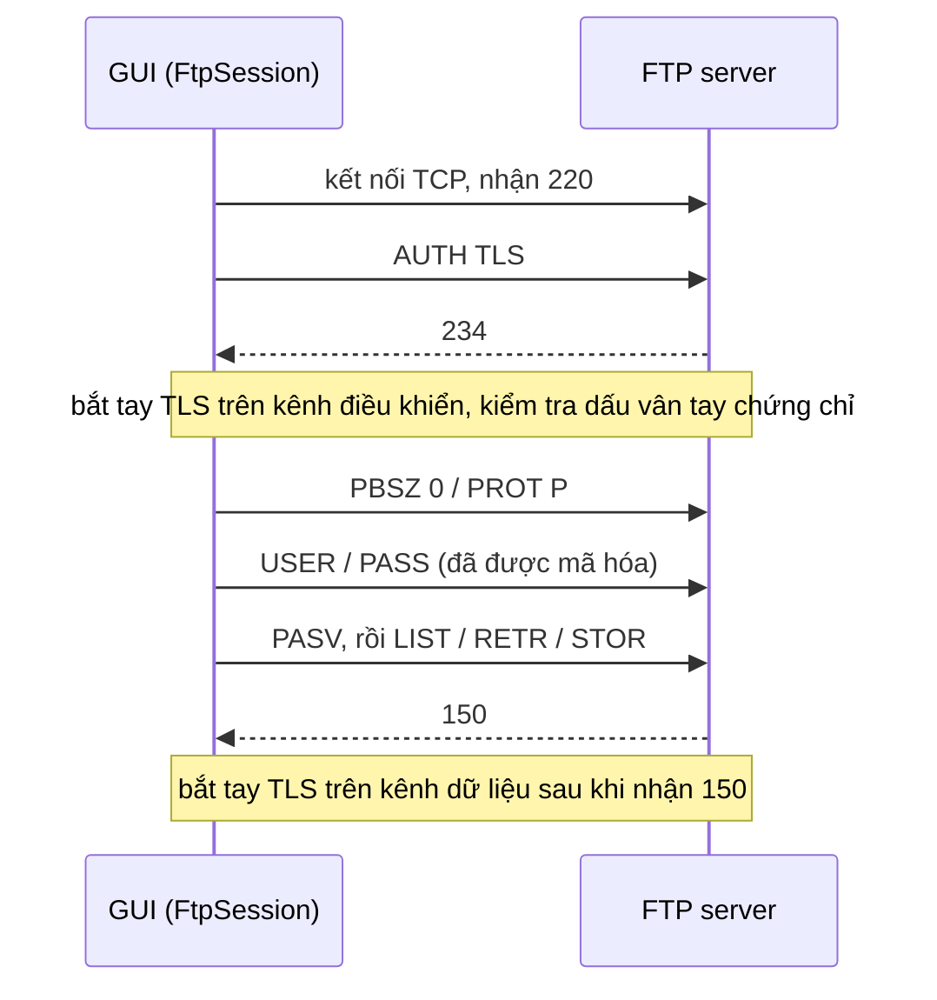

# Bảo mật đường truyền, tài khoản mẫu và đo hiệu năng

Tài liệu mô tả các cải tiến mới nhất của client GUI, server FTP và admin web. Phần thiết kế hạ tầng nằm ở
`THIET-KE-AZURE.md`, cách triển khai ở `TRIEN-KHAI-AZURE.md`, luồng dữ liệu bên trong server ở `ftp/LUONG-DU-LIEU.md`.

## 1. FTPS trong client GUI (`ftp-client-gui`)

Server đã hỗ trợ FTPS explicit (RFC 4217). Client giờ cũng nói được giao thức này.



- **Tự thương lượng:** client luôn thử `AUTH TLS` ngay sau lời chào. Server không hỗ trợ (hoặc không cấu hình TLS)
  thì giữ kết nối thường. Mã nguồn: `net/FtpSession.negotiateTls`, `net/TlsClient`.
- **Chứng chỉ tự ký, ghim kiểu TOFU:** lần đầu gặp một `host:port`, client chấp nhận và lưu SHA-256 của chứng chỉ vào
  `~/.ftpclient/known_hosts`. Lần sau chứng chỉ khác thì kết nối bị từ chối (chống nghe lén/giả mạo).
  Máy chủ đổi chứng chỉ hợp lệ: xóa dòng `host:port` trong file đó.
- **Giao diện:** sau khi đăng nhập hiện "🔒 Mã hóa TLS" hoặc "⚠ Chưa mã hóa". Nếu server không có TLS, GUI hỏi xác nhận
  (mặc định "Không") trước khi gửi mật khẩu dạng rõ. Dấu vân tay chứng chỉ ghi trong khung log.
- **Thứ tự bắt tay kênh dữ liệu:** client chỉ bắt tay TLS sau khi nhận `150`, vì server chỉ bọc socket sau khi gửi `150`.

Bật TLS phía server: xem mục FTPS trong `TRIEN-KHAI-AZURE.md` và `ftp/scripts/gen-keystore.sh`.

## 2. Chặn tải tệp nhiễm mã độc

`RETR` luôn gọi `ScanService.blockReason`: tệp `INFECTED` và `QUARANTINED` không tải được; tệp `PENDING` bị chặn
khi `scan.enforce=true` (Ansible bật mặc định, biến `ftp_scan_enforce`). Upload được quét bằng clamd **trước** khi
commit vào kho nên tệp nhiễm không bao giờ được lưu (xem mục 10 trong `ftp/LUONG-DU-LIEU.md`).

## 2b. Quyền xóa tệp

`DELE` và `RMD` cho phép xóa khi người dùng thỏa **một trong hai**: (1) có quyền `file:delete` (vai trò `file_manager`) và ACL cho phép;
(2) có quyền `file:upload` và là **chủ sở hữu** tệp/thư mục (người đã tải lên hoặc tạo, hoặc chủ thư mục cha).
Nhờ vậy nhân viên (`employee`) tự gỡ được tệp mình tải nhầm lên; tệp của người khác vẫn chỉ `file_manager` xóa được.
Mã nguồn: `ClientSession.canDelete`. Lần từ chối được ghi audit: `denied: not owner and no file:delete permission`.

## 3. Tài khoản mẫu

Migration tạo 4 tài khoản có mật khẩu mặc định: `admin`, `sv`, `fm`, `auditor` (mật khẩu trùng tên đăng nhập).

| Biến môi trường | Tác dụng |
|---|---|
| `FTP_SEED_PASSWORD` (≥ 8 ký tự) | Khi server khởi động, tài khoản mẫu nào **còn** mật khẩu mặc định sẽ được đổi sang giá trị này. Tài khoản đã tự đổi mật khẩu thì giữ nguyên. |
| (không đặt) | Server in `CANH BAO` kèm danh sách tài khoản còn mật khẩu mặc định. |

Triển khai Azure: đặt `vault_ftp_seed_password` trong `ansible/group_vars/ftpserver/vault.yml`.
Mã nguồn: `ftp/src/main/java/ftpserver/auth/SeedAccounts.java`, test `SeedAccountsTest`.

## 4. Giao diện: thông báo và thao tác nguy hiểm

- **Admin web:** thao tác Cách ly, Xóa hẳn, Duyệt sạch, Khóa/Mở khóa, Đặt lại mật khẩu, Gỡ vai trò đều có hộp xác nhận.
  Thông báo viết tiếng Việt có dấu; trạng thái tệp hiển thị "Chờ quét / Sạch / Nhiễm mã độc / Đã cách ly"
  (giá trị lưu trong DB vẫn là `PENDING/CLEAN/INFECTED/QUARANTINED`). Banner cảnh báo mã độc ở dashboard tắt được;
  việc tắt nhớ theo trình duyệt và banner tự hiện lại khi có sự kiện mới.
- **GUI:** `ui/ErrorText` đổi lỗi FTP thô thành câu dễ hiểu (mã độc, không đủ quyền, sai mật khẩu, mất kết nối...).
  Log vẫn giữ bản gốc. Hộp xóa đặt "Không" làm nút mặc định.

## 5. Đo hiệu năng

```bash
cd ftp
python3 scripts/bench_throughput.py --host <ip> --port 2121 --user fm --password <mk> \
        --size-mb 20 --clients 1,5,10,25 [--tls]
```

Mỗi client tải lên rồi tải về một tệp riêng, kiểm tra SHA-256, xóa tệp; in MB/s tổng, thời gian trung bình và số lỗi.
Tài khoản cần quyền ghi (ví dụ `fm`). Số dải cổng PASV phải đủ cho số client (mỗi client dùng một cổng cho mỗi lần truyền).

Kết quả đo ngày 2026-11-06 (loopback, một máy 16 nhân, file 20 MB, FTP thường, storage local, không quét virus; 0 lỗi, SHA-256 khớp):

| Số client | Thời gian cả đợt | Thông lượng thực (lên+xuống) |
|---|---|---|
| 1 | 0,16 s | 252 MB/s |
| 10 | 0,75 s | 535 MB/s |
| 50 | 3,26 s | 613 MB/s |
| 100 | 6,71 s | 596 MB/s |
| 200 | 13,70 s | 584 MB/s |

- Server chịu được 200 kết nối đồng thời không lỗi; thông lượng bão hòa ~600 MB/s từ khoảng 10 client; thời gian cả đợt tăng tuyến tính theo số client.
- Cột "MB/s up/down" của script (tổng byte / thời gian trung bình mỗi client) **bị thổi phồng** khi client không chạy chồng nhau (vd. 100 client cho 13.888 MB/s upload), nên báo cáo dùng cột "MB/s thực" (wall-clock).
- Loopback không có độ trễ và băng thông mạng thật nên chỉ phản ánh chi phí phần mềm. Chưa đo FTPS, S3/SeaweedFS, clamd; số liệu cho báo cáo nên đo lại giữa hai máy hoặc từ client tới VM Azure.
