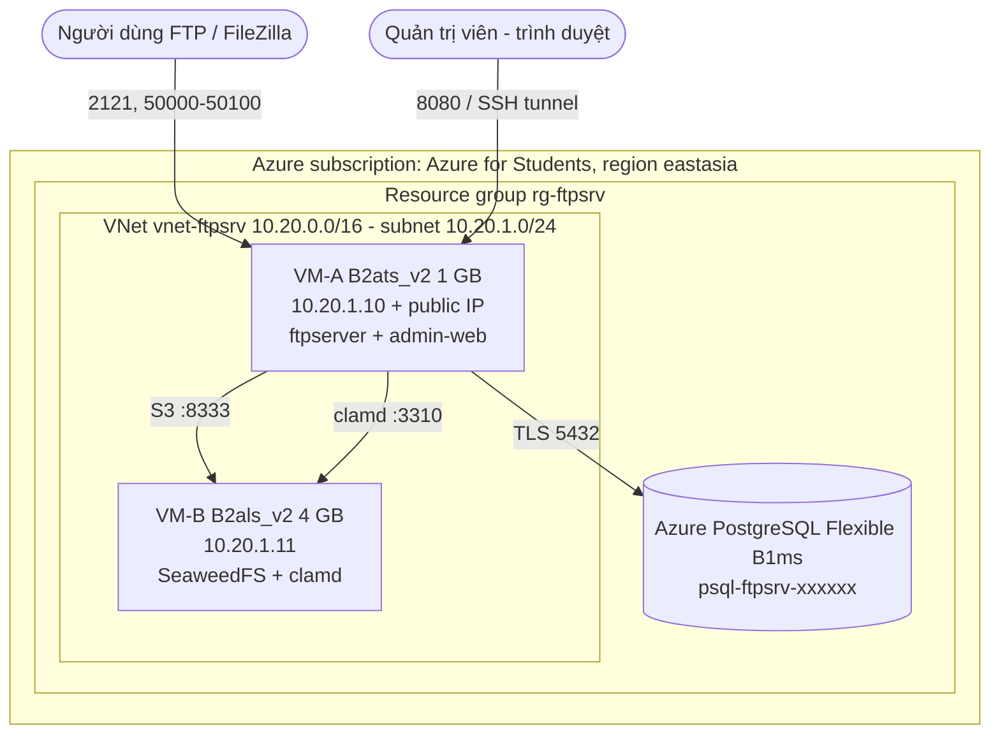
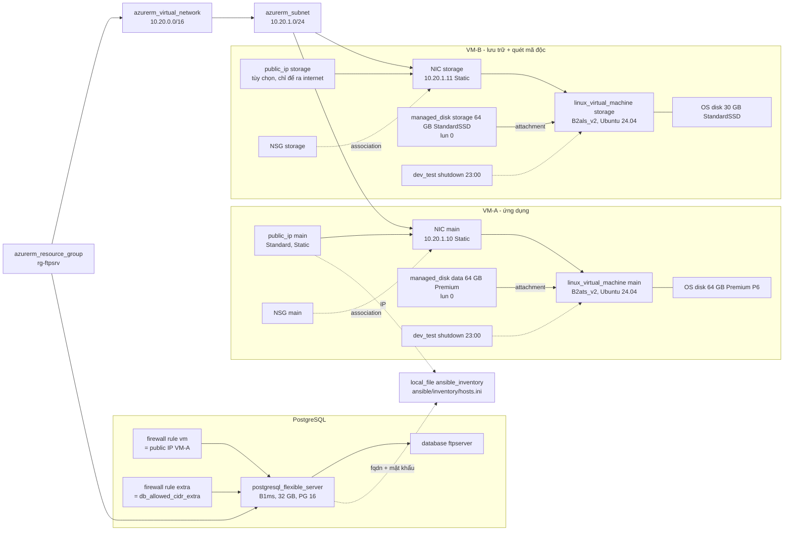
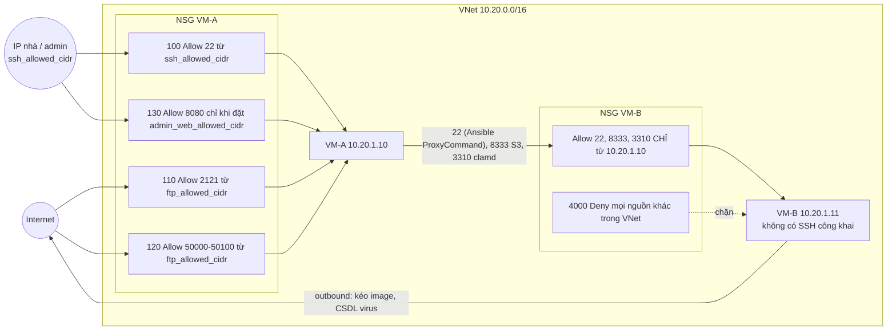
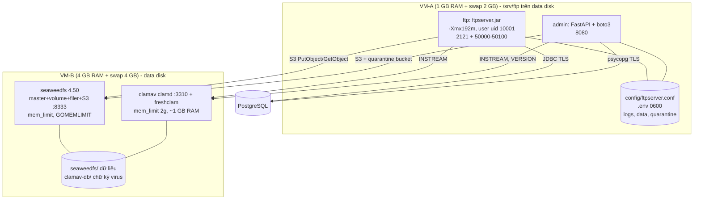
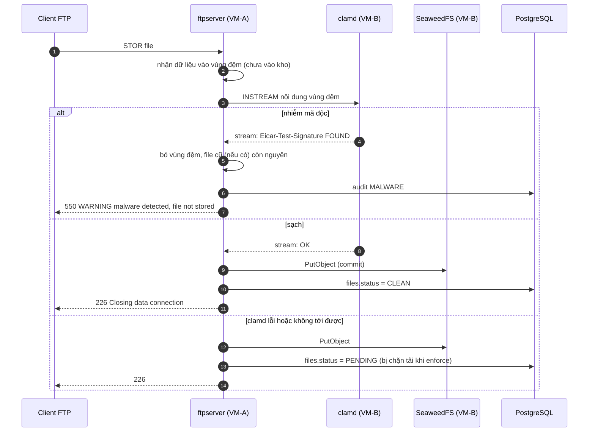
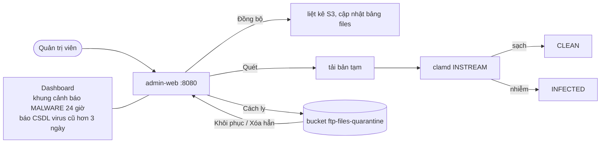
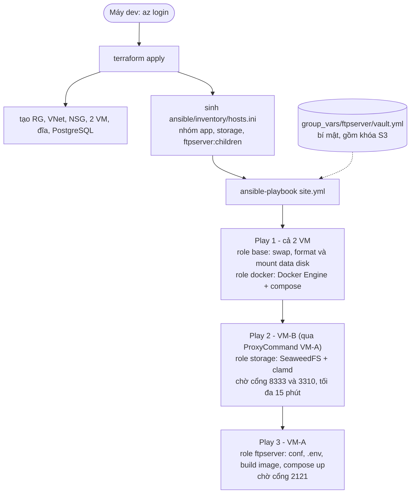
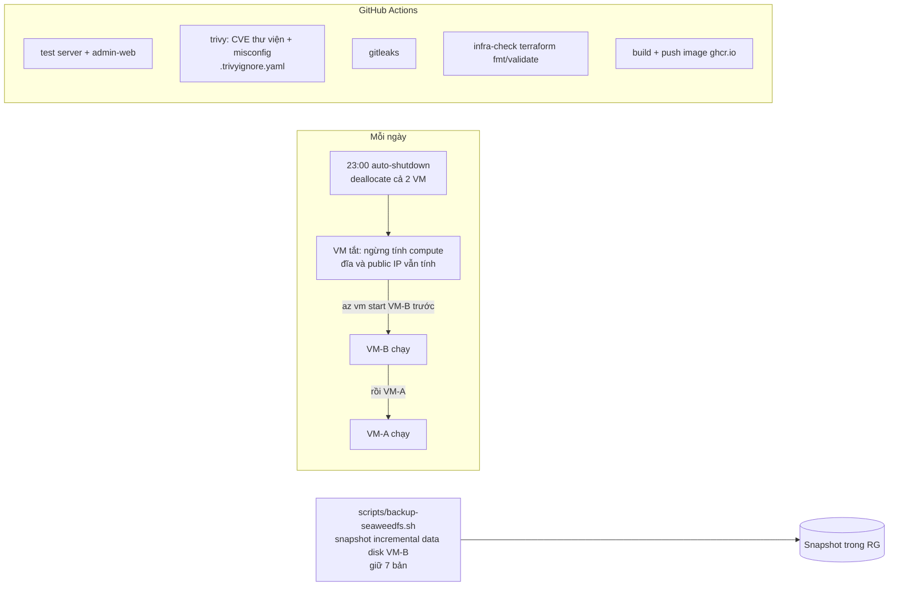
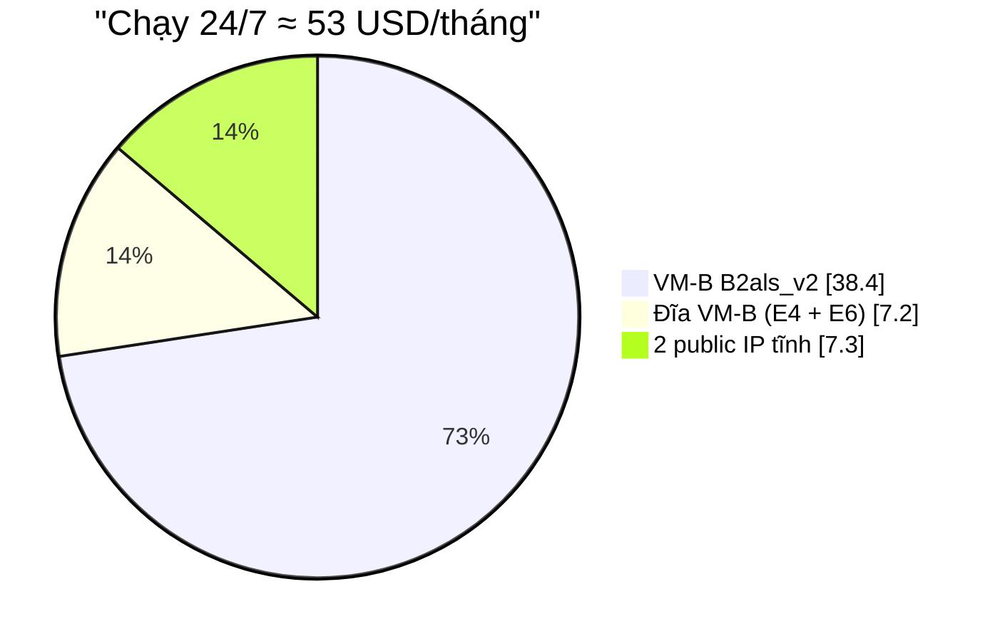

# Thiết kế hạ tầng Azure — sơ đồ các thành phần

Các sơ đồ dùng Mermaid (GitHub tự vẽ). Nguồn sự thật là `terraform/*.tf` và `ansible/`. Hướng dẫn triển khai: [`TRIEN-KHAI-AZURE.md`](TRIEN-KHAI-AZURE.md).

## 1. Toàn cảnh

## 2. Tài nguyên Azure (Terraform)

## 3. Mạng và luật NSG

clamd không có xác thực, vì vậy cổng 3310 chỉ được mở cho VM-A.

## 4. Container trên từng VM

## 5. Luồng upload và phát hiện mã độc

## 6. Luồng quản trị và cách ly

## 7. Triển khai: Terraform rồi Ansible

## 8. Vận hành: bật/tắt, sao lưu, CI

## 9. Chi phí hàng tháng (eastasia, giá bán lẻ)

| Khoản | Chạy 24/7 | ~8 giờ/ngày |
|---|---|---|
| VM-B `B2als_v2` (0,0526 USD/giờ) | 38,4 | 12,6 |
| Đĩa VM-B | 7,2 | 7,2 |
| 2 public IP tĩnh | 7,3 | 7,3 |
| VM-A, 2 đĩa P6, PostgreSQL B1ms | 0 nếu còn ưu đãi 12 tháng | 0 nếu còn ưu đãi |
| **Tổng** | **≈ 53 USD** | **≈ 27 USD** |

VM-A, đĩa P6 và PostgreSQL chỉ miễn phí khi subscription còn ưu đãi miễn phí 12 tháng; chưa kiểm tra được trên subscription thật.
`Standard_B2s` không có ở eastasia cho gói Student, nên VM-B dùng `Standard_B2als_v2`.
