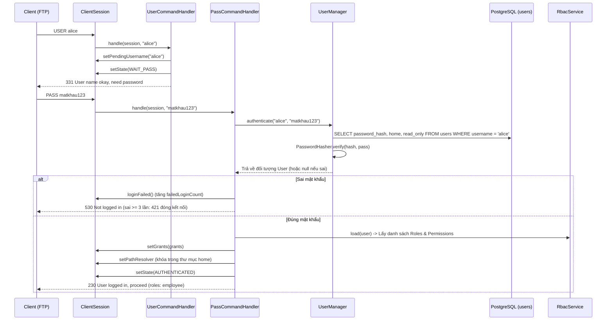
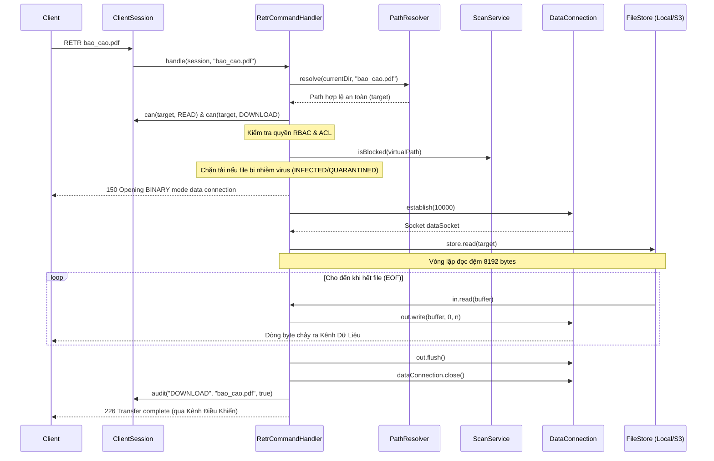
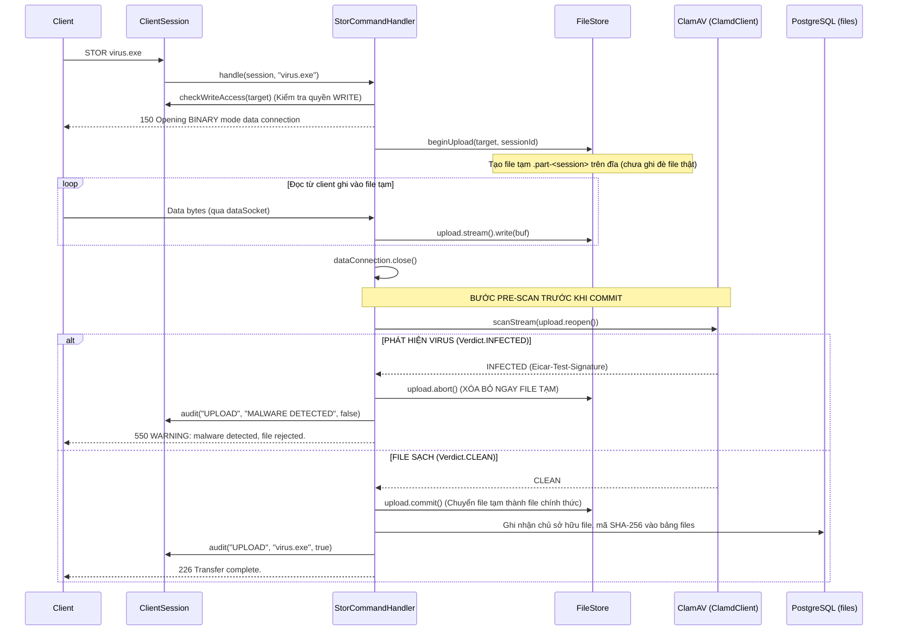

# HƯỚNG DẪN ĐỌC HIỂU TOÀN BỘ SOURCE CODE FTP SERVER (DÀNH CHO BEGINNER)

Tài liệu này được viết theo hướng "cầm tay chỉ việc", bóc tách chi tiết từng dòng chảy dữ liệu (data flow) và luồng thực thi (execution flow) trong toàn bộ mã nguồn của dự án FTP Server (`src/main/java/ftpserver/`).

Mọi luồng đi đều chỉ rõ: **Bước này gọi đến Class nào, Hàm nào, trong File nào và dữ liệu thay đổi ra sao**.

---

## MỤC LỤC
1. [Kiến thức nền tảng: Mô hình FTP và Socket TCP](#1-kien-thuc-nen-tang-mo-hinh-ftp-va-socket-tcp)
2. [Bản đồ mã nguồn (Cấu trúc thư mục & Phân chia trách nhiệm)](#2-ban-do-ma-nguon)
3. [Giai đoạn 1: Khởi động Server (Server Startup)](#3-giai-doan-1-khoi-dong-server)
4. [Giai đoạn 2: Tiếp nhận kết nối Client & Khởi tạo phiên](#4-giai-doan-2-tiep-nhan-ket-noi-client--khoi-tao-phien)
5. [Giai đoạn 3: Vòng lặp nhận & điều phối lệnh (Command Dispatching)](#5-giai-doan-3-vong-lap-nhan--dieu-phoi-lenh)
6. [Giai đoạn 4: Xác thực & Phân quyền (USER, PASS, TLS)](#6-giai-doan-4-xac-thuc--phan-quyen)
7. [Giai đoạn 5: Thiết lập Kênh Dữ Liệu (PASV vs PORT)](#7-giai-doan-5-thiet-lap-kenh-du-lieu-pasv-vs-port)
8. [Giai đoạn 6: Luồng truyền dữ liệu thực tế (LIST, RETR, STOR)](#8-giai-doan-6-luong-truyen-du-lieu-thuc-te)
9. [Giai đoạn 7: Quản lý thư mục & tệp (CWD, PWD, MKD, DELE, RNFR/RNTO)](#9-giai-doan-7-quan-ly-thu-muc--tep)
10. [Giai đoạn 8: Các tính năng bảo mật mở rộng (SITE: SHARE, ACL, SCAN, BREAKGLASS)](#10-giai-doan-8-cac-tinh-nang-bao-mat-mo-rong)
11. [Giai đoạn 9: Đóng kết nối & Dọn dẹp tài nguyên (Teardown)](#11-giai-doan-9-dong-ket-noi--don-dep-tai-nguyen)
12. [Bảng tra cứu nhanh: Lệnh gọi qua hàm nào?](#12-bang-tra-cuu-nhanh-lenh-goi-qua-ham-nao)

---

## 1. KIẾN THỨC NỀN TẢNG: MÔ HÌNH FTP VÀ SOCKET TCP

Trước khi đọc code, bạn cần nắm **3 điểm đặc biệt nhất** của giao thức FTP (RFC 959):

```
                    ┌─────────────────────────┐
                    │      Client (FileZilla) │
                    └───────────┬─────────────┘
                                │
        Kênh 1: Control Channel │ Port 21 (Lệnh: USER, PASS, RETR, STOR, ...)
        (Tồn tại suốt phiên)    ▼
                    ┌─────────────────────────┐
                    │   FTP Server (Port 21)  │
                    └───────────┬─────────────┘
                                │
        Kênh 2: Data Channel    │ Port ngẫu nhiên (50000 - 50100)
        (Mở khi cần, xong đóng) ▼
                    ┌─────────────────────────┐
                    │ File Content / File List│
                    └─────────────────────────┘
```

1. **FTP dùng HAI kênh kết nối TCP độc lập:**
   - **Kênh Điều Khiển (Control Connection):** Client kết nối vào port `21` của Server. Kênh này dùng để gửi lệnh (text: `USER`, `PASS`, `LIST`, `RETR`,...) và nhận mã phản hồi (code: `220`, `331`, `230`, `550`,...). Kênh này **sống suốt cả phiên làm việc**.
   - **Kênh Dữ Liệu (Data Connection):** Khi cần gửi danh sách file hoặc nội dung file, một đường truyền TCP thứ hai được mở ra tạm thời. Truyền xong file là **đóng kết nối ngay lập tức**.
2. **Hai chế độ truyền dữ liệu (Passive vs Active):**
   - **PASV (Passive Mode - Phổ biến nhất):** Server mở một port chờ (ví dụ `50005`), Client chủ động kết nối tới port đó.
   - **PORT (Active Mode):** Client mở port chờ trên máy của nó, bảo Server kết nối ngược về.
3. **Mô hình đa luồng (Multi-threading via Thread Pool):**
   - Server chính nghe port `21`. Mỗi khi có 1 Client kết nối vào, Server đẩy Socket đó vào một **Thread Pool** (gồm 20 worker threads). Một thread sẽ chịu trách nhiệm chăm sóc Client đó từ đầu đến cuối phiên, giúp các Client không làm nghẽn nhau.

---

## 2. BẢN ĐỒ MÃ NGUỒN

Toàn bộ mã nguồn nằm trong gói `ftpserver` tại thư mục [src/main/java/ftpserver/](file:///mnt/01DC7E1E309A75E0/CODE/BTL_LTM/ftp/src/main/java/ftpserver/):

| Thư mục/Package | Trách nhiệm chính trong hệ thống |
|---|---|
| [Main.java](file:///mnt/01DC7E1E309A75E0/CODE/BTL_LTM/ftp/src/main/java/ftpserver/Main.java) | Điểm vào của chương trình (`main`), khởi tạo các dịch vụ và bật server |
| [config/](file:///mnt/01DC7E1E309A75E0/CODE/BTL_LTM/ftp/src/main/java/ftpserver/config/) | Đọc file cấu hình `ftpserver.conf` |
| [db/](file:///mnt/01DC7E1E309A75E0/CODE/BTL_LTM/ftp/src/main/java/ftpserver/db/) | Kết nối PostgreSQL (`Database.java`) và tự động chạy migration SQL (`Migrator.java`) |
| [auth/](file:///mnt/01DC7E1E309A75E0/CODE/BTL_LTM/ftp/src/main/java/ftpserver/auth/) | Quản lý tài khoản, băm mật khẩu (`PasswordHasher.java`), xác thực (`UserManager.java`) |
| [core/](file:///mnt/01DC7E1E309A75E0/CODE/BTL_LTM/ftp/src/main/java/ftpserver/core/) | Trái tim của Server: `FtpServer.java` (lắng nghe TCP), `ClientSession.java` (phiên làm việc), `CommandRegistry.java` |
| [command/](file:///mnt/01DC7E1E309A75E0/CODE/BTL_LTM/ftp/src/main/java/ftpserver/command/) | Chứa tất cả các lớp xử lý từng lệnh FTP (`PassCommandHandler`, `RetrCommandHandler`,...) |
| [data/](file:///mnt/01DC7E1E309A75E0/CODE/BTL_LTM/ftp/src/main/java/ftpserver/data/) | Quản lý Kênh Dữ Liệu (`DataConnection.java`) cho PASV/PORT |
| [fs/](file:///mnt/01DC7E1E309A75E0/CODE/BTL_LTM/ftp/src/main/java/ftpserver/fs/) | Lớp trừu tượng hoá ổ đĩa (`FileStore.java`: local đĩa hoặc S3 SeaweedFS), chống thoát thư mục (`PathResolver.java`) |
| [acl/](file:///mnt/01DC7E1E309A75E0/CODE/BTL_LTM/ftp/src/main/java/ftpserver/acl/) | Phân quyền từng file/folder (`AclService.java` - READ, DOWNLOAD, WRITE) |
| [rbac/](file:///mnt/01DC7E1E309A75E0/CODE/BTL_LTM/ftp/src/main/java/ftpserver/rbac/) | Phân quyền theo vai trò (`RbacService.java`: admin, employee, guest...) |
| [scan/](file:///mnt/01DC7E1E309A75E0/CODE/BTL_LTM/ftp/src/main/java/ftpserver/scan/) | Quét mã độc qua ClamAV (`ClamdClient.java`, `ScanService.java`) trước khi lưu file |
| [audit/](file:///mnt/01DC7E1E309A75E0/CODE/BTL_LTM/ftp/src/main/java/ftpserver/audit/) | Ghi nhật ký kiểm toán hành vi người dùng vào DB và file text (`AuditLog.java`) |
| [tls/](file:///mnt/01DC7E1E309A75E0/CODE/BTL_LTM/ftp/src/main/java/ftpserver/tls/) | Mã hóa FTPS (TLS/SSL) cho kênh điều khiển và kênh dữ liệu (`TlsSupport.java`) |

---

## 3. GIAI ĐOẠN 1: KHỞI ĐỘNG SERVER (SERVER STARTUP)

Điểm bắt đầu là hàm `public static void main(String[] args)` trong [Main.java](file:///mnt/01DC7E1E309A75E0/CODE/BTL_LTM/ftp/src/main/java/ftpserver/Main.java#L51).

### Sơ đồ luồng khởi động:
```
Main.main()
  │
  ├── 1. loadConfigOrExit() ──────> Config.load("ftpserver.conf")
  ├── 2. openDatabase() ──────────> new Database(url, user, pass) -> Migrator.migrate()
  ├── 3. new UserManager() ───────> gắn Database vào để tra cứu user
  ├── 4. createFileStore() ───────> LocalFileStore (ổ đĩa) hoặc S3FileStore (SeaweedFS)
  ├── 5. createPathResolver() ────> PathResolver(config.rootDir()) tính toRealPath()
  ├── 6. CommandRegistrations ────> Đăng ký map các lệnh FTP: "USER" -> UserCommandHandler, ...
  ├── 7. new TlsSupport() ────────> Nạp Keystore SSL nếu config.tlsEnabled() = true
  ├── 8. new AuditLog() ──────────> Mở file audit.log + kết nối bảng CSDL audit_logs
  ├── 9. scanService() ───────────> Kết nối ClamAV daemon (clamd) để quét virus
  ├── 10. new FtpServer(...) ─────> Ghép tất cả phụ thuộc vào đối tượng Server
  ├── 11. scheduleRescan() ───────> Lập lịch quét lại định kỳ trong background
  └── 12. server.start() ─────────> Bắt đầu mở ServerSocket(controlPort) và accept()
```

### Chi tiết từng hàm được gọi:
1. **Đọc cấu hình:** `Main.loadConfigOrExit(confPath)` gọi [Config.load(Path)](file:///mnt/01DC7E1E309A75E0/CODE/BTL_LTM/ftp/src/main/java/ftpserver/config/Config.java). Đọc file `ftpserver.conf` vào `java.util.Properties`, kiểm tra port, thư mục gốc `storage.root_dir`, cấu hình database `db.url`, v.v.
2. **Khởi tạo Database & Migration:** `Main.openDatabase(config)` tạo đối tượng `new Database(...)` và gọi [Migrator.migrate(database)](file:///mnt/01DC7E1E309A75E0/CODE/BTL_LTM/ftp/src/main/java/ftpserver/db/Migrator.java). Migrator đọc danh sách file SQL từ `db/migration/index.txt` (`V001__create_users.sql` đến `V009__personal_homes.sql`) và chạy tự động trên PostgreSQL.
3. **Quản lý tài khoản:** `new UserManager(database)` ([UserManager.java](file:///mnt/01DC7E1E309A75E0/CODE/BTL_LTM/ftp/src/main/java/ftpserver/auth/UserManager.java)) kết nối vào bảng `users` trong DB để sau này xác thực mật khẩu (dùng Argon2 / SHA-256 qua [PasswordHasher.java](file:///mnt/01DC7E1E309A75E0/CODE/BTL_LTM/ftp/src/main/java/ftpserver/auth/PasswordHasher.java)).
4. **Hệ thống lưu trữ:** `Main.createFileStore(config)` khởi tạo `LocalFileStore` (lưu file trực tiếp trên ổ cứng máy chủ) hoặc `S3FileStore` (lưu file lên object storage chuẩn S3 như SeaweedFS/MinIO/AWS).
5. **Chống tấn công Path Traversal:** `Main.createPathResolver(config)` tạo [PathResolver](file:///mnt/01DC7E1E309A75E0/CODE/BTL_LTM/ftp/src/main/java/ftpserver/fs/PathResolver.java). Hàm này gọi `rootDir.toRealPath()` một lần duy nhất để lưu lại đường dẫn gốc tuyệt đối của hệ thống.
6. **Đăng ký bảng lệnh FTP:** `CommandRegistrations.registerAll(registry)` ([CommandRegistrations.java](file:///mnt/01DC7E1E309A75E0/CODE/BTL_LTM/ftp/src/main/java/ftpserver/core/CommandRegistrations.java)). Đưa toàn bộ các class xử lý vào một `Map<String, CommandHandler>` trong [CommandRegistry.java](file:///mnt/01DC7E1E309A75E0/CODE/BTL_LTM/ftp/src/main/java/ftpserver/core/CommandRegistry.java):
   - Nhóm Core: `QUIT`, `SYST`, `NOOP`, `FEAT`, `OPTS`, `AUTH`, `PBSZ`, `PROT`
   - Nhóm Auth & FS: `USER`, `PASS`, `REIN`, `PWD`, `CWD`, `CDUP`, `MKD`, `RMD`, `DELE`, `TYPE`, `SIZE`, `MDTM`, `RNFR`, `RNTO`, `SITE`
   - Nhóm Data: `PASV`, `PORT`, `LIST`, `NLST`, `RETR`, `STOR`, `APPE`, `REST`
7. **Lắng nghe mạng:** `server.start()` trong [FtpServer.java](file:///mnt/01DC7E1E309A75E0/CODE/BTL_LTM/ftp/src/main/java/ftpserver/core/FtpServer.java#L53):
   - Tạo thread pool: `Executors.newFixedThreadPool(20)`
   - Mở cổng mạng: `listener = new ServerSocket(config.controlPort())` (thường là port `21` hoặc `2121`).
   - Vào vòng lặp `while (running) { listener.accept(); }`.

---

## 4. GIAI ĐOẠN 2: TIẾP NHẬN KẾT NỐI CLIENT & KHỞI TẠO PHIÊN

Code thực thi: [FtpServer.java](file:///mnt/01DC7E1E309A75E0/CODE/BTL_LTM/ftp/src/main/java/ftpserver/core/FtpServer.java#L64-L75).

```java
while (running) {
    Socket client = listener.accept(); // (1) Chờ có client kết nối tới
    ClientSession session = new ClientSession(client, registry, userManager, pathResolver, config, tls, audit, services); // (2)
    pool.submit(session); // (3) Giao cho 1 thread trong pool chạy
}
```

### Chuyện gì xảy ra tại đây?
1. **Bước 1 (`accept()`):** Khi FileZilla hay một FTP Client gõ `ftp 192.168.1.10`, hệ điều hành hoàn tất bắt tay 3 bước TCP (SYN, SYN-ACK, ACK). Hàm `listener.accept()` kết thúc trạng thái chờ và trả về một đối tượng `Socket client`.
2. **Bước 2 (Khởi tạo `ClientSession`):** `new ClientSession(...)` được sinh ra. Đối tượng này nhận một mã định danh duy nhất (ví dụ `S1`, `S2`, sinh bởi `AtomicLong COUNTER`), lưu giữ toàn bộ ngữ cảnh phiên (IP client, trạng thái đăng nhập, thư mục hiện tại, kênh dữ liệu, v.v.).
3. **Bước 3 (`pool.submit(session)`):** Thay vì xử lý trên luồng chính, `session` được ném vào `ExecutorService`. Một trong 20 worker thread đang rảnh sẽ nhận lấy và gọi hàm `ClientSession.run()`. Thread chính quay lại ngay lập tức tại lệnh `accept()` để đón client tiếp theo!

---

## 5. GIAI ĐOẠN 3: VÒNG LẶP NHẬN & ĐIỀU PHỐI LỆNH (COMMAND DISPATCHING)

Luồng chạy trong: [ClientSession.java](file:///mnt/01DC7E1E309A75E0/CODE/BTL_LTM/ftp/src/main/java/ftpserver/core/ClientSession.java), hàm `run()` và `dispatch()`.

```
ClientSession.run()
  │
  ├── 1. openStreams() ────────────> reader (BufferedReader), writer (PrintWriter)
  ├── 2. reply(220, "Service ready")> Gửi mã chào đón 220 cho Client
  │
  └── 3. while (state != CLOSED)
            │
            ├── line = reader.readLine()   <-- BLOCK chờ Client gửi text (kết thúc bằng \r\n)
            │
            ├── Tách: commandName = "USER", arg = "alice"
            │
            └── dispatch(commandName, arg)
                  │
                  ├── Kiểm tra lệnh có hỗ trợ không? (NOT_IMPLEMENTED)
                  ├── Tìm handler: registry.resolve(commandName)
                  ├── Kiểm tra chính sách TLS bắt buộc (tls.required)
                  ├── Kiểm tra đã đăng nhập chưa? (handler.requiresAuth())
                  ├── Kiểm tra tài khoản chỉ đọc có cố tình ghi không? (handler.requiresWrite())
                  │
                  └── handler.handle(this, arg) ──────> GỌI ĐẾN HANDLER TƯƠNG ỨNG
```

### Các bước kiểm tra "tiền trạm" (Pre-flight checks) trong `dispatch`:
Trước khi chuyển việc cho từng Handler cụ thể, hàm `ClientSession.dispatch` đóng vai trò người gác cổng:
- **Lọc lệnh chưa viết:** Nếu là `ABOR` -> trả mã `502 Command not implemented`.
- **Lọc lệnh lạ:** Nếu `registry.resolve(commandName) == null` -> trả `500 Command unrecognized`.
- **Bảo mật TLS:** Nếu bật `tls.required = true` mà client chưa gửi `AUTH TLS` -> trả `530 TLS required`.
- **Bảo vệ trạng thái:** Nếu lệnh hiện tại không phải `REST` thì xoá `restartOffset = 0`; không phải `RNTO` thì xoá `renameFrom = null`.
- **Kiểm tra đăng nhập:** Nếu `handler.requiresAuth() == true` mà `state != AUTHENTICATED` -> lập tức trả `530 Not logged in`.
- **Kiểm tra quyền ghi (Read-Only account):** Nếu lệnh cần ghi (`STOR`, `DELE`, `MKD`,...) mà tài khoản có cờ `user.readOnly() == true` -> trả `550 Permission denied`.

---

## 6. GIAI ĐOẠN 4: XÁC THỰC & PHÂN QUYỀN (USER, PASS, TLS)

### 6.1. Luồng kích hoạt mã hoá FTPS (`AUTH TLS`)
Nếu client hỗ trợ FTPS (FTP qua TLS):
1. Client gửi: `AUTH TLS`
2. `ClientSession.dispatch()` gọi [AuthCommandHandler.java](file:///mnt/01DC7E1E309A75E0/CODE/BTL_LTM/ftp/src/main/java/ftpserver/command/AuthCommandHandler.java).
3. `session.upgradeToTls()`:
   - Gửi phản hồi `234 Proceed with negotiation`.
   - Gọi `tls.wrap(controlSocket)` ([TlsSupport.java](file:///mnt/01DC7E1E309A75E0/CODE/BTL_LTM/ftp/src/main/java/ftpserver/tls/TlsSupport.java)) để bọc socket thường thành `SSLSocket`.
   - Tạo lại `reader` và `writer` trên socket SSL mới. Kể từ đây, mọi dữ liệu chữ ASCII truyền qua kênh điều khiển đều được mã hóa bằng TLS 1.3 / TLS 1.2.

---

### 6.2. Luồng đăng nhập 2 bước (`USER` rồi `PASS`)



#### Chi tiết mã nguồn từng hàm:
1. **Lệnh `USER alice`:**
   - [UserCommandHandler.java](file:///mnt/01DC7E1E309A75E0/CODE/BTL_LTM/ftp/src/main/java/ftpserver/command/UserCommandHandler.java#L31):
   - Lưu tạm tên: `session.setPendingUsername("alice")`.
   - Đổi trạng thái phiên: `session.setState(SessionState.WAIT_PASS)`.
   - Phản hồi: `session.reply(331, "User name okay, need password.")`.
2. **Lệnh `PASS matkhau123`:**
   - [PassCommandHandler.java](file:///mnt/01DC7E1E309A75E0/CODE/BTL_LTM/ftp/src/main/java/ftpserver/command/PassCommandHandler.java#L36):
   - Kiểm tra xem trạng thái có đúng là `WAIT_PASS` không (nếu gửi PASS trước USER -> trả `503 Bad sequence of commands`).
   - Gọi `session.userManager().authenticate("alice", "matkhau123")`:
     - Truy vấn SQL vào bảng `users`.
     - Gọi `PasswordHasher.verify(hash, password)`.
   - **Nếu thất bại (`loginFailed`):**
     - `session.incrementFailedLoginCount()`.
     - Ghi nhật ký kiểm toán thất bại: `session.auditAs(..., "LOGIN", "bad credentials", false)`.
     - Nếu đã thử sai $\ge 3$ lần -> gửi mã `421 Too many failed login attempts` và đóng phiên.
   - **Nếu thành công (`loginSucceeded`):**
     - Thiết lập thư mục Home của user: Tạo `homeResolver` nhốt user trong đường dẫn của họ.
     - Nếu user là nhân viên có home là `/`, hệ thống tự sinh thư mục cá nhân `/home/alice` (`personalHome`).
     - Tải quyền RBAC từ DB: `session.setGrants(session.rbac().load(user))`.
     - Chuyển trạng thái: `session.setState(SessionState.AUTHENTICATED)`.
     - Ghi nhật ký: `session.audit("LOGIN", "roles=...", true)`.
     - Phản hồi cho client: `230 User logged in, proceed (roles: ...)`.

---

## 7. GIAI ĐOẠN 5: THIẾT LẬP KÊNH DỮ LIỆU (PASV VS PORT)

Trước khi thực hiện `LIST`, `RETR` (tải về), hay `STOR` (tải lên), Client và Server bắt buộc phải thương lượng địa chỉ cho Kênh Dữ Liệu.

Code thực thi: [DataConnection.java](file:///mnt/01DC7E1E309A75E0/CODE/BTL_LTM/ftp/src/main/java/ftpserver/data/DataConnection.java).

### Chế độ Bị Động - Passive Mode (`PASV`)
Client gửi: `PASV` -> Vào [PasvCommandHandler.java](file:///mnt/01DC7E1E309A75E0/CODE/BTL_LTM/ftp/src/main/java/ftpserver/command/PasvCommandHandler.java):
1. Gọi `session.getDataConnection().openPassive(portMin, portMax)`:
   - Server lặp qua dải port được cấu hình (ví dụ `50000` đến `50100`).
   - Thử tạo `new ServerSocket(port)`. Cổng nào mở thành công thì dừng lại.
   - Lưu socket này vào biến `passiveSocket`, đặt `mode = DataMode.PASSIVE`.
2. Mã hóa địa chỉ IP và Port thành 6 số nguyên `(h1,h2,h3,h4,p1,p2)`:
   - Công thức port: `Port = p1 * 256 + p2`.
   - Ví dụ port `50007` $\rightarrow$ $50007 / 256 = 195$, $50007 \% 256 = 87$ $\rightarrow$ `(192,168,1,10,195,87)`.
3. Server gửi trả mã: `227 Entering Passive Mode (192,168,1,10,195,87)`.
4. Đổi trạng thái: `session.setState(SessionState.DATA_READY)`.
> **Lưu ý cực quan trọng:** Tại thời điểm này, `passiveSocket.accept()` **CHƯA hề chạy**! Server chỉ mới mở cổng để đó và chờ lệnh truyền dữ liệu tiếp theo.

### Chế độ Chủ Động - Active Mode (`PORT`)
Client gửi: `PORT 192,168,1,50,200,15` -> Vào [PortCommandHandler.java](file:///mnt/01DC7E1E309A75E0/CODE/BTL_LTM/ftp/src/main/java/ftpserver/command/PortCommandHandler.java):
1. Server phân tích 6 số thành IP `192.168.1.50` và Port `51215`.
2. Gọi `session.getDataConnection().setActiveTarget(ip, port)`.
3. Đặt `mode = DataMode.ACTIVE`. Chưa hề kết nối TCP nào được tạo ra lúc này.
4. Gửi `200 PORT command successful`, đổi `session.setState(SessionState.DATA_READY)`.

---

## 8. GIAI ĐOẠN 6: LUỒNG TRUYỀN DỮ LIỆU THỰC TẾ

Khi trạng thái đã là `DATA_READY`, client có thể gọi `LIST`, `RETR`, hoặc `STOR`. Lúc này kênh dữ liệu mới thực sự được kích hoạt thông qua hàm:
```java
Socket dataSocket = session.getDataConnection().establish(10_000);
```
- Nếu là **PASV**: Hàm này gọi `passiveSocket.accept()`, chờ client kết nối vào trong tối đa 10 giây.
- Nếu là **PORT**: Hàm này gọi `socket.connect(activeTarget, 10_000)`, chủ động kết nối ngược lại máy client.
- Nếu phiên có bật bảo mật `PROT P` (TLS cho data): Hàm gọi `tls.wrap(socket)` để mã hoá luôn cả kênh dữ liệu.

---

### 8.1. Luồng Lấy Danh Sách File (`LIST`)
Code: [ListCommandHandler.java](file:///mnt/01DC7E1E309A75E0/CODE/BTL_LTM/ftp/src/main/java/ftpserver/command/ListCommandHandler.java) và [ListingFormatter.java](file:///mnt/01DC7E1E309A75E0/CODE/BTL_LTM/ftp/src/main/java/ftpserver/command/ListingFormatter.java).

```
Client               Control Channel (21)         Data Channel (50007)          FileStore / DB
  │                           │                            │                          │
  ├─ LIST ───────────────────>│                            │                          │
  │                           ├─ 150 About to open... ────>│                          │
  │                           ├─ establish(10000) ────────>│ (TCP Connect xong)       │
  │                           │                            │                          │
  │                           │   ListingFormatter.writeListing()                     │
  │                           │                            ├─ session.store().list() ─┤
  │                           │                            │  Lọc theo session.can() ─┤
  │                           │                            │  Tra chủ sở hữu ownerOf ─┤
  │                           │<── Gửi text Unix "ls -l" ──┤                          │
  │                           │    "drwxr-xr-x 1 owner..." │                          │
  │                           │                            │                          │
  │                           ├─ dataConnection.close() ──>│ (ĐÓNG KÊNH DỮ LIỆU)      │
  │<─ 226 Closing data conn ──┤                            │                          │
```

**Chi tiết từng bước:**
1. Server kiểm tra quyền xem thư mục: `session.can(dir, Perm.READ)`.
2. Trả lời trên kênh điều khiển: `150 About to open data connection`.
3. Gọi `establish()` để có `Socket dataSocket`.
4. `ListingFormatter.writeListing`:
   - Đọc danh sách file từ `FileStore` (ổ đĩa hoặc S3).
   - Với từng file/folder: kiểm tra quyền `session.can(p, Perm.READ)` (nếu không có quyền thì giấu đi không hiển thị).
   - Tra cứu người sở hữu từ bảng ACL trong CSDL: `session.acl().ownerOf(...)`.
   - Format chuỗi chuẩn Unix (dạng `drwxr-xr-x 1 alice staff 4096 Nov 24 10:00 tailieu.pdf`).
   - Ghi thẳng chuỗi text này vào `dataSocket.getOutputStream()`.
5. Đóng `dataSocket` (trong khối `finally`).
6. Trả lời trên kênh điều khiển: `226 Closing data connection`.
> **Mẹo nhận biết:** Client như FileZilla chỉ biết danh sách đã gửi xong khi nó thấy Kênh Dữ Liệu bị đóng lại (nhận EOF - End Of File).

---

### 8.2. Luồng Tải File Về Máy (`RETR filename`)
Code: [RetrCommandHandler.java](file:///mnt/01DC7E1E309A75E0/CODE/BTL_LTM/ftp/src/main/java/ftpserver/command/RetrCommandHandler.java).



#### Đoạn code xử lý truyền byte (Tại sao không tràn RAM khi file nặng hàng GB?):
Trong [RetrCommandHandler.java](file:///mnt/01DC7E1E309A75E0/CODE/BTL_LTM/ftp/src/main/java/ftpserver/command/RetrCommandHandler.java#L82-L107):
```java
try (Socket dataSocket = session.getDataConnection().establish(DATA_CONNECT_TIMEOUT_MS);
     InputStream in = session.store().read(target);
     OutputStream out = dataSocket.getOutputStream()) {

    byte[] buf = new byte[8192]; // Mảng đệm chỉ tốn đúng 8 KB RAM!
    int n;
    while ((n = in.read(buf)) != -1) {
        out.write(buf, 0, n);    // Đọc được 8KB từ đĩa -> Ghi ngay 8KB ra mạng
    }
    out.flush();
}
```
Dữ liệu đi theo dạng dòng chảy (stream) từ đĩa sang socket mạng qua bộ đệm chỉ vỏn vẹn `8192 byte` (8KB). Do đó, dù bạn tải file 10GB thì server cũng chỉ tốn 8KB bộ nhớ cho thao tác này, hoàn toàn không sợ bị lỗi `OutOfMemoryError`!

---

### 8.3. Luồng Tải File Lên Server (`STOR filename` / `APPE filename`)
Code: [StorCommandHandler.java](file:///mnt/01DC7E1E309A75E0/CODE/BTL_LTM/ftp/src/main/java/ftpserver/command/StorCommandHandler.java).

Đây là một trong những luồng phức tạp và được thiết kế cẩn trọng nhất trong dự án vì nó kết hợp cả **Bản ghi tạm (Spooling)** và **Quét virus tự động (ClamAV Prescan)**.



#### Tại sao lại dùng cơ chế này?
1. **Tính nguyên tử (Atomicity):** Nếu trong lúc đang tải file lên mà mạng bị đứt, file tạm sẽ bị huỷ (`upload.abort()`). File cũ của người dùng trước đó (nếu bị ghi đè) vẫn còn nguyên vẹn 100%, không bị hỏng nửa vời.
2. **Ngăn chặn phần mềm độc hại (Malware Prevention):** File được đẩy thẳng qua ClamAV daemon kiểm tra **ngay trước khi commit**. Nếu phát hiện mã độc, file bị huỷ ngay lập tức trên RAM/vùng tạm, không bao giờ được xuất hiện trong cây thư mục của server.

---

## 9. GIAI ĐOẠN 7: QUẢN LÝ THƯ MỤC & TỆP (CWD, PWD, MKD, DELE, RNFR/RNTO)

### 9.1. Lệnh đổi thư mục (`CWD`) & Xem thư mục hiện tại (`PWD`)
- **`PWD`** ([PwdCommandHandler.java](file:///mnt/01DC7E1E309A75E0/CODE/BTL_LTM/ftp/src/main/java/ftpserver/command/PwdCommandHandler.java)):
  - Lấy đường dẫn thật: `session.getCurrentDir()`.
  - Đổi sang đường dẫn ảo: `session.pathResolver().toVirtualPath(real)`.
  - Ví dụ thư mục thật trên Linux là `/mnt/data/ftproot/tailieu/baocao`, thì client chỉ nhìn thấy `"/tailieu/baocao"`. Người dùng không thể biết cấu trúc thư mục thật của hệ điều hành máy chủ.
- **`CWD <dir>`** ([CwdCommandHandler.java](file:///mnt/01DC7E1E309A75E0/CODE/BTL_LTM/ftp/src/main/java/ftpserver/command/CwdCommandHandler.java)):
  - Gọi [PathResolver.resolve(currentDir, arg)](file:///mnt/01DC7E1E309A75E0/CODE/BTL_LTM/ftp/src/main/java/ftpserver/fs/PathResolver.java#L47).
  - Kiểm tra xem thư mục đích có tồn tại không: `session.store().isDirectory(target)`.
  - Kiểm tra quyền: `session.can(target, Perm.READ)`.
  - Cập nhật thư mục hiện hành: `session.setCurrentDir(target)`. Trả về `250 Directory changed to /...`.

> **Cơ chế chống tấn công Path Traversal:**
> Giả sử hacker gõ `CWD ../../../etc`.
> Trong `PathResolver.java`, hàm `candidate = currentDir.resolve(arg).normalize()`.
> Sau đó có dòng code then chốt:
> ```java
> if (!candidate.startsWith(rootDir)) {
>     throw new SecurityException("Path traversal attempt");
> }
> ```
> Nếu đường dẫn sau khi chuẩn hóa vượt ra khỏi `rootDir`, một `SecurityException` bị ném ra ngay lập tức và server trả về lỗi `550 Permission denied`.

---

### 9.2. Lệnh tạo thư mục (`MKD`) & Xoá tệp (`DELE`)
- **`MKD <dirname>`** ([MkdCommandHandler.java](file:///mnt/01DC7E1E309A75E0/CODE/BTL_LTM/ftp/src/main/java/ftpserver/command/MkdCommandHandler.java)):
  - Kiểm tra quyền ghi trên thư mục cha: `session.can(target.getParent(), Perm.WRITE)`.
  - Gọi `session.store().createDirectories(target)`.
  - Ghi nhận quyền sở hữu thư mục trong CSDL: `session.acl().recordOwner(aclKey, user.name())`.
- **`DELE <filename>`** ([DeleCommandHandler.java](file:///mnt/01DC7E1E309A75E0/CODE/BTL_LTM/ftp/src/main/java/ftpserver/command/DeleCommandHandler.java)):
  - Kiểm tra quyền xoá: `session.canDelete(target)` (chỉ cho phép nếu là Admin/File Manager, hoặc chính người đã tải file đó lên).
  - Gọi `session.store().deleteFile(target)` để xoá file trên ổ đĩa/S3.
  - Xoá metadata trong bảng `files` và bảng `file_acl` trong CSDL.
  - Ghi audit log sự kiện `DELETE`.

---

### 9.3. Lệnh đổi tên hai bước (`RNFR` -> `RNTO`)
Giao thức FTP quy định đổi tên phải qua 2 lệnh liên tiếp:
1. **`RNFR file_cu.txt` (Rename From)** ([RnfrCommandHandler.java](file:///mnt/01DC7E1E309A75E0/CODE/BTL_LTM/ftp/src/main/java/ftpserver/command/RnfrCommandHandler.java)):
   - Kiểm tra file nguồn có tồn tại không, user có quyền xoá/di chuyển không.
   - Lưu tạm vào biến phiên: `session.setRenameFrom(source)`.
   - Trả lời: `350 File exists, ready for destination name`.
2. **`RNTO file_moi.txt` (Rename To)** ([RntoCommandHandler.java](file:///mnt/01DC7E1E309A75E0/CODE/BTL_LTM/ftp/src/main/java/ftpserver/command/RntoCommandHandler.java)):
   - Lấy lại `source = session.getRenameFrom()`. Nếu không có `source` (do client chưa gọi RNFR trước đó) -> trả `503 Bad sequence of commands`.
   - Kiểm tra quyền ghi tại thư mục đích.
   - Gọi `session.store().move(source, destination)`.
   - Cập nhật lại đường dẫn mới trong cơ sở dữ liệu.
   - Trả lời: `250 Rename successful`.

---

## 10. GIAI ĐOẠN 8: CÁC TÍNH NĂNG BẢO MẬT MỞ RỘNG (SITE COMMANDS)

Tất cả nằm trong [SiteCommandHandler.java](file:///mnt/01DC7E1E309A75E0/CODE/BTL_LTM/ftp/src/main/java/ftpserver/command/SiteCommandHandler.java). Đây là tính năng nâng cao mà nhóm phát triển mở rộng trên nền FTP chuẩn:

| Cú pháp lệnh | Mục đích & Luồng xử lý trong code |
|---|---|
| `SITE SHARE <file> <user> <PERM>` | Chủ sở hữu chia sẻ quyền xem/tải/ghi (`READ`/`DOWNLOAD`/`WRITE`) một file cụ thể cho user khác. Code gọi `AclService.setPermission()`. |
| `SITE ACL <file>` | Xem danh sách những ai đang có quyền truy cập vào file này. Gọi `AclService.listAcls()`. |
| `SITE USERS <prefix>` | Gợi ý tên người dùng khi muốn share file (tự động autocomplete). |
| `SITE AUDIT [n] [user=...]` | (Dành cho kiểm toán viên - quyền `audit:view`): Xem $n$ dòng nhật ký bảo mật gần nhất từ bảng `audit_logs`. |
| `SITE SCAN` | (Quyền `scan:view`): Báo cáo tóm tắt các file bị nhiễm virus đang bị cách ly. |
| `SITE BREAKGLASS GRANT <user> <folder> <phút> <lý do>` | **Cơ chế Break-glass (Khẩn cấp):** Cho phép Admin cấp quyền vượt cấp tạm thời trong một số phút khi có sự cố. Sau khi hết thời gian, quyền tự động bị thu hồi. |

---

## 11. GIAI ĐOẠN 9: ĐÓNG KẾT NỐI & DỌN DẸP TÀI NGUYÊN (TEARDOWN)

Khi client gửi lệnh `QUIT` hoặc khi client bị rớt mạng / tắt đột ngột / hết thời gian chờ (idle timeout):

1. **Nếu client gửi `QUIT`:** [QuitCommandHandler.java](file:///mnt/01DC7E1E309A75E0/CODE/BTL_LTM/ftp/src/main/java/ftpserver/command/QuitCommandHandler.java) gọi `session.reply(221, "Goodbye.")` và đặt `session.setState(SessionState.CLOSED)`.
2. **Khối `finally` thần thánh:** Trong [ClientSession.java](file:///mnt/01DC7E1E309A75E0/CODE/BTL_LTM/ftp/src/main/java/ftpserver/core/ClientSession.java#L170), dù vòng lặp kết thúc vì bất cứ lý do nào, hàm `cleanup()` cũng được gọi:
   ```java
   private void cleanup() {
       if (dataConnection != null) {
           dataConnection.close(); // Đóng ServerSocket PASV còn treo (chống rò rỉ cổng)
       }
       closeQuietly(reader);
       closeQuietly(writer);
       closeQuietly(ioSocket);
       closeQuietly(controlSocket); // Đóng kênh điều khiển TCP
       state = SessionState.CLOSED;
       if (user != null) {
           audit("LOGOUT", "session closed", true); // Ghi nhận đăng xuất
       }
       if (sessions != null) {
           sessions.unregister(sessionId); // Xóa khỏi danh sách theo dõi
       }
   }
   ```
3. **Trả luồng về Pool:** Sau khi hàm `run()` kết thúc, worker thread đó **không bị huỷ**, mà nó quay trở về hàng đợi của `ExecutorService`, sẵn sàng phục vụ một kết nối mới khác. Bộ nhớ RAM và các file descriptor được giải phóng triệt để.

---

## 12. BẢNG TRA CỨU NHANH: LỆNH GỌI QUA HÀM NÀO?

Bảng tóm tắt để bạn đối chiếu nhanh khi đọc từng class:

| Lệnh FTP | File Handler xử lý | Các hàm chính được gọi qua | Mã trả về chính |
|---|---|---|---|
| Khởi động Server | [Main.java](file:///mnt/01DC7E1E309A75E0/CODE/BTL_LTM/ftp/src/main/java/ftpserver/Main.java) | `Config.load()` $\rightarrow$ `Migrator.migrate()` $\rightarrow$ `FtpServer.start()` | Console log |
| Kết nối TCP | [FtpServer.java](file:///mnt/01DC7E1E309A75E0/CODE/BTL_LTM/ftp/src/main/java/ftpserver/core/FtpServer.java) | `listener.accept()` $\rightarrow$ `pool.submit(session)` $\rightarrow$ `ClientSession.run()` | `220` |
| `AUTH TLS` | [AuthCommandHandler.java](file:///mnt/01DC7E1E309A75E0/CODE/BTL_LTM/ftp/src/main/java/ftpserver/command/AuthCommandHandler.java) | `session.upgradeToTls()` $\rightarrow$ `TlsSupport.wrap()` | `234` |
| `USER` | [UserCommandHandler.java](file:///mnt/01DC7E1E309A75E0/CODE/BTL_LTM/ftp/src/main/java/ftpserver/command/UserCommandHandler.java) | `session.setPendingUsername()` $\rightarrow$ `session.setState(WAIT_PASS)` | `331` |
| `PASS` | [PassCommandHandler.java](file:///mnt/01DC7E1E309A75E0/CODE/BTL_LTM/ftp/src/main/java/ftpserver/command/PassCommandHandler.java) | `UserManager.authenticate()` $\rightarrow$ `RbacService.load()` $\rightarrow$ `session.setUser()` | `230` / `530` / `421` |
| `PWD` | [PwdCommandHandler.java](file:///mnt/01DC7E1E309A75E0/CODE/BTL_LTM/ftp/src/main/java/ftpserver/command/PwdCommandHandler.java) | `session.getCurrentDir()` $\rightarrow$ `PathResolver.toVirtualPath()` | `257` |
| `CWD` | [CwdCommandHandler.java](file:///mnt/01DC7E1E309A75E0/CODE/BTL_LTM/ftp/src/main/java/ftpserver/command/CwdCommandHandler.java) | `PathResolver.resolve()` $\rightarrow$ `session.can(READ)` $\rightarrow$ `setCurrentDir()` | `250` / `550` |
| `PASV` | [PasvCommandHandler.java](file:///mnt/01DC7E1E309A75E0/CODE/BTL_LTM/ftp/src/main/java/ftpserver/command/PasvCommandHandler.java) | `DataConnection.openPassive(min, max)` $\rightarrow$ `session.setState(DATA_READY)` | `227` |
| `PORT` | [PortCommandHandler.java](file:///mnt/01DC7E1E309A75E0/CODE/BTL_LTM/ftp/src/main/java/ftpserver/command/PortCommandHandler.java) | `DataConnection.setActiveTarget(ip, port)` $\rightarrow$ `session.setState(DATA_READY)` | `200` |
| `LIST` | [ListCommandHandler.java](file:///mnt/01DC7E1E309A75E0/CODE/BTL_LTM/ftp/src/main/java/ftpserver/command/ListCommandHandler.java) | `DataConnection.establish()` $\rightarrow$ `ListingFormatter.writeListing()` $\rightarrow$ `close()` | `150` $\rightarrow$ `226` |
| `RETR` | [RetrCommandHandler.java](file:///mnt/01DC7E1E309A75E0/CODE/BTL_LTM/ftp/src/main/java/ftpserver/command/RetrCommandHandler.java) | `session.can(DOWNLOAD)` $\rightarrow$ `DataConnection.establish()` $\rightarrow$ `store.read()` | `150` $\rightarrow$ `226` |
| `STOR` | [StorCommandHandler.java](file:///mnt/01DC7E1E309A75E0/CODE/BTL_LTM/ftp/src/main/java/ftpserver/command/StorCommandHandler.java) | `FileStore.beginUpload()` $\rightarrow$ `ScanService.prescan()` $\rightarrow$ `commit()` | `150` $\rightarrow$ `226` / `550` |
| `DELE` | [DeleCommandHandler.java](file:///mnt/01DC7E1E309A75E0/CODE/BTL_LTM/ftp/src/main/java/ftpserver/command/DeleCommandHandler.java) | `session.canDelete()` $\rightarrow$ `FileStore.deleteFile()` $\rightarrow$ `AclService` | `250` / `550` |
| `RNFR` + `RNTO` | `RnfrCommandHandler` + `RntoCommandHandler` | `session.setRenameFrom()` $\rightarrow$ `session.store().move()` | `350` $\rightarrow$ `250` |
| `SITE` | [SiteCommandHandler.java](file:///mnt/01DC7E1E309A75E0/CODE/BTL_LTM/ftp/src/main/java/ftpserver/command/SiteCommandHandler.java) | `AclService.setPermission()` / `AuditLog.query()` / `ClamdClient` | `200` / `213` / `550` |
| `QUIT` | [QuitCommandHandler.java](file:///mnt/01DC7E1E309A75E0/CODE/BTL_LTM/ftp/src/main/java/ftpserver/command/QuitCommandHandler.java) | `session.setState(CLOSED)` $\rightarrow$ `ClientSession.cleanup()` | `221` |
