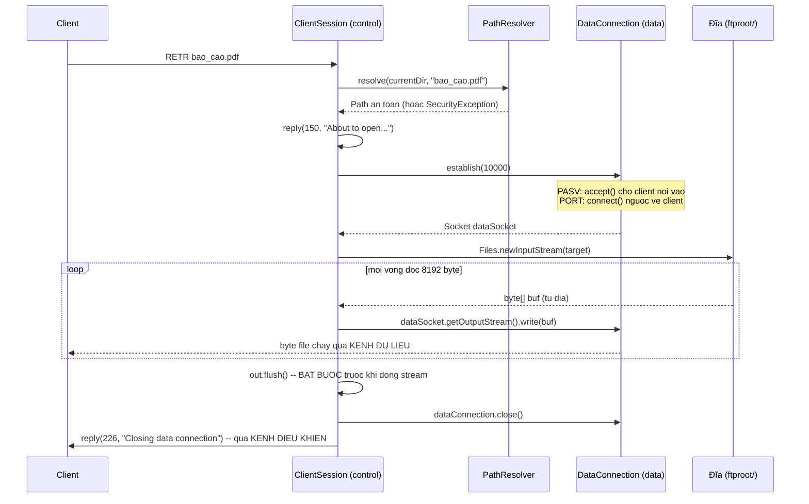
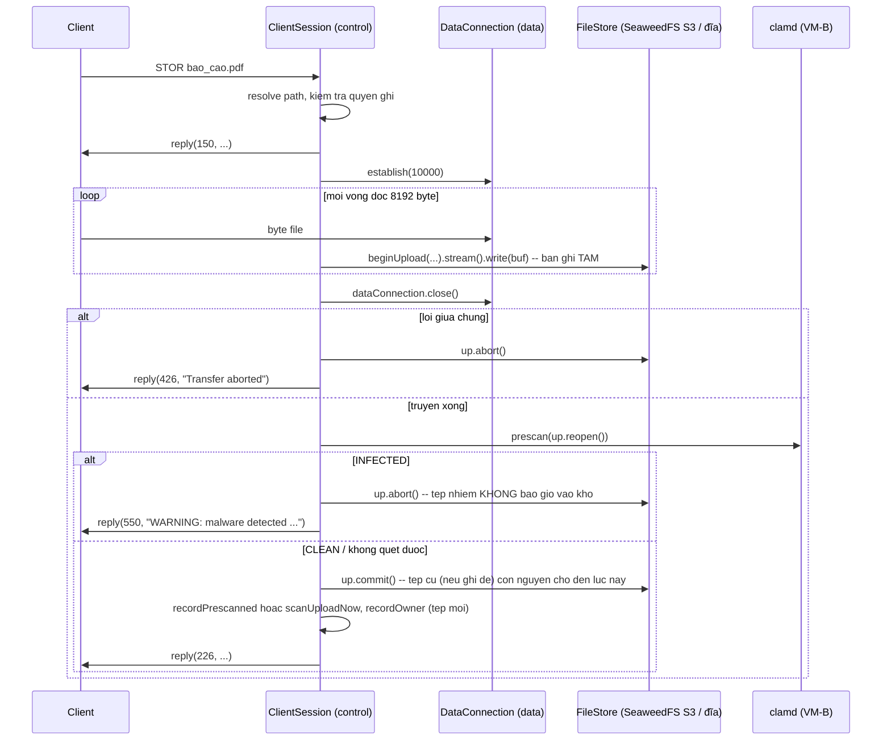

# Luồng dữ liệu trong FTP Server — đi qua đoạn code nào

> **Cập nhật lưu trữ:** mọi thao tác tệp nay đi qua `fs/FileStore` (`session.store()`), có hai backend: `LocalFileStore` (đĩa, `storage.type=local`) và `S3FileStore` (SeaweedFS qua S3, `storage.type=s3`). Các đoạn `Files.*` dưới đây mô tả backend local; với S3 thì `Files.newInputStream` ↔ `FileStore.read` (GetObject), `.part-<id>` + `Files.move` ↔ `FileStore.beginUpload` + `commit` (tệp tạm cục bộ rồi PutObject một lần).

Tài liệu này bám theo đúng code thật trong `src/main/java/ftpserver/`, không phải sơ đồ lý thuyết. Mỗi mục ghi rõ file, method, và **byte thực sự chảy qua đâu**.

---

## 1. Hai kênh — nền tảng của mọi thứ dưới đây

| Kênh | Class quản lý | Sống bao lâu |
|---|---|---|
| **Điều khiển** (control) | `core/ClientSession.java` — field `controlSocket`, `reader`, `writer` | Từ lúc `accept()` tới lúc `QUIT`/ngắt kết nối — suốt cả phiên |
| **Dữ liệu** (data) | `data/DataConnection.java` | Mở lại cho **mỗi lần** `LIST`/`RETR`/`STOR`, đóng ngay sau khi xong |

Toàn bộ tài liệu này chỉ có hai chỗ ghi ra kênh điều khiển và đọc/ghi kênh dữ liệu — nhớ hai điểm neo đó, phần còn lại chỉ là các lệnh cụ thể gọi vào hai điểm neo này.

- **Điểm neo kênh điều khiển:** `ClientSession.reply(int code, String message)` — [`core/ClientSession.java`](src/main/java/ftpserver/core/ClientSession.java)
- **Điểm neo kênh dữ liệu:** `DataConnection.establish(int timeoutMs)` — [`data/DataConnection.java`](src/main/java/ftpserver/data/DataConnection.java)

---

## 2. Khởi động server — dữ liệu cấu hình đi từ file vào bộ nhớ

```
ftpserver.conf (file text)
      │  Files.newInputStream + Properties.load()
      ▼
Config.load()                    config/Config.java
      │  tạo Map<String,User> bất biến
      ▼
Main.main()                      Main.java
      │  new UserManager(config.users())
      │  new PathResolver(config.rootDir())   -- gọi rootDir.toRealPath() MỘT LẦN
      │  CommandRegistrations.registerAll(registry)
      ▼
new FtpServer(config, userManager, pathResolver, registry)
      │  server.start()
      ▼
new ServerSocket(config.controlPort())  -- bắt đầu nhận kết nối TCP
```

Ba đối tượng `userManager`, `pathResolver`, `config` được tạo **đúng một lần** ở `Main`, sau đó truyền tay qua constructor xuống `FtpServer` rồi xuống từng `ClientSession` — không đối tượng nào tự đọc lại file `.conf`.

---

## 3. Một kết nối TCP mới tới — dữ liệu đi vào thread pool

Code: [`core/FtpServer.java`](src/main/java/ftpserver/core/FtpServer.java), method `start()`.

```java
while (running) {
    Socket client = listener.accept();                 // (1) TCP handshake xong, có Socket
    ClientSession session = new ClientSession(client, registry, userManager, pathResolver, config);
    pool.submit(session);                               // (2) giao cho 1 trong 20 thread
}
```

- **(1)** `accept()` chặn tới khi có client — bản thân `Socket` object chính là "đường ống" byte hai chiều, chưa có gì đi qua cả.
- **(2)** `pool.submit(session)` không chạy `session.run()` ngay tại thread chính — nó xếp vào `ExecutorService` (`Executors.newFixedThreadPool(20)`), một trong 20 thread rảnh sẽ lấy ra và gọi `run()`. Thread chính quay lại `accept()` ngay lập tức, không chờ.

Từ đây, **mỗi `ClientSession` chạy độc lập trên một thread riêng, dữ liệu của phiên này không bao giờ chạm phiên khác** vì mọi trạng thái (`state`, `currentDir`, `user`...) là field instance của `ClientSession`, không có biến `static` nào giữ dữ liệu phiên.

---

## 4. Vòng đời đọc-lệnh — trục xương sống của kênh điều khiển

Code: [`core/ClientSession.java`](src/main/java/ftpserver/core/ClientSession.java), method `run()` → `dispatch()`.

```
Socket.getInputStream()
      │  bọc BufferedReader (US_ASCII)
      ▼
reader.readLine()          <-- BLOCK ở đây cho tới khi client gửi một dòng kết thúc CRLF
      │  String "RETR bao_cao.pdf"
      ▼
tách commandName="RETR", arg="bao_cao.pdf"     (ClientSession.run(), dùng indexOf(' '))
      ▼
dispatch(commandName, arg)
      │
      ├─ NOT_IMPLEMENTED.contains("RETR")? không → tiếp
      ├─ registry.resolve("RETR")                  core/CommandRegistry.java
      │       → trả về instance RetrCommandHandler (đăng ký sẵn từ CommandRegistrations)
      ├─ handler.requiresAuth() == true, session đã AUTHENTICATED? có → tiếp
      ├─ handler.requiresWrite() == false → bỏ qua kiểm tra quyền ghi
      ▼
handler.handle(session, "bao_cao.pdf")      command/RetrCommandHandler.java
      │  (chi tiết ở mục 8)
      ▼
session.reply(code, message)                ClientSession.reply()
      │  writer.print(code + " " + message + "\r\n"); writer.flush();
      ▼
Socket.getOutputStream()  →  byte chảy ra network  →  client nhận được dòng đáp ứng
```

Vòng lặp `while (state != CLOSED)` trong `run()` quay lại `readLine()` ngay sau khi `dispatch()` xong — đây là lý do **một phiên chỉ xử lý được một lệnh tại một thời điểm**, tuần tự, không cần khoá gì cả.

---

## 5. Xác thực — `USER` rồi `PASS`

```
Client: "USER toannd"
   → UserCommandHandler.handle()            command/UserCommandHandler.java
        session.setPendingUsername("toannd")
        session.setState(WAIT_PASS)
        reply(331, ...)                     -- dữ liệu "toannd" CHỈ nằm trong bộ nhớ (field), chưa xác thực

Client: "PASS 123456"
   → PassCommandHandler.handle()            command/PassCommandHandler.java
        session.userManager().authenticate("toannd", "123456")
             │
             ▼
        UserManager.authenticate()          auth/UserManager.java
             │  users.get("toannd")  -- tra trong Map đã nạp từ Config lúc khởi động (mục 2)
             │  so sánh u.password().equals("123456")
             ▼
        trả về User record (name, password, readOnly) hoặc null
        │
        ├─ khớp → session.setUser(user); session.setCurrentDir(pathResolver.rootDir());
        │          session.setState(AUTHENTICATED); reply(230, ...)
        └─ sai   → failedLoginCount++; reply(530 hoặc 421 nếu đã sai lần 3)
```

Mật khẩu không bao giờ được ghi log nguyên văn — trong `ClientSession.dispatch()`, dòng log console thay `arg` của lệnh `PASS` bằng `"****"` trước khi `System.out.println`.

---

## 6. Duyệt thư mục — dữ liệu đường dẫn đi qua `PathResolver`

Mọi lệnh có tham số đường dẫn (`CWD`, `MKD`, `RMD`, `DELE`, `RETR`, `STOR`) đều đi qua đúng một cửa:

```
arg (String người dùng gõ, VD "../../etc")
      ▼
PathResolver.resolve(currentDir, arg)         fs/PathResolver.java
      │  Path candidate = currentDir.resolve(arg).normalize();
      │  if (!candidate.startsWith(rootDir)) throw SecurityException
      ▼
Path an toàn (nằm trong rootDir) HOẶC exception bị handler bắt → reply(550, ...)
```

`rootDir` trong `PathResolver` được tính **một lần duy nhất** bằng `toRealPath()` lúc `Main` khởi tạo (mục 2) — mọi lệnh sau đó chỉ so sánh với giá trị đã cố định này, không đọc lại từ đĩa.

Ví dụ cụ thể — `CwdCommandHandler.handle()` ([`command/CwdCommandHandler.java`](src/main/java/ftpserver/command/CwdCommandHandler.java)):
```java
Path target = session.pathResolver().resolve(session.getCurrentDir(), arg);
if (!Files.isDirectory(target)) { reply(550); return; }
session.setCurrentDir(target);   // <-- dữ liệu "thư mục hiện tại" chỉ tồn tại trong field này
```

`PWD` sau đó đọc lại đúng field `currentDir` này, đổi ngược sang đường dẫn ảo bằng `pathResolver.toVirtualPath()` để không lộ đường dẫn thật của hệ điều hành.

---

## 7. Thiết lập kênh dữ liệu — `PASV` / `PORT`

Đây là chỗ **tạo ra** đường ống thứ hai, nhưng chưa có byte file nào chảy qua ở bước này.

**`PASV`** — [`command/PasvCommandHandler.java`](src/main/java/ftpserver/command/PasvCommandHandler.java):
```
DataConnection.openPassive(portMin, portMax)     data/DataConnection.java
      │  for port in [min, max]: try new ServerSocket(port) → thành công thì dừng
      ▼
ServerSocket đang LISTEN trên 1 cổng (VD 50007), CHƯA accept() — đó là việc của bước 8/9/10
      │
      ▼
reply(227, "Entering Passive Mode (127,0,0,1,195,55)")   -- mã hoá port=50007 thành 195*256+55
```

**`PORT`** — [`command/PortCommandHandler.java`](src/main/java/ftpserver/command/PortCommandHandler.java): ngược lại, server chỉ **ghi nhớ** địa chỉ IP + cổng client gửi lên (`DataConnection.setActiveTarget()`), chưa `connect()` gì cả.

Cả hai đường đều dừng ở `session.setState(DATA_READY)` — cờ này được `LIST`/`RETR`/`STOR` kiểm tra ở bước tiếp theo.

---

## 8. `LIST`/`NLST` — dữ liệu là danh sách tên file

[`command/ListCommandHandler.java`](src/main/java/ftpserver/command/ListCommandHandler.java) →  [`command/ListingFormatter.java`](src/main/java/ftpserver/command/ListingFormatter.java):

```
session.getDataConnection().establish(10000)      <-- BÂY GIỜ mới accept() (PASV) hoặc connect() (PORT)
      ▼
Socket dataSocket  (kênh dữ liệu thật, khác hẳn controlSocket)
      ▼
Files.list(session.getCurrentDir())               -- đọc thư mục THẬT trên đĩa
      │  với mỗi Path: format thành 1 dòng "drwxr-xr-x 1 owner group ... ten_file"
      ▼
dataSocket.getOutputStream().write(...)            -- byte danh sách chảy ra KÊNH DỮ LIỆU, không phải kênh điều khiển
      ▼
dataConnection.close()                              -- đóng kênh dữ liệu NGAY sau khi ghi xong
      ▼
session.reply(226, "Closing data connection")      -- đáp ứng cuối cùng đi qua KÊNH ĐIỀU KHIỂN
```

Thứ tự bắt buộc: `226` phải gửi **sau** khi `dataConnection.close()` đã chạy xong — client (FileZilla) dùng chính việc đóng socket dữ liệu làm dấu hiệu "đã nhận đủ danh sách".

---

## 9. `RETR` — tải file về, sơ đồ đầy đủ nhất



File `RetrCommandHandler.java` — đúng đoạn code sinh ra vòng lặp trên:
```java
try (Socket dataSocket = session.getDataConnection().establish(10_000);
     InputStream in = Files.newInputStream(target);
     OutputStream out = dataSocket.getOutputStream()) {
    byte[] buf = new byte[8192];
    int n;
    while ((n = in.read(buf)) != -1) {
        out.write(buf, 0, n);
    }
    out.flush();
}
```
Byte đi **thẳng** từ `InputStream` (đọc đĩa) sang `OutputStream` (ghi socket) qua một mảng đệm 8192 byte trung gian — không có bước nào giữ toàn bộ file trong bộ nhớ, nên file 1 GB hay 1 KB đều chạy như nhau.

---

## 10. `STOR` — tải file lên: bản ghi tạm, quét clamd, rồi mới commit



File `StorCommandHandler.java` — dữ liệu **không bao giờ ghi thẳng vào file đích**: luôn đi qua `FileStore.beginUpload` (bản ghi tạm theo `sessionId`), được quét bằng clamd (`ScanService.prescan`) **trước** `commit()`. Nhờ vậy hai client cùng `STOR` một tên không làm hỏng file, và tệp nhiễm mã độc không bao giờ vào kho. Ngoại lệ: `APPE`/`REST` (`direct`) ghi tiếp trực tiếp, bỏ qua prescan và được quét sau commit (`scanUploadNow`); nếu quét sau commit phát hiện mã độc thì tệp bị xoá.

---

## 11. Đóng phiên — dữ liệu tài nguyên được giải phóng ở đâu

Code: [`core/ClientSession.java`](src/main/java/ftpserver/core/ClientSession.java), method `cleanup()`, chạy trong khối `finally` của `run()` — nghĩa là chạy **dù** vòng lặp thoát bằng cách nào: `QUIT` bình thường, client tắt cửa sổ đột ngột, hay hết `SO_TIMEOUT` (300 giây không gửi lệnh nào).

```
finally {
    dataConnection.close()     -- đóng ServerSocket PASV còn treo, nếu client PASV rồi ngắt trước RETR
    closeQuietly(reader)
    closeQuietly(writer)
    closeQuietly(controlSocket)
    state = CLOSED
}
```

`pool.submit(session)` ở mục 3 trả `session.run()` về hoàn toàn — thread lúc này **quay lại pool**, sẵn sàng nhận `ClientSession` tiếp theo. Đây là lý do 100 lần "connect → PASV → ngắt đột ngột" không làm tăng số thread hay số cổng đang mở (đã đo bằng `scripts/pasv_leak_test.py`).

---

## 12. Bảng tra nhanh — lệnh nào chạm file nào

| Lệnh | Handler | File chạm tới trong `core`/`data`/`fs` |
|---|---|---|
| `USER`/`PASS` | `UserCommandHandler`, `PassCommandHandler` | `auth/UserManager.java` |
| `PWD`/`CWD`/`CDUP` | `PwdCommandHandler`, `CwdCommandHandler`, `CdupCommandHandler` | `fs/PathResolver.java` |
| `MKD`/`RMD`/`DELE` | `MkdCommandHandler`, `RmdCommandHandler`, `DeleCommandHandler` | `fs/PathResolver.java` + `java.nio.file.Files` |
| `TYPE` | `TypeCommandHandler` | chỉ đổi field `session.type`, không chạm đĩa/socket |
| `PASV`/`PORT` | `PasvCommandHandler`, `PortCommandHandler` | `data/DataConnection.java` |
| `LIST`/`NLST` | `ListCommandHandler`, `NlstCommandHandler` | `data/DataConnection.java` + `command/ListingFormatter.java` |
| `RETR` | `RetrCommandHandler` | `data/DataConnection.java` + đọc file qua `Files.newInputStream` |
| `STOR` | `StorCommandHandler` | `data/DataConnection.java` + `FileStore.beginUpload` + prescan clamd + `commit` |
| `QUIT` | `QuitCommandHandler` | chỉ đổi `state`, việc đóng socket thật nằm ở `ClientSession.cleanup()` |
